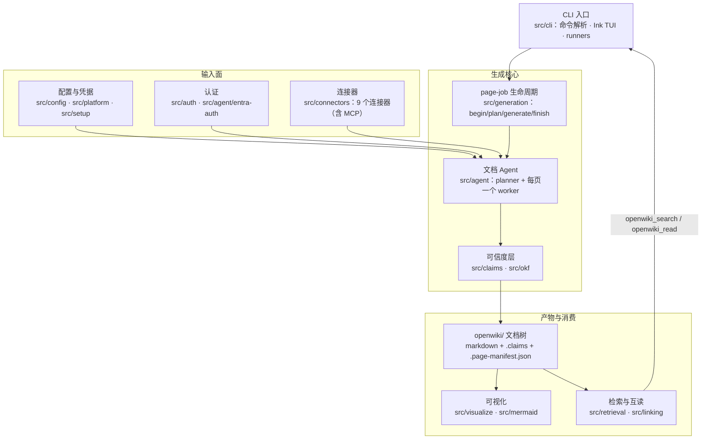

# 01 — 系统全景

> 本篇对应 upstream 发布基线 `v0.9.0`（`b7027e3`，2026-11-05）。`src/` 是 18 个 domain 目录、178 个文件的树；自 2026-09 的 `e92cc11` 起 `src/` 无删除文件，变的是两个新 domain（`retrieval/`、`linking/`）与既有目录内的增量。

## 1. 一句话画像

OpenWiki 是一个 CLI 工具：**它让一个被有意约束的 AI Agent，把分散的证据（Git 仓库或个人数据源）整理成一套持续维护、可自校正的 markdown 文档 wiki**。"可自校正"来自证据命题（grounded claims）：写进 wiki 的每条事实命题都带源码证据与版本令牌，源码漂移时能被检测、重定位并显式裁决。

## 2. Domain 目录地图

运行时全景（框图对应 `src/` 的领域分包；箭头是调用/数据流向，不是 import 依赖）：




`src/` 按领域分包（各目录的文档见对应主题区）：

```
入口与界面
  src/cli/            CLI 入口(cli.tsx 116 行) + app/components/input/run-log/diagnostics
                      + commands(1447)/startup/run-mode/runners/integrations
                      + link.tsx 与 wiki-workspace-manager.tsx（workspace 互读的交互界面）
生成核心
  src/generation/     page-job 状态机：begin→planning→generating→finish（.run.json + .page-manifest.json）
  src/agent/          agent 编排(index.ts 2843) + prompts/ 提示词 + DeepAgents 后端边界
                      + utils.ts 源指纹 + openwiki-ignore + repository-runner（CLI 侧驱动）
                      + bob.ts 与 entra-auth.ts（provider 侧适配）
  src/okf/            OKF v0.2 front matter 校验/修复/投影（sources/verified/generated）
  src/claims/         grounded claims：证据命题 + repo:// 证据版本令牌 + 稀疏对账
模型与数据
  src/config/         常量(constants 1457：15 providers)/env/openwiki-home/reasoning
  src/model-availability.ts   openai 模型可用性校验
  src/connectors/     9 个连接器 + http.ts 弹性层 + MCP 客户端子系统 + sources/langsmith/
  src/auth/           OAuth PKCE + oauth-discovery 校验 + external-cli(gh) + tokens
  src/ingestion/      摄取编排 + code-mode（增量拉取 + CI 工作流生成）
读侧（v0.9.0 新增）
  src/retrieval/      wiki 检索/读取协议：searchWiki / readWikiSections（openwiki_search / openwiki_read）
  src/linking/        多 wiki 互读：wiki workspace 注册表（wiki-workspaces.json）+ 跨仓库发现与作用域解析
运维与消费
  src/scheduling/     macOS LaunchAgent 管理
  src/visualize/      原生 wiki 可视化器（回环服务 + force-graph + 静态导出）
  src/mermaid/        生成页面的 mermaid 围栏校验/降级（finalize 阶段）
  src/integrations/   9 个宿主目标（bob/codex/claude/opencode/cursor/kiro/omp/antigravity/copilot）
                      + stdio MCP server（6 个生命周期工具 + 4 个检索工具）+ pi 原生包
  src/setup/          凭据向导（组合根 + 8 文件）+ onboarding
  src/platform/       进程/OS 兜底：fs-errors/utils/diagnostics/language/windows-acl
  src/telemetry/      错误分类学（errors.ts 714）+ PostHog 发送 + run 级遥测边界
```

依赖原则：**生成核心单向向下**——`okf/`、`claims/` 不反向依赖 `generation/`（生命周期由 generation 拥有，okf/claims 只接收投影与对账数据）；`config/` 只放纯配置数据与解析，进程/OS 兜底一律进 `platform/`；`cli/` 只做编排不藏业务语义。**读侧同样单向**——`retrieval/` 只依赖 `linking/`、`claims/`、`okf/`，只有 `integrations/core/retrieval-tools.ts` 消费它，`generation/` 与 `agent/` 从不 import 读侧代码。

## 3. 端到端数据流：一次 repository update

以 `openwiki --update`（code 模式）为例，从敲命令到 wiki 落盘：

| # | 阶段 | 发生了什么 | 源码入口 | 详见 |
|---|------|-----------|---------|------|
| 1 | 命令解析 | `CliCommand` 11-variant 解析、环境加载判定 | `src/cli/commands.ts` | 03 区 02 号 |
| 2 | 启动判定 | TTY/凭据预检；缺凭据时干净的 no-op update 豁免 | `src/cli/startup.ts:24-147` | 03 区 03 号 |
| 3 | 模式映射 | `code` → cwd=仓库根、outputMode=`repository` | `src/cli/run-mode.ts:40-55` | 03 区 03 号 |
| 4 | 运行分流 | repository init/update **不走 DeepAgent**，快速路径直入 page-job 生命周期 | `src/agent/index.ts:191-253` | 04 区 01 号 |
| 5 | no-op 前置门 | 源指纹未变 + claims 无 issue + 基线全覆盖 + 语言未变 → 干净退出 | `src/generation/repository-run.ts:493-540` | 05 区 02 号 |
| 6 | begin/resume | `.run.json` 检查点新建或恢复；源指纹漂移则整计划作废重规划 | `src/generation/repository-run.ts:401`（begin） | 05 区 01 号 |
| 7 | planning | planner agent 经 `submit_plan` 提交有序页任务（page job）队列 | `src/agent/repository-runner.ts`（runPlanningAgent :450） | 05 区 01 号 |
| 8 | generating | 每页一个受限 worker（`writableWikiPages` 单页写白名单）研究并写页；**稀疏对账（sparse reconciliation）**裁决本页证据命题（claim）。worker 池默认 1 个，`OPENWIKI_PAGE_CONCURRENCY`（1–8）可并行，quickstart 页始终押到最后 | `src/generation/repository-run.ts`（submitRepositoryPage :1309-1460 八步事务序）；worker 池 `src/agent/repository-runner.ts:633`；对账协议详见 07 区 01 号 | 05 区 + 07 区 |
| 9 | 页事务 | 写页→frontmatter 修复→claims 对账→claimsRuntime.finalize→durable 断言→manifest 记录→`.run.json`→改内存 | 同上 | 05 区 01 号 |
| 10 | 失败处理 | worker 未提交 → 还原快照并重试一次（上限 2 次尝试），仍失败则标 skipped；不中断整轮，finish 时统一还原 | `src/agent/repository-runner.ts:884-925`（重试）；`src/generation/repository-run.ts:1214-1276`（skip） | 05 区 01 号 |
| 11 | finish | pending=0 → 删废弃页 → **finalize 五步** → 整表替换 manifest → 元数据 complete/interrupted → 删 `.run.json` | `src/generation/repository-run.ts:1640-1796`；五步管线 `src/agent/wiki-finalizer.ts:263-291` | 05 区 03 号 |
| 12 | 收尾五步 | mermaid 校验降级 → index_sync → link_validation → claims_sources 投影 → generated 溯源（provenance）盖章（最后） | 同上 | 05 区 03 号 + 07 区 03 号 |

claims 运行时在第 6 步 begin/resume 内装配（`prepareClaimsRuntime`，`src/generation/repository-run.ts:446`（begin）/:721（resume）；`src/claims/brains/code/runtime.ts:64`，仅 repository 模式启用）；OKF 的 `sources`/`verified` 投影在 11-12 步发生，`generated` 章最后盖以免被覆盖（`src/okf/index-sync.ts:288` 的 `okf_version: "0.2"` 根戳也在 index_sync 写入）。finish 的结论文本是：只要有页被 skipped 或源在收尾前又变了，就写 `interrupted`，否则走 `persistRunMetadataIfChanged` 写 `complete`。

**init 的差别**：不走 manifest 增量，而是从零重建——先建 wiki-replacement 备份、状态落盘后才提交备份、失败可回滚（详见 05 区 01 号）。

## 4. 双模式对照

| 维度 | Code mode | Personal mode |
|------|-----------|---------------|
| 入口 | 裸 `openwiki`（**默认**）/ `openwiki code` / `--init` / `--update` | `openwiki personal` / `openwiki --mode personal` / `openwiki ingest` |
| 工作目录 | 你的仓库根 | `~/.openwiki/wiki/`（`openWikiLocalWikiDir`） |
| 输出模式 | `repository` | `local-wiki` |
| 证据来源 | Git 仓库（源码 + git 历史） | 连接器数据（Gmail/Slack/Notion/langsmith 等 9 个） |
| 生成管线 | page-job 生命周期（05 区） | DeepAgents 主路径（04 区） |
| 连接器工具 | **不注入**（tools.ts repository 门控返回空） | 注入（personal 专属能力） |
| shell | 白名单（仅 `pwd` / `git rev-parse HEAD`） | **完全禁用**（后端直接拒绝，见 04 区 04 号） |
| claims | 启用（`prepareClaimsRuntime` repository 门禁） | 不启用（同名概念 "contested claims" 是提示词层争议事实保全，见 10 区） |
| 定时化 | CI 工作流（11 区 02 号） | LaunchAgent/cron（11 区 01 号） |

模式映射的实现钥匙是 `src/cli/run-mode.ts:40-55`（mode→cwd/outputMode），映射结果决定提示词模板（prompts/code.ts vs personal.ts）、后端边界与生命周期路径。

## 5. 模块依赖原则

1. **生命周期单点拥有**：`src/generation/` 拥有 page-job 状态机；CLI（经 `agent/repository-runner.ts`）与宿主集成（`src/integrations/core/session-manager.ts`）是**两个驱动方、一份状态机**。
2. **可信度层单向**：`okf/`、`claims/` 被 generation 调用，从不反向 import generation；claims 是事实状态所有者，okf 只是投影目标（07 区 03 号）。
3. **config / platform 分层**：`config/` = 纯配置数据与解析（可测试、无 OS 副作用）；`platform/` = 进程/OS 兜底（fs-errors、windows-acl、语言、诊断清洗）。
4. **agent 被三层边界约束**：`.openwikiignore` 路径排除、`.claims` 所有权隐藏、shell 白名单——全部在 `src/agent/docs-only-backend.ts` 的 11 个覆写方法里（04 区 04 号）。
5. **遥测单一边界**：`with-run-telemetry.ts` 包住 setup→connectors→agent（14 区 04 号）；错误统一进分类学（错误类别闭集）。
6. **安装与被装分离**：`src/integrations/`（客户端集成逻辑）与顶层 `integrations/openwiki/`（被安装的 skill 包资产）是两回事；顶层 `skills/` 又是自研 agent 的捆绑技能（bundled skills），与前者无关（13 区 02 号划界表）。
7. **读侧与生产侧分离**：`retrieval/`（搜索/整节读取）与 `linking/`（多 wiki 作用域）只读、无模型调用、不参与生成；它们由宿主集成层装配成工具（`src/integrations/core/session-manager.ts:225-227`），生产侧不 import 它们（15 区）。

## 6. v0.9.0 相对 2026-09 基线的结构增量

只列影响架构地图本身的部分（逐条机制见对应主题区）：

| 增量 | 落点 | 对架构的含义 |
|------|------|--------------|
| 两个新 domain | `src/retrieval/wiki.ts`（1293 行）、`src/linking/wiki-workspaces.ts`（1671 行） | 首次出现**不跑模型的读路径**；wiki 从"单仓库产物"变成"可被别的仓库按 workspace 发现并互读的对象"（15 区） |
| page 生成可并行 | `src/config/constants.ts:94-100`（`OPENWIKI_PAGE_CONCURRENCY`，1–8，默认 1）+ `src/agent/repository-runner.ts:633-676` | 生成阶段不再纯串行：worker 池按槽位起同构 worker，quickstart 押后；单页写锁与页级事务序仍是串行的安全边界（05 区 01 号） |
| provider 15 个 | `SELECTABLE_OPENWIKI_PROVIDERS`（`src/config/constants.ts:278-294`）多出 `bob`、`mistral` | 模型面变宽，`createModel()` 增加 IBM Bob 专属传输分支（06 区） |
| 第三种凭据来源 | `src/agent/entra-auth.ts:16`（`createEntraTokenProvider`）+ `OPENAI_COMPATIBLE_AUTH=entra-id` | `ProviderAuthMethod` 四元不变，但 `openai-compatible` 的 apiKey 可以是 Azure Identity 的异步 token 回调（09 区） |
| 并行下的重试语义 | `PARALLEL_PROVIDER_RETRY_ATTEMPTS = 5`（`src/config/constants.ts:93`） | 并发 worker 共享一个 key 时，速率限制变成常见失败，`resolveProviderRetryAttempts`（`:1199`）自动放宽重试 |

## 7. 主题区导航

| 何时读 | 去哪里 |
|--------|--------|
| 装不起来、第一次跑 | 01-quickstart/ |
| 想知道"为什么这样设计" | 02 区 05-key-design-decisions.md |
| 命令怎么解析、TUI 怎么分层 | 03-cli-and-tui/ |
| agent 怎么被约束、提示词长什么样 | 04-agent-and-prompting/ |
| 一轮生成怎么推进/恢复/收尾 | 05-generation-lifecycle/ |
| 模型怎么接、推理力度（reasoning effort）怎么配 | 06-model-providers/ |
| wiki 凭什么可信 | 07-claims-and-okf/ |
| 数据从哪来 | 08-connectors-and-data-sources/、10-ingestion-and-personal-mode/ |
| 怎么认证 | 09-authentication-and-oauth/ |
| 怎么定时跑 | 11-scheduling-and-ci/ |
| 浏览/导出 wiki | 12-visualizer/ |
| 用 coding agent 驱动 OpenWiki | 13-integrations/ |
| 配置分层与遥测排错 | 14-configuration-and-telemetry/ |
| wiki 怎么被别的 Agent 检索、跨仓库互读 | 15-agent-consumption/ |
| 把 OpenWiki 放进真实生产流水线 | 16-production-paths/ |
| 源码→文档覆盖关系 | `_meta/git-tracking/coverage-map.md` |

## Source Anchor

| 源文件 | 关键符号 | 说明 |
|--------|---------|------|
| `src/agent/index.ts:191-253` | run 分流 | repository 快速路径入口 |
| `src/generation/repository-run.ts:401` | `beginRepositoryRun` | 生命周期开始/恢复 |
| `src/generation/repository-run.ts:493-540` | no-op 前置门 | update 短路判定 |
| `src/generation/repository-run.ts:1309-1460` | `submitRepositoryPage` 事务序 | 逐页八步持久化 |
| `src/generation/repository-run.ts:1640-1796` | `finishRepositoryRun` | 收尾与元数据定稿 |
| `src/agent/repository-runner.ts:633-676` | `runPendingPageAgents` | 页 worker 池（`pageConcurrency` 槽位） |
| `src/agent/repository-runner.ts:884-925` | `runPageAgent` | 每页最多 2 次尝试，失败后 restore + skip |
| `src/agent/wiki-finalizer.ts:263-291` | finalize 五步 | mermaid→index_sync→link_validation→claims_sources→generated |
| `src/claims/brains/code/runtime.ts:64` | `prepareClaimsRuntime` | claims 运行时装配（repository 门禁） |
| `src/okf/index-sync.ts:288` | `okf_version "0.2"` | 确定性 index 根戳 |
| `src/config/constants.ts:94-100` | `OPENWIKI_PAGE_CONCURRENCY` / `MAX_PAGE_CONCURRENCY` | 页并行度 1–8，默认 1 |
| `src/retrieval/wiki.ts:507` | `searchWiki` | wiki 检索（MCP `openwiki_search` 的实现） |
| `src/retrieval/wiki.ts:706` | `readWikiSections` | 整节读取（MCP `openwiki_read`） |
| `src/linking/wiki-workspaces.ts:17` | `WIKI_WORKSPACES_FILE` | `wiki-workspaces.json` 命名 workspace 注册表 |
| `src/integrations/core/session-manager.ts:225-227` | `tools()` | 读侧工具 + 6 个生命周期工具的唯一装配点 |
| `src/cli/run-mode.ts:40-55` | cwd/outputMode 映射 | 双模式实现钥匙 |
| `src/cli/startup.ts:24-147` | 启动判定链 | TTY/凭据/no-op 豁免 |
| `src/agent/docs-only-backend.ts` | 11 方法覆写 | agent 三层边界 |
| `src/telemetry/with-run-telemetry.ts` | `withRunTelemetry` | run 级遥测边界 |
