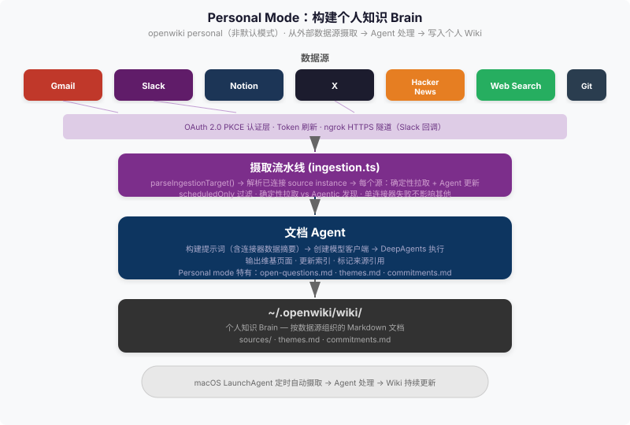

# 03 — Personal Mode：构建个人知识库 (Personal Mode)

## 1. Personal Mode 做什么

Personal Mode 是 OpenWiki 的两大运行模式之一（`src/cli/commands.ts:26` 的 `OpenWikiRunMode = "personal" | "code"`），但**不是默认值**：命令行默认解析为 code（`src/cli/commands.ts:625`），且非 chat 命令在默认 modeSource 下强制 code（`src/cli/commands.ts:1075-1077`）——personal 需要显式选择。它的核心目标：**从用户连接的外部数据源（Gmail、Slack、Notion 等）定期拉取数据，由 Agent 消化整理后，写回 `~/.openwiki/wiki/`，形成一个持续更新的个人知识 brain**。

```
外部数据源 → 认证层 → 摄取流水线 → Agent 处理 → ~/.openwiki/wiki/
```

与 Code Mode 的不同：Code Mode 以"理解一个代码仓库并生成文档"为目标，而 Personal Mode 以"理解一个人的信息流并持续维护知识库"为目标。两者共享同一套 Agent 引擎 (`src/agent/index.ts:167-297` 的 `runOpenWikiAgent`)，但使用不同的提示词（prompt）模板和输出格式；Personal Mode 的 agent 没有 shell（提示词与后端双重禁止，见 3.4）。

## 2. 一张图看懂



> 图里画出了 8 个 personal 连接器中的 7 个；`custom-mcp` 是通用 MCP 入口，未单独画出。

## 3. 四层流水线

Personal Mode 的数据流分为四个层次：数据源层（拉什么）、认证层（怎么授权）、摄取层（怎么拉）、Agent 处理层（怎么消化）。每一层都是独立的关注点。

### 3.1 数据源层：8 个 personal 模式连接器（Connector）

数据源由 `src/connectors/registry.ts:24` 的 `createConnectorRegistry()` 统一注册，共 **9 个连接器**（`src/connectors/types.ts:1-10` 的 `ConnectorId` 九个取值）；其中 8 个属于 personal 模式，`langsmith` 是唯一的 code 模式连接器（`mode: "code"`，`src/connectors/types.ts:20` 的模式轴），只在 Code Mode 的增量拉取中出现。每个连接器返回一个 `ConnectorRuntime` 对象（`src/connectors/types.ts:44`），包含 `backend`、`mode`、`supportsAgenticDiscovery`、`ingest()` 等字段：

| 连接器 ID | 显示名称 | 后端类型 | 确定性拉取？ | 数据来源与说明 |
|-----------|---------|---------|------------|--------------|
| `google` | Gmail | `direct-api` | 是 | 通过 Gmail API 拉取最近邮件，支持自定义查询（`query`）、标签过滤（`labelIds`），输出 `gmail-messages.json` |
| `slack` | Slack | `direct-api` | 是 | 通过 Slack API 拉取私信和频道消息，包括自我消息搜索（`my_messages_search`）和最近会话回退（`recent_messages`），输出 `identity.json` + `my-recent-messages.json` |
| `notion` | Notion | `mcp-stdio` | 否（Agentic） | 通过 MCP（Model Context Protocol）连接 Notion，需要 `OPENWIKI_NOTION_MCP_ACCESS_TOKEN` 环境变量。Agent 通过 MCP 工具按需发现和检索页面 |
| `custom-mcp` | Custom MCP | `mcp-stdio` | 否（Agentic） | 新增的通用只读 MCP 连接器：配置 `~/.openwiki/connectors/custom-mcp/config.json` 即可接入任意 MCP server（HTTP 或 stdio transport），密钥以 env 名写入 transport，不做硬性要求 |
| `x` | X（Twitter） | `direct-api` | 是 | 通过 X API v2 拉取时间线、用户帖子、提及、书签、列表帖子，默认启用全部 5 个 stream（`home_timeline`、`user_posts`、`mentions`、`bookmarks`、`list_posts`） |
| `hackernews` | Hacker News | `direct-api` | 是 | 拉取 HN 公开 feed（`top`、`new`、`best`、`ask`、`show`、`job`）+ Algolia 搜索查询，输出 `hackernews-results.json` |
| `web-search` | Web Search | `direct-api` | 是 | 通过 Tavily（LangChain 集成）执行网页搜索，需要 `TAVILY_API_KEY`，支持自定义查询列表（`queries`）、搜索深度和时间范围，输出 `web-search-results.json` |
| `git-repo` | Local Git Repos | `local-git` | 否（Agentic） | 读取本地克隆的 Git 仓库，生成紧凑的 manifest（repo 路径、分支、HEAD、状态、变更文件、最近提交）。Agent 直接检查仓库文件系统而非复制全部内容 |

**关键设计**：`supportsAgenticDiscovery` 字段区分两类连接器：
- **确定性拉取**（Deterministic Pull，`supportsAgenticDiscovery === false`）：连接器的 `ingest()` 方法自己完成数据拉取，写入原始文件（raw files），Agent 只需读取这些文件做综合。适用于 Gmail、Slack、X、HN、Web Search。
- **Agentic 发现**（Agentic Discovery，`supportsAgenticDiscovery === true`）：连接器不做确定性拉取，而是为 Agent 提供工具/权限让 Agent 自行探索。适用于 Notion、Custom MCP（通过 MCP 工具）和 Git Repo（直接检查本地文件系统）。

连接器各字段的完整清单、双配置通路（personal 的 `~/.openwiki/connectors/` 与 code 的仓库内 `openwiki/` 配置）与弹性 HTTP 加固层，见 ../08-connectors-and-data-sources/。

### 3.2 认证层：OAuth 2.0 PKCE

数据源中需要用户授权的（Gmail、Slack、X），通过 OAuth 2.0 PKCE（Proof Key for Code Exchange）流程完成认证（`src/auth/oauth.ts`）：

1. **PKCE 流程**：`runOAuthAuth()`（`src/auth/oauth.ts:47`）生成 `code_verifier`（64 字节随机字符串）和 `code_challenge`（SHA-256 hash），打开浏览器让用户在提供商页面授权
2. **本地回调服务器**：启动 `127.0.0.1:53682` 的 HTTP 服务器接收授权回调（code），回调端口可通过 `OPENWIKI_OAUTH_CALLBACK_PORT` 环境变量修改
3. **Token 交换与刷新**：用 code 换取 access_token + refresh_token，存储在 `~/.openwiki/` 下。连接器运行时通过 `src/auth/tokens.ts:32` 的 `getOAuthAccessToken()` / `:47` 的 `refreshOAuthAccessToken()` 自动管理 token 生命周期
4. **Slack 特殊需求 —— ngrok 隧道**：Slack 的 OAuth 回调要求 HTTPS URL，而本地回调是 `http://127.0.0.1`。`startNgrokTunnel()`（`src/auth/ngrok.ts:23`）使用 ngrok 创建 HTTPS 公网隧道，将 ngrok URL 设为 redirect URI，回调被 ngrok 转发回本地端口。HTTPS redirect URI 存储在 `OPENWIKI_HTTPS_OAUTH_REDIRECT_URI` 环境变量中

不需要 OAuth 的连接器：Hacker News（公开 API）、Web Search（Tavily API Key）、Git Repo（本地文件系统）、Custom MCP（按 server 需要以 env 名引用密钥）。Notion 通过 `OPENWIKI_NOTION_MCP_ACCESS_TOKEN` 环境变量直接配置 token。

OAuth 端点校验、回调安全与 token 落盘规则的细节见 ../09-authentication-and-oauth/。

### 3.3 摄取层：`ingestion.ts` 编排

`src/ingestion/ingestion.ts`（474 行）是整个摄取流水线的编排器（orchestrator），核心入口是 `runOpenWikiIngestion()`（`:67-107`）：

```
parseIngestionTarget() → resolveIngestionSourceInstances() → for each source: runSourceIngestion()
```

**步骤拆解**：

1. **`parseIngestionTarget()`**（`:109-122`）：解析用户指定的摄取目标，可以是 `"all"`（全部连接器）、单个 connector ID（如 `"google"`）、或特定 source instance ID
2. **`resolveIngestionSourceInstances()`**（`src/ingestion/ingestion.ts:224`）：从 `~/.openwiki/onboarding.json`（`src/setup/onboarding.ts`，482 行；路径常量 `openWikiOnboardingPath` 在 `:11`）读取已配置的 source instances，按目标过滤：
   - 仅返回 `connectedAt` 存在的（已完成首次配置的）
   - `scheduledOnly` 模式下跳过 paused 状态的 schedule
3. **`runSourceIngestion()`**（`:126`，对象参数）：对每个 source instance 依次执行：
   - **确定性拉取**（如果是确定性连接器）：调用 `connector.ingest()`，传入 `windowHours=24`（最近 24 小时数据，`INGESTION_WINDOW_HOURS = 24`，`:36`）；拉取本身失败且没有 raw file 时直接以 `status: "error"` 返回（`:156-173`）
   - **Agent 更新**：调用 `runOpenWikiAgent("update", ...)` 并传入 `outputMode: "local-wiki"`，Agent 会根据 source 类型执行不同的处理策略
   - **遥测边界**：每次单源 agent 更新被 `withRunTelemetry("update", …)`（`:195-200`）包裹——这是该次运行的唯一遥测记录边界，与 CLI 路径同构，使定时摄取的运行也进入遥测；包裹范围覆盖 agent 运行本身，连接器抛错在此边界内被转为 error 结果而非逃逸异常
   - **单源失败隔离**：整个单源流程包在 try/catch 中（`:211-220`）——任何异常（含确定性拉取失败）被捕获并输出 `"<连接器> ingestion failed: …"`，该源以 `status: "error"` 记入结果后继续处理下一个源。单个连接器失败**不会阻断**其他连接器的摄取
4. **24 小时摄取窗口**：`INGESTION_WINDOW_HOURS = 24`（`:36`），所有连接器的确定性拉取默认取最近 24 小时数据，同一数值也写进单源 user message（`src/ingestion/ingestion.ts:295`）

### 3.4 Agent 处理层

Personal Mode 和 Code Mode 共享同一个 Agent 引擎（`src/agent/index.ts:167-297` 的 `runOpenWikiAgent()`），但 Personal Mode 使用 `outputMode: "local-wiki"`，会触发 personal 模板（`src/agent/prompts/personal.ts`，612 行）。

**shell 被彻底关掉**：`OpenWikiLocalShellBackend.execute`（`src/agent/docs-only-backend.ts:545-576`）在 `outputMode === "local-wiki"` 时直接返回 `exitCode: 1` 与"Shell execution is disabled in personal mode"，提示词侧也明写同一句。这是 v0.6.0 之后的语义：personal 模式消费的是不可信的外部内容（邮件、帖子、MCP 响应），无人值守摄取时更不能把宿主 shell 交给它。

**Personal Mode 特有的合成策略**（定义在 `src/ingestion/ingestion.ts` 的 `createSourceSynthesisPolicy()` `:351` 与 `createConnectorSynthesisGuidance()` `:366`，后者已导出供 code 模式连接器复用）：

1. **跨源综合**：数据不按 source 孤立存放，而是综合到跨源规范文件（canonical cross-source files）中
2. **置信度标签（信心标签）5 个**：每条信息标记为 `confirmed`、`source-backed`、`contested`、`watchlist` 或 `saved-context`，其中 **`contested`（有争议）** 表示可信来源互相矛盾且现有证据无法裁决（`:354-355`）
3. **Contested 双主张保留**：当可信来源互相矛盾且没有 ground truth 裁决时，不再"新覆盖旧"，而是在规范页面新增 **`## Contested`** 小节同时保留双方主张（各带来源与日期）；争议事实在被解决前不得表现为 confirmed/source-backed，也**不允许仅按时间新近度裁决**（`ingestion.ts:355`）。同一纪律也写入 personal 提示词模板（`src/agent/prompts/personal.ts:223-230`）：争议解决时需留解决说明（日期、决定性证据、被取代的来源）
4. **去重**：使用稳定的 topic key 去重，更新已有的 themes、open questions、commitments，不在多个 source 页面中重复同一事实
5. **按连接器定制策略**：每个连接器有专用的合成指南：
   - Gmail：分类为 `action_required` / `scheduled_commitment` / `decision_or_approval` 等 13 个类别，只写高/中优先级且持久的信息
   - Slack：工作请求、提及、截止日期路由到 commitments.md
   - Notion：按 `last_edited_time`、提及、人员属性筛选，保持 `/sources/notion.md` 精简
   - X：书签和喜欢的内容默认为 `saved-context`，仅重复出现或高信号时提升到 themes.md
   - Hacker News：低参与度条目默认为 `watchlist`，仅重复/高参与/多源印证时提升
   - Web Search：单弱结果标记为 `watchlist`，跨查询合并到已有主题
   - Git Repo：用仓库路径、分支、HEAD、提交作为证据，不镜像仓库清单

**Agent 创建用户消息**：`createSourceUpdateMessage()`（`src/ingestion/ingestion.ts:272`）根据是否确定性拉取生成不同的用户提示，包含 wiki goal、source 特定指令、合成策略、以及确定性拉取的原始数据文件路径。

## 4. Personal Brain 的特殊文件

Personal Mode 的 Agent 会将综合结果写入 `~/.openwiki/wiki/` 下的四类规范文件（canonical files），这些文件是 personal brain 的核心结构：

| 文件 | 用途 | 结构约定 |
|------|------|---------|
| `open-questions.md` | 记录用户核心记忆/wiki 质量中的不确定性 | **Active**（Owner、Seen、Evidence、Notes）→ **Answered**（Evidence 指向答案、Answered 日期）→ **Stale**（Why、Last seen）。注意：不是记录源文档中出现的开放问题，而是记录会影响未来辅助质量的 wiki 本身的不确定性 |
| `themes.md` | 跨源趋势索引 | 紧凑索引：倾向表格行或每条一个简短字段条目，描述性文本不超过 1-2 句，细节和例子留在 source pages 中；Confidence 列可标 `contested` |
| `commitments.md` | 工作任务和待办 | 每个条目包含 **Owner**（me / team / other:name / unknown）。来自 Gmail 的 action items、Slack 的直接请求和截止日期、Notion 的指派任务等都会被路由到这里 |
| `personal-logistics.md` | 非工作类生活管理事项 | 来自 Gmail 的物流类邮件（`personal_logistics` 分类）、安排、预约等 |

## 5. 定时自动运行

Personal Mode 支持通过 macOS LaunchAgent 实现定时自动摄取（`src/scheduling/schedules.ts`，955 行）：

**调度机制**：
- 用户通过 CLI 配置 cron 表达式：`openwiki cron` 相关子命令
- `installConnectorSchedule()`（`:132`）将 cron 表达式转换为 macOS `launchd` 的 `StartCalendarInterval` 格式，写入 `~/Library/LaunchAgents/com.openwiki.ingestion.plist`；cron 语义与 launchd 语义的边界（`day+weekday` 同设被拒）见 ../11-scheduling-and-ci/01-macos-launchagents.md
- LaunchAgent 的 `ProgramArguments` 为：`node <cli-path> ingest all --scheduled --print`（`:826-833`）；plist 同时注入 `EnvironmentVariables`（`:834-841`，经 `escapePlist` 转义）以支持 `OPENWIKI_CONFIG_DIR`
- 定时触发时，自动执行全部已配置连接器的摄取流水线，输出写入日志文件 `~/.openwiki/logs/ingestion.schedule.log`（`:182`）

**电源管理集成**：
- 可配置 macOS `pmset` 的 wake/sleep 定时，在摄取调度前自动唤醒 Mac（`installOpenWikiPowerSchedule()`，`:357`）
- 唤醒时间 = 最早 cron 时间 - 2 分钟，睡眠时间 = 最晚 cron 时间 + 30 分钟

**暂停与恢复**：
- `pauseConnectorSchedules()`（`:234`）：通过设置 `pausedAt` 时间戳暂停，同时 unload LaunchAgent 和取消 pmset 唤醒
- `resumeConnectorSchedules()`（`:274`）：清除 `pausedAt`，重新安装 LaunchAgent 和 pmset 唤醒
- `deleteConnectorSchedules()`（`:327`）：完全移除 schedule 配置、LaunchAgent plist 和 pmset 唤醒

## 6. Source Anchor

| 源文件 | 关键符号 | 说明 |
|--------|---------|------|
| `src/ingestion/ingestion.ts:36` | `INGESTION_WINDOW_HOURS` | 24 小时摄取窗口（同时写进单源 user message `:295`） |
| `src/ingestion/ingestion.ts:67-107` | `runOpenWikiIngestion()` | 摄取流水线总入口，遍历 source instances |
| `src/ingestion/ingestion.ts:109-122` | `parseIngestionTarget()` | 解析摄取目标（"all" / connector ID / source instance ID） |
| `src/ingestion/ingestion.ts:126-221` | `runSourceIngestion()` | 单 source 摄取：确定性拉取 + Agent 更新（内部函数，对象参数） |
| `src/ingestion/ingestion.ts:195-200` | `withRunTelemetry` 边界 | 单源 agent 更新的唯一遥测记录边界 |
| `src/ingestion/ingestion.ts:211-220` | 单源失败隔离 | catch → `status: "error"`，不阻断其他源 |
| `src/ingestion/ingestion.ts:224` | `resolveIngestionSourceInstances()` | 从 onboarding 配置解析已连接的源实例 |
| `src/ingestion/ingestion.ts:272` | `createSourceUpdateMessage()` | 按 source 生成 agent 用户消息 |
| `src/ingestion/ingestion.ts:351-364` | `createSourceSynthesisPolicy()` | 跨源综合策略（5 个信心标签 + Contested 纪律 `:354-355`） |
| `src/ingestion/ingestion.ts:366-420` | `createConnectorSynthesisGuidance()` | 按连接器定制的合成指南（Gmail 分类、Slack 路由等，code 模式复用） |
| `src/connectors/registry.ts:24` | `createConnectorRegistry()` | 注册全部 9 个连接器 |
| `src/connectors/types.ts:1-10` | `ConnectorId` | 连接器 ID 联合类型（9 个取值） |
| `src/connectors/types.ts:20` | `ConnectorDefinition.mode` | `"code" \| "personal"` 模式轴 |
| `src/connectors/types.ts:44` | `ConnectorRuntime` | 连接器运行时接口（definition + ingest 方法） |
| `src/auth/oauth.ts:47` | `runOAuthAuth()` | OAuth 2.0 PKCE 授权流程入口 |
| `src/auth/ngrok.ts:23` | `startNgrokTunnel()` | 为 Slack OAuth 回调创建 ngrok HTTPS 隧道 |
| `src/auth/tokens.ts:32,47` | `getOAuthAccessToken()` / `refreshOAuthAccessToken()` | Token 获取与自动刷新 |
| `src/setup/onboarding.ts:11` | `openWikiOnboardingPath` | `~/.openwiki/onboarding.json` 路径常量 |
| `src/setup/onboarding.ts:37` | `OnboardingSourceInstanceConfig` | source instance 配置类型 |
| `src/scheduling/schedules.ts:132` | `installConnectorSchedule()` | 安装 macOS LaunchAgent 定时任务 |
| `src/scheduling/schedules.ts:234` | `pauseConnectorSchedules()` | 暂停定时调度（unload LaunchAgent + 取消唤醒） |
| `src/scheduling/schedules.ts:274` | `resumeConnectorSchedules()` | 恢复定时调度 |
| `src/scheduling/schedules.ts:327` | `deleteConnectorSchedules()` | 完全移除 schedule 配置 |
| `src/scheduling/schedules.ts:357` | `installOpenWikiPowerSchedule()` | 配置 pmset 唤醒/sleep 与调度对齐 |
| `src/scheduling/schedules.ts:812` | `createLaunchAgentPlist()` | 生成 LaunchAgent plist XML（含 `EnvironmentVariables` `:834-841`） |
| `src/agent/index.ts:167-297` | `runOpenWikiAgent()` | Agent 运行入口（Personal 和 Code Mode 共享） |
| `src/agent/docs-only-backend.ts:545-576` | `execute()` | personal 模式禁 shell（`exitCode: 1`） |
| `src/agent/prompt.ts:21` | `createSystemPrompt()` | Agent 系统提示词，`outputMode: "local-wiki"` 选 personal 模板 |
| `src/agent/prompts/personal.ts:223-230` | 信心标签与 Contested 纪律 | 5 个信心标签 + 双主张保留规则（提示词侧，:445-452 为多语言变体） |
| `src/agent/types.ts:130-134` | `RunContext` | 运行上下文（`lastUpdate` + `language` + `wikiGoal`） |
| `src/cli/commands.ts:26` | `OpenWikiRunMode` | `"personal" \| "code"` 运行模式联合类型 |
