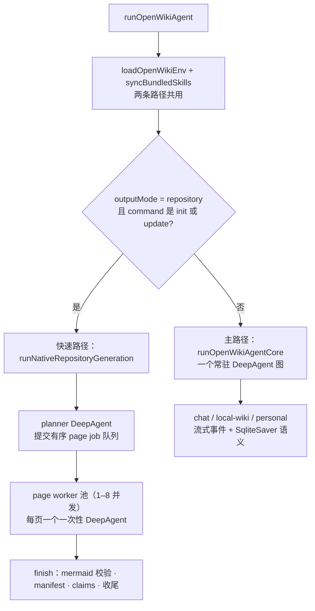

# 01 — 运行路径与编排 (Run Paths and Orchestration)

OpenWiki 的 agent 编排入口是 `runOpenWikiAgent()`（`src/agent/index.ts:167-290`）。它在最外层做一次**双路径分流（dual-path dispatch）**：repository 模式的 `init`/`update` 走原生 page-job 快速路径，不创建 DeepAgent；`chat` 与 `local-wiki` 走 DeepAgent 主路径。"一次运行 = 10 步流水线"的叙事只对主路径成立，对 repository 生成不适用。

> **源码是唯一真相源。** 本文所有行号锚定 `src/agent/index.ts`（2843 行）、`src/agent/types.ts`（134 行）、`src/agent/crash-guard.ts`（185 行）、`src/agent/repository-runner.ts`（1152 行）在分支 `ethan` 基线 v0.9.0（`b7027e3`）的状态。

## 1. 双路径分流（Dual-Path Dispatch）




**源码位置**：`src/agent/index.ts:191-245`

```typescript
// index.ts:191-192
const isRepositoryGeneration =
  outputMode === "repository" && (command === "init" || command === "update");

if (isRepositoryGeneration) {
  // repository 快速路径，见第 2 节
}
// 之后才是 chat/local-wiki 主路径
```

分流发生在 `loadOpenWikiEnv()` 与 `syncBundledSkills()` 之后（`index.ts:186-187`，这两个前置步骤对两条路径都会执行）。分流条件是 `outputMode` 与 `command` 的组合：只有 **repository 模式的 init/update** 进入快速路径；repository 模式的 `chat`（CODE_SYSTEM_PROMPTS.chat）仍走主路径。

**低层工厂的对称防御**：`createOpenWikiAgent()`（`index.ts:415-449`）对同一组合直接抛错（`index.ts:423-427`）：

```
Repository init/update use the OpenWiki page-job runner; call runOpenWikiAgent instead of createOpenWikiAgent.
```

这保证外部调用者无法绕过分流、把 repository init/update 塞回 DeepAgent 主路径。

### 两条路径的职责分界

| 维度 | repository init/update（快速路径） | chat / local-wiki（主路径） |
|------|-----------------------------------|----------------------------|
| 编排者 | `runNativeRepositoryGeneration`（`src/agent/repository-runner.ts:363-417`） | `runOpenWikiAgentCore`（`index.ts:580-822`） |
| DeepAgent | 不走 `createDeepAgent` 主图；planner 与每个 page worker 各建一次性 DeepAgent（`repository-runner.ts:450-544`、`884-1047`） | 一个常驻 `createDeepAgent` 图（`index.ts:473-578`） |
| 并发度 | `pageConcurrency`（`OPENWIKI_PAGE_CONCURRENCY`，1–8，默认 1）驱动多个 worker 槽位共享同一持久队列（第 2.2 节） | 单图单次 `agent.stream` |
| 检查点（checkpoint） | 无 agent 级 checkpointer；持久化靠 `.run.json`（05 区） | `SqliteSaver`（chat 持久化 / init、update 内存，见第 7 节） |
| 连接器工具 | repository 模式零暴露（`createOpenWikiConnectorTools("repository")` 返回空数组，08 区） | personal/local-wiki 模式注入完整连接器工具 |
| 中间件 | planner/page worker 各挂 `createFilesystemMiddleware` + `submissionLimit` + `NO_DELEGATION_MIDDLEWARE` | local-wiki 追加 6 工具文件系统中间件、翻译中间件 + `createOpenWikiIndexMiddleware`（`index.ts:502-570`） |
| 进度事件 | `repository_progress` 结构化生命周期事件 | `text` / `tool_start` / `tool_end` 流式事件 |
| 元数据 | 由 page-job 生命周期写入（含 interrupted 语义，05 区） | `persistRunMetadataIfChanged`（`index.ts:778-805`） |
| 详见 | `05-generation-lifecycle/01-page-job-state-machine.md` | 本文第 4-8 节 |

## 2. repository 快速路径（Native Repository Generation）

**源码位置**：`src/agent/index.ts:194-245`

快速路径在分支内完成三件事：

1. **`resolveRunConfig`**（`index.ts:197-199`）——与主路径共用同一套配置解析（见第 3 节）。
2. **`createModel`**（`index.ts:201-212`）——用 `inStageSync("build", …, { errorClass: "build_error", errorDetail: "model" })` 包裹的同步构建。两个 provider 特化适配器就住在本目录：`bob.ts` 的 `createBobFetch()`（Bob 分支 `index.ts:1319-1330`）与 `entra-auth.ts` 的 `createEntraTokenProvider()`（openai-compatible 的 Entra 分支 `index.ts:1335-1338`）；分支细节归 `06-model-providers/02-provider-model-creation.md` §4.7 与 `09-authentication-and-oauth/03-entra-id-auth.md`。
3. **`runNativeRepositoryGeneration`**（`index.ts:213-228`）——把 `root`、`mode`、`language`、`force`（用户消息非空即视为强制）、`planningContext`（即 `options.userMessage`）、`modelId`、已初始化的 `model`、`pageConcurrency` 和 `onEvent` 交给 repository-runner。此后的一切编排（planner → 逐页 worker → finalize）都发生在 05 区描述的持久化生命周期里。

分支的收尾（`index.ts:230-238`）：`generation.skipped` 为真时把 `telemetryContext.outcome` 标为 `"noop"`；`catch` 里附挂 OpenRouter 调试信息后原样重抛；`finally` 恢复被包装的全局 `fetch`（见第 8 节）。

### 2.1 repository_progress 事件

**类型定义**：`src/agent/types.ts:13-68`

repository 快速路径不流式输出模型文本，而是发出**结构化生命周期进度事件** `RepositoryGenerationProgressEvent`：`type: "repository_progress"`，`stage` 取 `"planning" | "generating" | "finalizing" | "replanning" | "noop"`，可携带 `resumed`（是否续跑中断的持久化运行）、`page` / `pageIndex` / `pageCount`（仅页面生成阶段），以及**并发池专属**的 `completedCount`（已 complete/skipped 的页数）与 `inFlightPages`（按启动序的在场页路径，`types.ts:52-67`）。单 worker 时后两个字段不下发，消费方回落到 `page`/`pageIndex`。发射点在 `src/agent/repository-runner.ts`：

| stage | 发射位置 | 语义 |
|-------|---------|------|
| `noop` | `repository-runner.ts:368` | 严格前置门判定无需生成（判定逻辑见 05 区 02） |
| `planning` | `repository-runner.ts:374-378` | planner 开始（或续跑）规划 |
| `generating` | `emitGeneratingProgress`（`repository-runner.ts:802-826`，调用点 `:734`、`:758`） | 每领取一个 page job 发一次，带页路径与队列位置；并发池另带在场页清单 |
| `finalizing` | `repository-runner.ts:396-401` | 页面队列耗尽，进入 finalize 管线 |
| `replanning` | 类型联合保留（`types.ts:22`），CLI 渲染层有对应文案（`src/cli/run-log/progress.ts:38`） | 源漂移（source drift）触发重规划的保留档位 |

worker 内部的工具事件由 `streamWorkerTools`（`repository-runner.ts:1069-1104`）以 `streamMode: ["tools"]` + `subgraphs: true` 消费，只转发白名单 `WORKER_TOOL_NAMES`（`repository-runner.ts:97-102`）：6 个文件系统工具（read_file/ls/glob/grep/write_file/edit_file，即转发达绝对多数的事件）+ `submit_plan`/`inspect_claims`/`submit_page` 三个提交类工具（`parseWorkerToolEvent`，`repository-runner.ts:1107-1147`）；worker 的叙述文本被刻意丢弃。page worker 的事件还会被追加 `page` 字段（`streamWorkerTools` 的 `page` 参数，`:1080`、`:1097-1103`），供 CLI 把工具卡片归到所属页。

### 2.2 页面 worker 并发池（Page Worker Pool）

**源码位置**：`src/agent/repository-runner.ts:564-838`

v0.7 起页面生成可以并行。`NativeRepositoryGenerationOptions` 新增两个可选参数（`repository-runner.ts:311-331`）：

- `pageConcurrency`（默认 1）：同时在跑的 page worker 数上限，由 `resolvePageConcurrency()` 从 `OPENWIKI_PAGE_CONCURRENCY` 解析（`src/config/constants.ts:94-100`、`:1158-1186`），取值 1–8，非法值直接抛错。
- `workerStartStaggerMs`（默认 `DEFAULT_WORKER_START_STAGGER_MS = 1_000`，`repository-runner.ts:559`）：首批 worker 按槽位错开启动，避免同时打满 provider。

`PageWorkerPool`（`repository-runner.ts:574-612`）是**进程内**记账：`claimed`（本进程已派发的 job id）、`acquiring`（把 `nextRepositoryPage` 的选页串行化，避免同一 tick 多个并发调用选到同一个队头）、`inFlight`、`size`（活的上限）、`fatal`、`skipped`。三条不变量值得记住：

1. **quickstart 押后**：并发时 `runPendingPageAgents` 先把 `/openwiki/quickstart.md` 从队列里 hold 住（`repository-runner.ts:652-660`），等其它页全部跑完，再用 `size = 1` 跑一轮收尾（`:669-672`）——quickstart 是任务路由图，必须链到已经存在的页。
2. **限流降载**：某个页 worker 因 provider 限流（`isRateLimitError`，`repository-runner.ts:840-869`）被跳过时，活的上限减一、绝不低于 1，并发一条 `text` 事件说明（`:752-762`）。限流不立即重试：`runPageAgent` 遇到限流直接放弃本轮重试（`:906-911`）。
3. **致命错误即停**：任一 worker 抛致命错误后，`pool.fatal` 记下第一个错误，其余槽位不再领新页，但让在场 worker 完成提交或跳过，最后在 finalize 前重抛（`:674-675`），保证运行不会带着 pending job 收尾。

## 3. resolveRunConfig 与模型可用性检查

**源码位置**：`src/agent/index.ts:299-394`

`resolveRunConfig()` 是两条路径共用的**运行前配置解析**。它把"provider 解析 → 凭据验证 → 模型解析 → 可用性检查 → 并发度 → 重试/输出预算解析"收敛为一个带遥测阶段标签（`catch` 里 `tagErrorStage(error, "config")`，`index.ts:390-392`）的步骤序列，返回六个字段：`provider`、`modelId`、`providerRetryAttempts`、`pageConcurrency`、`maxOutputTokens?`、`streamIdleTimeout?`（`index.ts:302-309`）。

解析顺序：

| 步骤 | 源码行 | 说明 |
|------|--------|------|
| `resolveConfiguredProvider()` | `index.ts:311` | 解析 provider；`onProviderResolved` 回调立刻把结果发布到共享遥测上下文（`index.ts:295-298` 的注释说明了动机：后续失败仍能归因到 provider） |
| `resolveProviderBaseUrl` | `index.ts:314` | 解析并调试输出 base URL |
| `resolveExternalCliCredential` + 校验 | `index.ts:322-326` | external-cli 认证的 provider（如 copilot）在此解析/校验 gh CLI 凭据（09 区） |
| `ensureProviderCredentials` | `index.ts:327` | 缺失凭据 env 检查（实现 `index.ts:995-1009`，走 `getMissingProviderEnvKey`，对 Entra ID 认证的 openai-compatible 不算缺 key） |
| `ensureProviderBaseUrl` / `SecretKey` / `Region` | `index.ts:334-336` | 条件性要求（实现 `index.ts:1011-1059`） |
| `ensureFreshChatGptTokens` | `index.ts:340` | 仅 `openai-chatgpt`：建模型前刷新 OAuth token，使 `createModel` 保持同步 |
| `resolveModelId` | `index.ts:344` | CLI 参数 → `OPENWIKI_MODEL_ID` → provider 默认模型（实现 `index.ts:1061-1097`；无候选模型时直接抛错） |
| `getSelectedModelAvailability` | `index.ts:346-364` | 模型可用性检查：`unavailable` 直接阻断运行（`index.ts:352-356`），`unknown` 放行并记 debug（算法细节在 06 区 03） |
| `resolvePageConcurrency` | `index.ts:365` | 页面 worker 并发度（`OPENWIKI_PAGE_CONCURRENCY`，1–8，默认 1，见 2.2） |
| `resolveProviderRetryAttempts` | `index.ts:367-369` | `OPENWIKI_PROVIDER_RETRY_ATTEMPTS`；并发 >1 时默认拿到 `PARALLEL_PROVIDER_RETRY_ATTEMPTS = 5`（`src/config/constants.ts:93`、`:1190-1210`） |
| `resolveConfiguredMaxOutputTokens` / `resolveStreamIdleTimeoutForProvider` | `index.ts:371-380` | 输出预算与流空闲超时（随签名传入 `createModel`） |

**跨提供商模型名警告**：`resolveModelId` 末尾调用 `warnOnProviderModelMismatch()`（`index.ts:1089`，实现 `index.ts:1099-1121`）。当配置的模型 ID 属于其他 provider 的已知模型时，发一条可操作的 `text` 警告并镜像到 stderr——非致命，因为自定义网关可能合法提供该模型。

## 4. chat/local-wiki 主路径（10 步流水线的现存边界）

**源码位置**：`src/agent/index.ts:580-822`

> **边界声明**：旧文档把整条 agent 流程统称"10 步流水线"。本基线中这套叙事**只适用于本节描述的 chat/local-wiki 主路径**；repository init/update 的流水线是 page-job 状态机（planning → generating → finalizing，见 05 区），与下列步骤无对应关系。

主路径按顺序执行（步骤编号为本文叙事，非源码注释）：

1. **构建 RunContext**（`index.ts:593-597`）：`createRunContext(cwd, outputMode, options.language)`，带 `build_error/run_context` 错误标签。`RunContext` 现为 `{ lastUpdate, language?, wikiGoal? }`（`src/agent/types.ts:130-134`）——**`gitSummary` 字段已不存在**，文本型 Git 证据不复存在（源指纹体系见 03 篇）。
2. **内容快照**（`index.ts:599-606`）：非 chat 命令对 wiki 内容目录做 SHA-256 快照（`createOpenWikiContentSnapshot`），chat 为 `null`。
3. **构建模型**（`index.ts:608-619`）：`createModel(provider, modelId, providerRetryAttempts, maxOutputTokens, streamIdleTimeout)`。
4. **解析 thread ID**（`index.ts:622`）：优先 `options.threadId`（跨调用恢复对话），否则 `createThreadId(cwd, createRunThreadId())`；对外暴露的封装是 `createOpenWikiThreadId(cwd)`（`index.ts:968-970`）。
5. **创建 checkpointer**（`index.ts:624-635`）：按命令选择目标（第 7 节）。
6. **组装 agent 图**（`index.ts:636-653`）：调用 `createOpenWikiAgentGraph`（`index.ts:473-578`）。
7. **构建用户消息**（`index.ts:655-662`）：`createRunUserMessage`（`index.ts:833-850`）——followup 模式直透用户文本，否则 `createUserPrompt` 装配模板（装配规则见 02 篇）。
8. **打开流**（`index.ts:664-691`）：决定流模式并 `agent.stream`（第 5 节）。
9. **消费流 + crash-guard 窗口**（`index.ts:693-760`）：注册 active run、逐 chunk 解析转发（第 5、6 节）。
10. **善后**（`index.ts:763-821`）：checkpoint 收权、元数据写入、返回结果。

第 6 步的图组装中有四个主路径专属配置：

- **local-wiki 文件系统中间件**（`index.ts:511-526`）：仅 `outputMode === "local-wiki"` 时显式挂 `createFilesystemMiddleware`，工具集固定为 `ls`/`read_file`/`glob`/`grep`/`write_file`/`edit_file`——**没有 `execute`**，所以 personal 模式无论命令是什么都拿不到 shell（与后端 `execute` 的 personal 拒绝互为纵深，见 04 篇 §5）。
- **翻译中间件**（`index.ts:491-497` 决定计划，挂载 `index.ts:530-558`）：update 命令且语言切换时生成 `resolveTranslationPlan`，由 beforeAgent 阶段整库重译，避免新旧语言混排；init/chat 恒为 `undefined`。
- **本地化索引**（`index.ts:499-500`，挂载 `index.ts:559-565`）：`resolveIndexLabels`/`resolveConceptTypeLabel` 为确定性目录索引提供本地化标题与兜底 `type`。
- **`subagents: []`**（`index.ts:569`）：主路径显式禁用子代理（subagent）生成。

### Chat vs Init vs Update 在主路径内的差异

| 维度 | `chat` | `local-wiki init/update` |
|------|--------|--------------------------|
| 内容快照 | `null`（第 2 步跳过） | SHA-256 哈希 |
| checkpointer | **持久化** `~/.openwiki/openwiki.sqlite` | **内存** `:memory:` |
| backend `docsOnly` | 传 `command !== "chat"`，但 repository 输出模式强制为真（04 篇 §1.4） | `true`（写入边界见 04 篇） |
| 中间件 | 空数组（`index.ts:527-528`） | 文件系统中间件（仅 local-wiki）+ 翻译（按需）+ 索引中间件 |
| 元数据写入 | 从不写入 | 总是刷新（第 6 节） |
| 连接器工具 | chat 走 `CODE_*` 模板，工具按 outputMode 门控 | 完整连接器工具（08 区） |

## 5. 流解析（Stream Parsing）

### 5.1 流模式的决定

**源码位置**：`src/agent/index.ts:664-691`

主路径用 `agent.stream(input, { configurable: { thread_id }, streamMode, subgraphs: true })`（`index.ts:682-688`）。流模式（stream mode）有两种组合：

- 默认 `["messages", "tools"]`（`index.ts:674-676`）；
- `openai-compatible` provider **默认退到 `["updates", "tools"]`**（`index.ts:672-673`），已知良好的端点可设环境变量 `OPENWIKI_OPENAI_COMPATIBLE_STREAM_MESSAGES=true`（`src/config/constants.ts:36-37`，解析函数 `constants.ts:1278-1285`）选择回到 messages 模式。

退避的原因写在源码注释里（`index.ts:664-671`）：`messages` 模式强制 chunk 聚合，某些在首个 `role:"assistant"` delta 之前先流 reasoning 增量的端点会聚合成 `ChatMessageChunk`，被 agent 循环校验器拒绝（上游 issue #659）。`subgraphs: true` 让 chunk 携带命名空间（namespace），用于区分主图与子图输出。

### 5.2 chunk 解析函数族

**源码位置**：`src/agent/index.ts:1651-1753`

```typescript
// index.ts:1651
export function parseAgentStreamChunk(chunk: unknown): OpenWikiRunEvent | null
```

chunk 形状是三元组 `[namespace: string[], mode: "messages" | "tools" | "updates", payload]`（类型守卫 `isAgentStreamChunk`，`index.ts:1714-1731`）。按 mode 分派：

| mode | 处理函数 | 产出 |
|------|---------|------|
| `"tools"` | `parseToolStreamEvent`（`index.ts:2028-2059`） | `tool_start`（带 `formatToolCallName` + `formatToolArgs` 渲染的 `call` 字段）/ `tool_end`（`on_tool_end` → `finished`，`on_tool_error` → `error`） |
| `"updates"` | `parseUpdatesChunk`（`index.ts:1732-1753`） | 从节点状态差量 `{ nodeName: { messages: [...] } }` 中取第一条非空 assistant 文本，产出 `text` 事件 |
| `"messages"` | `extractMessageText`（`index.ts:1755` 起的递归提取族） | 模型文本 → `text` 事件 |

另保留 `parseStreamEvent()`（`index.ts:1680-1702`）解析 Agent Protocol 事件形状（`{ type: "event", method, params }`，守卫 `index.ts:1704-1712`），服务于公开 agent 工厂协议，与运行时主循环使用的 `parseAgentStreamChunk` 并存。

**无法解析 chunk 的调试兜底**：`options.debug` 开启时，解析不出事件的前 3 个 chunk 以 `stream.unhandledChunk <shape>` 记入调试输出（计数器 `unhandledChunkCount`，`index.ts:705`、判定 `:716-722`），之后静默跳过——上限防止病态端点刷屏，静默跳过则保证未知形状不会中断正常事件流（消费循环对 `null` 事件不转发、不报错）。

### 5.3 命名空间归类：model_request 归 "main"

**源码位置**：`src/agent/index.ts:2061-2079`

```typescript
const MODEL_REQUEST_NAMESPACE_PREFIX = "model_request:";

function getStreamSource(namespace: unknown): "main" | "subgraph"
```

DeepAgents 把主模型调用包在单个 `model_request` 命名空间里；`getStreamSource` 把**恰好一层**且以 `model_request:` 开头的命名空间归类为 `"main"`，其余非空命名空间归 `"subgraph"`，空命名空间归 `"main"`。`source` 字段只出现在 `text` 事件上，TUI 用它默认折叠子图输出。

### 5.4 数组参数渲染

**源码位置**：`src/agent/index.ts:2085-2105`

`formatToolArgs` 在检查 record **之前**先检查 `Array.isArray`（`index.ts:2088-2092`）：数组是 `typeof "object"` 且非空，若先走 record 分支会被渲染成 `0=…, 1=…`。数组渲染为逗号连接的值列表，record 渲染为 `key=value` 对。输入若是 JSON 字符串会先经 `parseStringifiedJson` 解析（`index.ts:2111-2121`）。

### 5.5 快速路径的流

repository 快速路径不走上述解析族：planner/page worker 的 `streamWorkerTools` 只订阅 `["tools"]` 模式（`repository-runner.ts:1077-1086`），`parseWorkerToolEvent` 丢弃白名单以外的一切 chunk——worker 的叙述文本（narration）不会进入 CLI 事件流。并发 worker 共享同一个 LangSmith thread（`resolveTraceThreadId(run.state.runId)`，`repository-runner.ts:536`、`:1032`），靠 `createDeepAgent({ name })` 区分 planner（`PLANNER_AGENT_NAME`，`:546`）与各页 worker（`workerAgentName(page)`，`:554-556`）。

## 6. crash-guard 与失败语义

### 6.1 注册窗口

**源码位置**：`src/agent/index.ts:696-703`（注册）、`index.ts:753`（注销）

```typescript
// index.ts:693-695 —— 注释：注册窗口恰好在流消费前后
// index.ts:696-703
registerActiveRun({
  command, cwd, modelId, outputMode,
  snapshotBefore: openWikiSnapshotBefore ?? undefined,
  language: context.language,
});
```

注册窗口是**精确的流消费窗口**：`registerActiveRun` 在流打开之后、`for await` 之前调用，`finally` 里 `clearActiveRun()`（`index.ts:753`）。这样逃逸所有 catch 的运行时失败能被归因到当前运行，而干净结束的运行不留下会被后续崩溃错误归因的陈旧记录。

`src/agent/crash-guard.ts` 是进程级单例实现：模块级 `activeRun` 槽位（`crash-guard.ts:59`，OpenWiki 设计上每进程一个运行）；`handleFatal()`（`crash-guard.ts:103-159`）在**任何 await 之前**同步取走并清空槽位（`crash-guard.ts:114-115`），使并发的 unhandledRejection 只有第一个能认领崩溃；随后尽力记录遥测（`crash-guard.ts:121-125`）、写入 interrupted 戳（`crash-guard.ts:132-144`）、输出 stderr 行并以非零码退出（`crash-guard.ts:158`）。处理器由 `installCrashGuard()`（`crash-guard.ts:173-185`）在 CLI 启动时幂等安装。

### 6.2 失败也写 interrupted 元数据

**源码位置**：`src/agent/index.ts:725-751`（流中途失败）、`index.ts:766-806`（收尾写入失败）

流中途抛错时，`catch` 块先 `tagErrorStage(error, "run")`（`index.ts:726`），然后**仍调用 `persistRunMetadataIfChanged(…, "interrupted", context.language)`**（`index.ts:733-742`）：已生成的部分内容保持可被后续 update diff，且 `interrupted` 状态让下一次调度更新不会对着半成品 wiki 误判 no-op。持久化自身失败被吞掉（只发 `metadata=writeFailed` debug，`:747-748`），原始运行错误照常传播（`:751`）。

正常路径的收尾写入（`index.ts:778-789`）以 `"complete"` 状态调用；若这次写入抛错，`catch`（`:790-805`）会再以 `"interrupted"` 兜底重写一次，然后重抛。状态字段的消费语义（interrupted 阻止 no-op 跳过）见 03 篇第 6 节；page-job 生命周期的对应行为（`repository-run.ts:1755-1776`）见 05 区 03。

## 7. 线程与 Checkpoint 系统（Thread and Checkpoint System）

### 检查点目标选择

**源码位置**：`src/agent/index.ts:942-956`

| command | persistent | connString |
|---------|-----------|------------|
| `chat` | `true` | `~/.openwiki/openwiki.sqlite`（路径常量 `index.ts:852`） |
| `init` / `update`（local-wiki） | `false` | `:memory:` |

设计动机不变：chat 需要跨轮对话连续性；生成类运行要求独立、可复现。`prepareCheckpointDirectory`（`index.ts:869-876`）以 `0700` 创建并收紧父目录权限；持久化运行成功后对 SQLite 文件本身 `chmod 0600`（`index.ts:763-771`，`chmodIfExists` 在 `index.ts:958-966`）。repository 快速路径**不创建 agent 级 checkpointer**——它的持久化边界是 `.run.json`（05 区 01）。

### Thread ID

**源码位置**：`src/agent/index.ts:968-982`

```typescript
// index.ts:968-970 —— 对外暴露的组合封装
export function createOpenWikiThreadId(cwd = process.cwd()): string {
  return createThreadId(cwd, createRunThreadId());
}

// index.ts:972-976
function createThreadId(cwd: string, runId: string): string {
  const digest = createHash("sha256").update(path.resolve(cwd)).digest("hex");
  return `openwiki-${digest.slice(0, 32)}-${runId}`;
}

// index.ts:978-982 —— base36 时间戳 + 随机后缀
function createRunThreadId(): string {
  return `${Date.now().toString(36)}-${Math.random().toString(36).slice(2, 10)}`;
}
```

前缀是工作目录的 SHA-256 前 32 个十六进制字符；后缀保证每次运行唯一。LangGraph 以完整 thread_id 为 checkpoint 键，所以对话连续性来自调用方跨调用传入同一个 `options.threadId`（`index.ts:622`），而非共享前缀。

### Checkpoint 历史裁剪

**源码位置**：`src/agent/index.ts:884-940`

`SqliteSaver.put()` 只插入不清理；chat 会话每轮复用同一 thread_id，SQLite 会随图步数无限增长。`pruneCheckpointHistory()`（`index.ts:884-922`，export 供测试）在每个 `checkpoint_ns` 分区内只保留最新一条 checkpoint（窗口函数 `ROW_NUMBER() ... rank = 1`），并清理不再被引用的 `writes` 行。包装函数 `prunePersistentCheckpointHistory`（`index.ts:924-940`）只对持久化目标执行、吞掉裁剪失败（只发 `checkpoint.pruneFailed` debug），在主路径 `finally` 中调用（`index.ts:754-759`）。

## 8. OpenRouter 调试 fetch 的并发安全

**源码位置**：`src/agent/index.ts:2217-2574`

`installOpenRouterDebugFetch()`（`index.ts:2446-2487`）为每次运行返回一个隔离的失败收集器（sink），并采用**引用计数**安装：`activeOpenRouterSinks` 集合（`index.ts:2217`）非空时复用已安装的全局 `fetch` 包装（`openRouterDebugFetch`，`index.ts:2222-2335`），只有最后一个运行 detach 时才恢复原始 fetch（`index.ts:2474-2481`）。并发运行的**安装/恢复互不干扰**；但失败捕获不是隔离的：`recordFailure` 把每次非 2xx/网络失败**广播写入所有已注册 sink**（`index.ts:2236-2240`，调用点 `:2267`、`:2295`、`:2328`），并发下某 run 的 sink 也会捕获到其他 run 的失败（单运行场景无差别）。非 2xx（以及 200 但畸形）时记入的是请求摘要、脱敏响应头与响应体预览（`index.ts:2254-2266`、`:2285-2298`）。入口处的 `attachOpenRouterDebugInfo`（`index.ts:2555-2564`）在两条路径的 `catch` 里（`index.ts:240`、`:284`）把失败挂到 error 对象上供 CLI 调试 UI 使用。provider 侧细节（何时启用、脱敏规则、404 瞬时重试）归 06 区 02。

## 9. 关键类型（Key Types）

**源码位置**：`src/agent/types.ts`（134 行，全文）

### OpenWikiRunEvent：事件联合已扩展

`src/agent/types.ts:70-105`

```typescript
export type OpenWikiRunEvent =
  | RepositoryGenerationProgressEvent   // types.ts:13-68，repository_progress
  | { source?: "main" | "subgraph"; type: "text"; text: string }
  | { type: "tool_start"; call: string; id: string; input: unknown; name: string; page?: string }
  | { type: "tool_end"; id: string; name: string; page?: string; status: "error" | "finished" }
  | { type: "debug"; message: string };
```

`repository_progress` 与两个工具事件上的 `page?: string`（`types.ts:83-89`、`:94-99`）都是本区间的增量：page worker 的工具事件带上是哪一页发出的，planner 与非 repository 运行留空。CLI 的 run-log reducer/progress 渲染按 `event.type` 分派（`src/cli/run-log/reducer.ts:21`、`src/cli/runners.ts:273`）。

### OpenWikiRunOptions

`src/agent/types.ts:107-117`

新增 `language?: string | null`（`types.ts:110`），贯穿 `resolveRunConfig`、`runNativeRepositoryGeneration` 与 no-op 判定。其余字段（`debug`、`isFollowup`、`modelId`、`onEvent`、`outputMode`、`threadId`、`userMessage`、`telemetryFile`）语义沿用。

### RunContext：只有 lastUpdate/language/wikiGoal

`src/agent/types.ts:130-134`

```typescript
export type RunContext = {
  lastUpdate: UpdateMetadata | null;
  language?: string;
  wikiGoal?: string;
};
```

`gitSummary: string` 字段已随文本型 Git 证据一并移除。提示词不再注入 Git 文本块；`{GIT_HISTORY_HINT}` 占位符只是"git 历史可用/不可用"的一句话提示（`src/agent/prompt.ts:150-154`）。

### UpdateRunStatus / UpdateMetadata

`src/agent/types.ts:119`、`types.ts:121-128`

`UpdateRunStatus = "complete" | "interrupted"`；`UpdateMetadata` 含可选 `status` 与 `language` 字段。完整读写与消费语义在 03 篇第 4 节。

## 10. 与 05 生成生命周期区的分工

| 主题 | 本篇（04 区 01） | 05 区 |
|------|-----------------|-------|
| repository 编排 | 入口分流（`index.ts:191-245`）与 `runNativeRepositoryGeneration` 的调用形态、页面 worker 并发池 | page-job 状态机、`.run.json`、恢复与重规划语义（`05-generation-lifecycle/01-page-job-state-machine.md`） |
| no-op / fast-forward | 主路径 no-op 预检的调用位置（`src/cli/startup.ts:123-147`） | 严格前置门：claims + manifest 覆盖 + 指纹稳定性双重校验（`05-generation-lifecycle/02-page-manifest-and-fast-forward.md`） |
| 元数据 | 写入时机与 interrupted 兜底（本文第 6 节） | 生命周期内的 `writeLastUpdateMetadata` 调用序列与 checkpoint 推进（`05-generation-lifecycle/03-finalize-pipeline.md`） |
| 指纹/变更检测 | —（实现见 03 篇） | 指纹的消费决策（no-op、fast-forward、漂移重规划） |

---

## Source Anchor

| 源文件 | 关键符号 | 说明 |
|--------|---------|------|
| `src/agent/index.ts:167-290` | `runOpenWikiAgent()` | 运行入口：环境加载、双路径分流、OpenRouter 包装 |
| `src/agent/index.ts:191-245` | `isRepositoryGeneration` 分支 | repository init/update 快速路径 |
| `src/agent/index.ts:247-250` | `OpenWikiIgnore.load` | 主路径加载 ignore 边界（repository 模式） |
| `src/agent/index.ts:299-394` | `resolveRunConfig()` | 配置解析：provider→凭据→模型→可用性→并发度→重试/预算 |
| `src/agent/index.ts:346-364` | `getSelectedModelAvailability` 调用 | 模型可用性检查（unavailable 阻断 / unknown 放行） |
| `src/agent/index.ts:415-449` | `createOpenWikiAgent()` | 低层工厂；repository+非 chat 抛错（`:423-427`） |
| `src/agent/index.ts:473-578` | `createOpenWikiAgentGraph()` | 主图组装：backend、local-wiki 文件系统中间件、翻译/索引中间件、`subagents: []` |
| `src/agent/index.ts:580-822` | `runOpenWikiAgentCore()` | chat/local-wiki 主路径（10 步叙事的现存边界） |
| `src/agent/index.ts:593-606` | `createRunContext` / `createOpenWikiContentSnapshot` 调用 | RunContext（无 gitSummary）与运行前快照 |
| `src/agent/index.ts:664-691` | `streamMessagesEnabled` / `agent.stream` | 流模式组合决策与流打开 |
| `src/agent/index.ts:696-703` | `registerActiveRun()` 调用 | crash-guard 注册窗口起点 |
| `src/agent/index.ts:705-724` | `parseAgentStreamChunk` 消费循环 | 逐 chunk 解析 + `scheduler.yield()` 让 Ink 重绘 |
| `src/agent/index.ts:725-751` | interrupted 元数据写入 | 流失败仍写 `status: "interrupted"` |
| `src/agent/index.ts:752-760` | `clearActiveRun` / `prunePersistentCheckpointHistory` | crash-guard 注销与 checkpoint 裁剪 |
| `src/agent/index.ts:778-805` | `persistRunMetadataIfChanged`（complete） | 正常收尾写入；失败降级 interrupted |
| `src/agent/index.ts:833-850` | `createRunUserMessage()` | followup 直透 vs 模板装配 |
| `src/agent/index.ts:852-876` | `checkpointPath` / `createCheckpointer` / `prepareCheckpointDirectory` | 持久化 SQLite 路径与 0700 目录 |
| `src/agent/index.ts:884-940` | `pruneCheckpointHistory` / `prunePersistentCheckpointHistory` | 只保留每 ns 最新 checkpoint |
| `src/agent/index.ts:942-956` | `resolveCheckpointTarget()` | chat 持久化 vs 其余 `:memory:` |
| `src/agent/index.ts:968-982` | `createOpenWikiThreadId()` / `createThreadId()` / `createRunThreadId()` | SHA-256 前缀 + base36 唯一后缀 |
| `src/agent/index.ts:995-1059` | `ensureProviderCredentials` 等四守卫 | 凭据/base URL/secret key/region 校验 |
| `src/agent/index.ts:1061-1097` | `resolveModelId()` | CLI → env → provider 默认，含校验 |
| `src/agent/index.ts:1099-1121` | `warnOnProviderModelMismatch()` | 跨 provider 模型名非致命警告 |
| `src/agent/index.ts:1530-1552` | `resolveAnthropicMaxOutputTokens()` | Claude 4/5 默认输出预算 |
| `src/agent/index.ts:1651-1678` | `parseAgentStreamChunk()` | 三元组 chunk 分派（messages/tools/updates） |
| `src/agent/index.ts:1680-1702` | `parseStreamEvent()` | Agent Protocol 事件形状解析（并存回退） |
| `src/agent/index.ts:1714-1731` | `isAgentStreamChunk()` | `[namespace, mode, payload]` 类型守卫 |
| `src/agent/index.ts:1732-1753` | `parseUpdatesChunk()` | updates 模式状态差量提取 assistant 文本 |
| `src/agent/index.ts:705,716-722` | `unhandledChunkCount` / `stream.unhandledChunk` 调试兜底 | 解析失败 chunk 的 shape 日志（每运行 debug 上限 3 条） |
| `src/agent/index.ts:2028-2059` | `parseToolStreamEvent()` | tool_start / tool_end 解析 |
| `src/agent/index.ts:2061-2079` | `MODEL_REQUEST_NAMESPACE_PREFIX` / `getStreamSource()` | model_request 命名空间归类 "main" |
| `src/agent/index.ts:2085-2105` | `formatToolArgs()` | 数组参数优先于 record 的渲染 |
| `src/agent/index.ts:2217-2574` | `activeOpenRouterSinks` / `installOpenRouterDebugFetch()` | 引用计数的并发安全 fetch 包装 |
| `src/agent/crash-guard.ts:15-77` | `ActiveRunRecord` / `registerActiveRun` / `clearActiveRun` | 进程级单槽注册 |
| `src/agent/crash-guard.ts:103-159` | `handleFatal()` | 同步认领崩溃 → 遥测 → interrupted 戳 → 非零退出 |
| `src/agent/repository-runner.ts:363-417` | `runNativeRepositoryGeneration()` | 快速路径编排：noop/planning/generating/finalizing |
| `src/agent/repository-runner.ts:545-556` | `PLANNER_AGENT_NAME` / `workerAgentName()` | LangSmith 里的 planner / 页 worker 名字 |
| `src/agent/repository-runner.ts:564-838` | `PageWorkerPool` / `runPendingPageAgents` / `runWorkerLoops` | 页面 worker 并发池、quickstart 押后、限流降载 |
| `src/agent/repository-runner.ts:840-869` | `isRateLimitError()` | 429 / ThrottlingException / 限流文案识别（含 cause 链） |
| `src/agent/repository-runner.ts:872,884-922` | `PAGE_WORKER_ATTEMPT_LIMIT` / `runPageAgent()` | 每页最多两次尝试（失败一次先还原再重试） |
| `src/agent/repository-runner.ts:1069-1104` | `streamWorkerTools()` | worker 仅订阅 `["tools"]` 流 |
| `src/agent/repository-runner.ts:1107-1147` | `parseWorkerToolEvent()` | worker 工具白名单事件归一化 |
| `src/agent/types.ts:13-68` | `RepositoryGenerationProgressEvent` | repository_progress 结构化事件（含 `completedCount`/`inFlightPages`） |
| `src/agent/types.ts:70-105` | `OpenWikiRunEvent` | 五成员事件联合 |
| `src/agent/types.ts:107-117` | `OpenWikiRunOptions` | 运行选项（含 `language`） |
| `src/agent/types.ts:119,121-128` | `UpdateRunStatus` / `UpdateMetadata` | 状态与语言字段 |
| `src/agent/types.ts:130-134` | `RunContext` | `lastUpdate` + `language` + `wikiGoal`（无 gitSummary） |
| `src/cli/startup.ts:123-147` | `canSkipCleanUpdateBeforeCredentials()` | 主路径 update 的 no-op 预检调用点 |
| `src/cli/run-log/reducer.ts:21-25` | run-log reducer 的 `repository_progress` 分派 | 进度事件在 TUI 日志中的折叠归并 |
| `src/cli/runners.ts:273` | runner 的事件分派分支 | CLI 层按 `event.type` 消费 repository_progress |
| `src/config/constants.ts:36-37,1278-1285` | `OPENAI_COMPATIBLE_STREAM_MESSAGES_ENV_KEY` / `resolveOpenAiCompatibleStreamMessages()` | openai-compatible 默认 updates 的退避开关 |
| `src/config/constants.ts:93-100,1158-1186,1199-1218` | `PARALLEL_PROVIDER_RETRY_ATTEMPTS` / `DEFAULT_PAGE_CONCURRENCY` / `MAX_PAGE_CONCURRENCY` / `resolvePageConcurrency()` / `resolveProviderRetryAttempts()` | 并发度与并发下的重试预算 |
