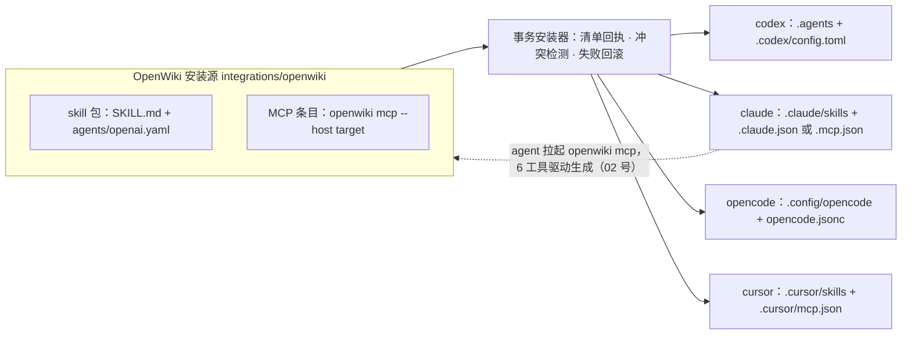
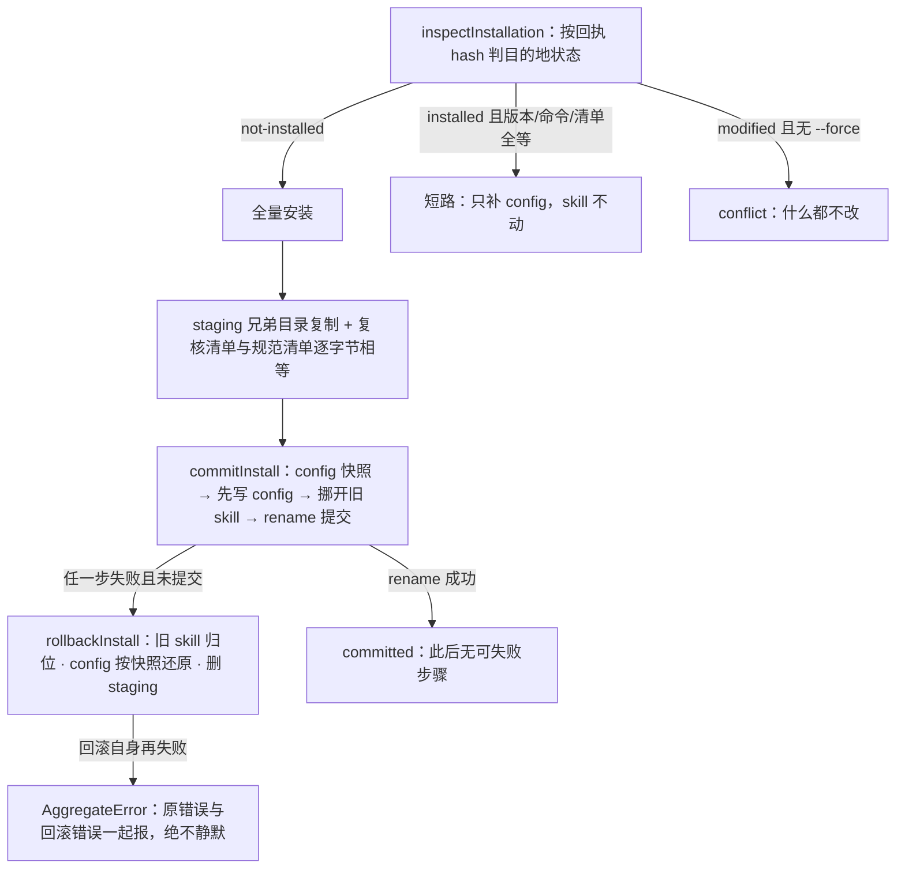

# 01 — 集成目标与事务安装 (Host Targets & Transactional Install)

OpenWiki 可以被装入 coding agent 宿主（host）：安装器把两样东西写进 host 的领地——一份规范的 skill 包（告诉 host 内的 agent 怎么驱动 OpenWiki）和一条本地 stdio MCP server 的 config 条目（让 agent 有工具可调）。支持 4 个目标：**Codex、Claude Code、OpenCode、Cursor**（`HostTargetId`，`src/integrations/install/types.ts:4`）。安装是**事务安装（transactional install）**：以 SHA-256 清单回执（receipt）判定 installed/modified，modified 无 `--force` 即冲突，提交失败自动回滚。本篇讲安装面；MCP 进程与 6 工具协议见 02 号。

> **源码是唯一真相源。** 本文行号对应 `ethan` 分支基线 `e92cc11`，引用前请重读源码核对。

> **30 秒版**：装进 host 靠两件东西——skill 包（教 host 内 agent 怎么驱动 OpenWiki）+ MCP config 条目（给 agent 6 个工具）。安装是**事务**：SHA-256 回执（receipt）定所有权，modified 无 `--force` 即冲突，提交「先易回滚者先行」，失败自动回滚。4 个目标（Codex/Claude/OpenCode/Cursor）的全部路径来自一张不可变注册表。



## 1. 产品概念与命令面

「装入 host」解决的问题是：host 内的 agent 天然会读 skill 目录里的说明、按 MCP config 启动本地 server。OpenWiki 顺着这个机制交付自己——**不驻留后台、不自带 agent**，只在 host 拉起 `openwiki mcp` 时作为一个无根（rootless）进程存在，把 05 区那套可恢复页任务（page job）生命周期以 6 个 MCP 工具暴露给 host（详见 02 号）。写作（调研、 prose、页面质量）由 host 侧模型承担，OpenWiki 只拥有状态、队列、校验与收尾。

命令面两组（入口分发在 `src/cli/cli.tsx:47-53`，`integrations`/`mcp` 走独立分支、不加载模型环境）：

```
openwiki integrations list                                   # 列出 4 目标与各自状态
openwiki integrations install <host> [--force] [--project [path]]
openwiki integrations uninstall <host> [--project [path]]
openwiki mcp --host <host>                                   # 由 host 的 MCP config 拉起，人一般不手敲
```

解析规则（`parseIntegrationsCommand`，`src/cli/commands.ts:539-650`）：

- 动作只认 `install`/`list`/`uninstall`，否则输出注册表动态生成的 usage（`:541-543`，usage 文案见 `:717-719`）；
- install/uninstall 必须带认识的目标名，未知目标报「Supported targets: …」（`:547-563`）；
- `--force` 仅 install 合法且只能出现一次（`:575-591`）；
- `--project` 把 scope 从默认的 user 切到 project：`--project`（`:569` 默认 `"user"`）后跟自由路径或 `--project=path`（`:594-625`），无值时落 `"."`；`--project` 之后出现裸路径会报「Project paths must follow --project.」（`:634-638`）。

执行面（`runIntegrationsCommand`，`src/cli/integrations.ts:20`）：

- scope 为 user 时 root 取 `os.homedir()`，project 时取 `--project` 给出的目录（`:24-25`）；
- `list` 对每个目标并发查状态后输出 `id\tstatus\tdisplayName` 制表行（`:26-39`）——这是脚本化巡检的稳定接口；
- install/uninstall 成功后打印 `changed/unchanged`、skill 路径、mcp 路径，若有保留备份再打一行 `backup:`（`:56-61`）；
- install 成功后追加三步指引：重启 host → 确认 openwiki MCP server 可用 → 让 agent「Initialize OpenWiki for this repository」（`:63-75`）；
- 错误统一走 stderr + 退出码 1（`:77-80`）。

## 2. 目标注册表与 4 目标安装路径表

全部路径集中在一个不可变注册表 `HOST_TARGETS`（`src/integrations/install/registry.ts:10-79`，`as const satisfies Record<HostTargetId, HostTarget>`）。注册表存的是 scope 相对路径；user scope 的 root 是 home 目录、project scope 的 root 是目标仓库根（`resolveInstallContext`，`src/integrations/install/install-paths.ts:75-110`：project scope 会先过 `resolveRepositoryRoot` 做 Git 根解析与安全拒绝，`:87-90`）。每个目标还带 `producerActor`——host 写出的页面会盖上这个 OKF producer 身份（`types.ts:79`；语义见 02 号 §4.3）。

| 目标 | producerActor | scope | skill 目录 | MCP config | 格式 kind |
|------|---------------|-------|-----------|------------|-----------|
| `codex` | `codex` | user | `~/.agents/skills/openwiki` | `~/.codex/config.toml` | `codex-toml` |
| `codex` | | project | `<repo>/.agents/skills/openwiki` | `<repo>/.codex/config.toml` | `codex-toml` |
| `claude` | `claude-code` | user | `~/.claude/skills/openwiki` | `~/.claude.json` | `json` |
| `claude` | | project | `<repo>/.claude/skills/openwiki` | `<repo>/.mcp.json` | `json` |
| `opencode` | `opencode` | user | `~/.config/opencode/skills/openwiki` | `~/.config/opencode/opencode.jsonc` | `opencode-json` |
| `opencode` | | project | `<repo>/.opencode/skills/openwiki` | `<repo>/opencode.jsonc` | `opencode-json` |
| `cursor` | `cursor` | user | `~/.cursor/skills/openwiki` | `~/.cursor/mcp.json` | `json` |
| `cursor` | | project | `<repo>/.cursor/skills/openwiki` | `<repo>/.cursor/mcp.json` | `json` |

逐目标要点：

- **codex**：两个 scope 完全同构（`.agents/` + `.codex/config.toml`），且是唯一用 TOML 的目标（`registry.ts:11-30`）。
- **claude**：唯一 user/project 落到**不同 config 文件**的目标——user 写 `~/.claude.json`（host 的全局配置），project 写仓库根 `.mcp.json`（`registry.ts:31-44`）。producerActor 也特例为 `claude-code` 而非 `claude`。
- **opencode**：唯一 config 文件是 JSONC（允许注释）的目标；user 布局挂在 `~/.config/opencode/`，project 平铺在仓库根（`registry.ts:45-64`）。
- **cursor**：两个 scope 同构（`.cursor/skills/openwiki` + `~/.cursor/mcp.json`），project scope 的 config 相对路径同样是 `.cursor/mcp.json`（即 `<repo>/.cursor/mcp.json`）（`registry.ts:65-78`）。

注册表 API 与类型：

- `getHostTarget(id: string)` 是信任边界：未认识的目标返回 `undefined`，由 CLI 层报错（`registry.ts:87-89`）；
- `listHostTargets()` 按注册顺序返回独立数组（`:96-98`）；
- `defaultMcpServerCommand(target)` 返回装进 config 的那条命令：`{ command: "openwiki", args: ["mcp", "--host", target] }`（`:106-113`）；
- 每个 `HostTarget` 携带 `documentationUrl`（如 codex 的 `https://learn.chatgpt.com/docs/extend/mcp`），供人查阅该 host 的 MCP 支持方式；
- 类型上 user scope 可为 `null`（`types.ts:84`），此时该目标仅支持 project，`resolveInstallContext` 会抛「仅支持 project scope，请加 `--project`」的 `invalid_input`（`install-paths.ts:81-86`）；当前 4 个目标都定义了 user scope，但 `status` 对 null scope 会短路返回 `unsupported`（`installer.ts:351`）。

## 3. 安装物两件

### 3.1 skill 包复制

安装源是包内规范 skill 包 `integrations/openwiki/`，由 `resolveCanonicalSkillBundle` 从安装器模块位置向上三级解析出包根再拼 `integrations/openwiki`（`src/integrations/install/skill-bundle.ts:78-84`；源码运行与打包构建两条路径都靠 `moduleUrl` 定位，`installer.ts:144-146`）。布局有硬约束（`inventorySkill`，`skill-bundle.ts:93-163`）：

- 顶层**只允许 `SKILL.md`、`agents/`、`references/` 三类条目**（`ALLOWED_BUNDLE_ROOTS`，`skill-bundle.ts:13`）；
- 其他顶层名、`SKILL.md` 出现在子路径、`agents`/`references` 是文件而非目录、树内任何符号链接（symbolic link）、任何特殊文件（device/fifo 等）一律抛错（`:129-160`）；
- 缺 `SKILL.md` 直接失败（`:104-106`）；
- 遍历按文件名排序、相对路径统一用 `/`，产出「相对路径 → SHA-256」的确定性清单（`:115-155`）——同一棵树无论谁在哪台机器上清单都逐字节相同，这是后面对比的根基。

当前仓库里该目录实际只有 `SKILL.md` 与 `agents/openai.yaml`；`references/` 在 4882ba3 页任务重构时被整体移除（详见 02 号 §5），安装白名单保留这个名字只是布局兼容。

安装即 `cp` 这棵树到 staging，并补写回执 `.openwiki-install.json`（`RECEIPT_FILE`，`skill-bundle.ts:12`）。回执 schema `SkillReceipt` 严格五键（`:18-43`，写入 `writeReceipt` `:173-191`）：

```json
{
  "package": "openwiki",
  "version": "<OPENWIKI_VERSION>",
  "target": "<host id>",
  "mcpServerCommand": { "command": "openwiki", "args": ["mcp", "--host", "<host>"] },
  "files": { "SKILL.md": "<sha256>", "agents/openai.yaml": "<sha256>" }
}
```

读回时同样严格（`readReceipt` `:254-280` 及校验函数 `:288-343`）：键集合必须恰好是五个、package 恒 `"openwiki"`、version 非空字符串、target 必须与期望 host 一致、每个 hash 是 64 位小写十六进制、`mcpServerCommand` 只有 command/args 两键、文件路径不得绝对/含 `..`/越出白名单顶层/是回执本身——任何不符都按「无效回执」处理，后果等同 modified。

### 3.2 MCP config 条目

第二件是往 host 的 MCP config 写一条受管条目。写什么由 `defaultMcpServerCommand(target)` 决定（见 §2），写到哪里、用什么格式由注册表的 `mcpConfig: { kind, relativePath }` 决定（`types.ts:35-45`；kind 三选一：`json` / `codex-toml` / `opencode-json`）。三种格式渲染出的条目长相（以 codex/claude/opencode 各自的 `--host` 为例）：

TOML（codex，`renderBlock`，`config-toml.ts:157-164`）：

```toml
# OPENWIKI:MCP:START
[mcp_servers.openwiki]
command = "openwiki"
args = ["mcp", "--host", "codex"]
# OPENWIKI:MCP:END
```

JSON（claude/cursor，`config-json.ts:27,38`，两空格缩进 + 结尾换行）：

```json
{ "mcpServers": { "openwiki": { "command": "openwiki", "args": ["mcp", "--host", "claude"] } } }
```

JSONC（opencode，`entryFromCommand` `:91-101` 与 `renderFullConfig` `:159-164`，挂在顶层 `mcp` 对象下）：

```jsonc
{ "mcp": { "openwiki": { "type": "local", "command": ["openwiki", "mcp", "--host", "opencode"], "enabled": true } } }
```

适配器细节见 §5；这三段渲染即「回执里 `mcpServerCommand` 记录的命令」与「config 里实际条目」必须逐字节一致的原因——卸载与状态判定都以这个等价性为前提。

## 4. 事务安装 / 卸载 / 状态

事务核心是 `HostIntegrationInstaller`（`src/integrations/install/installer.ts:114`），文件操作（move/removeDirectory）、时钟、ID 源、bundle 位置全部可注入（`:74-102`），失败注入测试因此成为可能；模块底部另有三个薄封装 `installHostIntegration`/`uninstallHostIntegration`/`getHostIntegrationStatus` 供 CLI 使用（`:515-548`）。

### 4.1 安装主流程（install，installer.ts:156-237）

```
resolveInstallContext          # 解析 root/skill/config 绝对路径，project 先过 Git 根守卫
→ assertMcpServerCommand       # 校验可执行覆盖值的形状（:670-687）
→ inventorySkill(canonical)    # 给规范包算 SHA-256 清单
→ inspectInstallation(dest)    # 用回执 hash 判定目的地状态
→ [modified 且无 --force]       # → 抛 conflict，什么都不改（:173-178）
→ [已是最新]                    # → 只补/校 config，skill 不动（:186-199）
→ mkdir 父目录 + 再查 symlink    # 缩小 TOCTOU 窗口（:201-202）
→ cp 规范包 → staging 兄弟目录   # 私有隐藏目录 .openwiki-staging-<id>（:203-212）
→ 复核 staging 清单 == 规范清单  # 不一致抛 invalid_state 并清掉 staging（:214-226）
→ writeReceipt(staging)        # 回执在 staging 里生成，随 rename 一起生效
→ commitInstall（:383-437）
```

同一个流程画成分支图（事务三出口 + 回滚路径一目了然）：



两个前置判定值得单独说：

- **canonical 对比**：第 168 行先给规范包算清单，第 215-221 行给 staging 副本再算一次并要求 `sameFiles` 完全相等（`skill-bundle.ts:235-245`，键数与逐键 hash 都要相同）——复制过程本身也被事务覆盖。
- **回执 hash 判状态**：`inspectInstallation`（`skill-bundle.ts:200-226`）里，目录缺失 → `not-installed`；目录是 symlink / 回执缺失或无效 / 清单与回执 `files` 不符 → `modified`；全对 → `installed` 并带出回执。**modified 是整个子系统的安全词**：它意味着「目的地有 OpenWiki 不拥有或被改动过的内容」。

提交段（`commitInstall`，`installer.ts:383-437`）顺序刻意安排为「先易回滚者先行」：

1. **config 快照**（`snapshotTextFile`，`install-paths.ts:153-164`）——记下 config 原字节或不存在的标记；
2. **先写 config**（`:398-404`）——适配器是原子的（§5）且自带冲突检测，此时失败连 skill 都没动过；
3. **挪开旧 skill**（`:405-415`）——有旧目的地时 `rename` 到私有 rollback 兄弟目录；`--force` 时改为时间戳备份名 `<name>.openwiki-backup-<ISO时间>-<id>`（`forcedBackupPath`，`install-paths.ts:210-220`），提交成功后**保留不删**并写进结果 `backupPath`（`cleanupPriorSkill`，`installer.ts:446-458`；非 force 的 rollback 目录删不掉时也保留并上报）；
4. **rename 提交**（`:417`）——staging 一次 `rename` 到正式位置，`committed = true`；rename 之后不再有可失败步骤；
5. 任一步失败且尚未提交 → `rollbackInstall`（`:469-503`）：旧 skill 移回原位、config 按快照还原（`restoreTextFile`，`install-paths.ts:172-181`——原先是「不存在」就删掉新建的文件）、删除 staging；回滚自身再失败的错误不吞掉，与原始错误一起打成 `AggregateError`（「安装失败且回滚不完整」，`installer.ts:497-502`），宁可报重也不静默留下半套状态。

「已是最新」短路（`:186-199`）要求 receipt.version 等于当前包版本、receipt 记录的 MCP 命令与本次目标命令一致（`sameMcpServerCommand`，`:654-663`）、且 receipt 清单与规范清单逐文件 hash 相同；此时仍会走一次 config 安装——config 条目可能被用户删过，需要补。反之，`installed` 状态下回执里记录的旧命令会作为 `replaceableEntry` 传给适配器，允许从「旧版 OpenWiki 装的条目」平滑升级（`:180-185`）。

### 4.2 卸载（uninstall，installer.ts:246-338）

同样先解析上下文、检查状态；**skill 或 config 任一为 modified 即冲突拒删**：

- skill modified → 拒删（`:259-264`）；
- config 条目与回执里记录的命令不完全一致 → 拒删（`:274-279`）——绝不动用户改过的东西，包括 host config 里的其他 server 条目。

两者都 absent 则直接报 unchanged（`:283-285`）。有东西可删时（`:287-337`）：

1. config 快照；
2. 先删 config 受管条目（若在）；
3. 再把 skill 目录 rename 到 `uninstall` 兄弟目录（若在）；
4. 第 3 步成功后删掉该目录，删失败则保留并在 `backupPath` 上报（`:323-330`）；
5. config 删成功但移动失败 → 按快照还原，还原再失败同样 `AggregateError`（`:308-321`）。

收尾用 `removeEmptySkillParents` 自下而上清空因卸载变空的父目录，但**绝不越过 host 领地根**（如 `~/.claude/`）也不动 host 根目录本身（`install-paths.ts:228-244`——保护路径取相对路径第一段，例如 claude user scope 下保护的是 `~/.claude`）。

### 4.3 状态判定（status，installer.ts:347-369）

skill 状态与 config 状态分开查再合并：

| skill | config | 合并结果 |
|-------|--------|----------|
| not-installed | not-installed | `not-installed` |
| installed | installed | `installed` |
| 其余任何组合 | | `modified` |

config 的期望条目以**回执里记录的命令**为准（无回执时退回默认命令，`installedMcpServerCommand`，`:640-645`）。四种状态对外就是 `HostIntegrationStatus`（`types.ts:9-10`），`openwiki integrations list` 直接展示它。

### 4.4 排错抓手

| 现象 | 根因 | 处置 |
|------|------|------|
| install 报 conflict「unmanaged or modified skill」 | 目的地有非 OpenWiki 内容或被手改 | 确认后 `--force`（会产生时间戳备份）或手动清理 |
| install 报「Refusing to replace a modified OpenWiki MCP block/entry」 | config 条目存在但与回执/期望不一致 | 恢复一致或手动处理后重装 |
| uninstall 报「Refusing to remove a modified skill」 | skill 被手改、回执丢失或损毁 | 人工确认后手动删除该目录 |
| install/uninstall 报 destinations must not contain symbolic links | 目的地路径上有 symlink 组件 | 换真实目录，勿用链接布局 |
| install 报「supports project-scoped integrations only」 | 目标 user scope 为 null（当前目标均不会） | 按提示加 `--project` |
| 结果里出现 `backup:` 行 | 清理旧副本失败（权限/占用），OpenWiki 保留了副本 | 按 backupPath 人工处理；状态不受影响 |

## 5. 三种 config 适配器

三个适配器同构，各自暴露三件套：`install*`（幂等——已有等值条目返回 false 不重写；已有「可替换条目」才改写；其余一律 conflict）、`uninstall*`（只删与期望逐字节等价的受管条目）、`get*Status`（absent/intact/modified）。所有写盘都经 `writeTextAtomic`（`src/integrations/install/atomic-file.ts:11-34`）：先 lstat 记下原文件 mode（新建缺省 0644），写同目录隐藏临时文件，一次 `rename` 顶替——config 永远不会以半截状态被 host 读到，且权限位不漂移。

```text
              一套三件套契约（install* / uninstall* / get*Status）
                                 │
        ┌────────────────────────┼───────────────────────────┐
        ▼                        ▼                           ▼
  config-json              config-toml                config-opencode
  （claude / cursor）       （codex managed block）     （JSONC AST 切片手术）
  整文件 parse，            文本级标记对切片，           节点 offset 手术，
  只动 mcpServers.openwiki  块外同名表即 conflict       注释与排版原样保留
        └────────────────────────┼───────────────────────────┘
                                 ▼
              writeTextAtomic：tmp + rename，原子且不漂移权限
```

### 5.1 JSON（claude、cursor）

整文件 `JSON.parse`，只动 `mcpServers.openwiki` 一个键（`config-json.ts:14-40`）。等值判定要求条目恰好两键且 command 与 args 逐项相等（`matchesEntry` `:156-165`）；不认识或不等值即 conflict。坏 JSON 报 `invalid_input` 且**不尝试修复**（`readJsonObject` `:101-124`）。卸载只删 openwiki 键，留下其余 server 原样（`:49-70`）。状态查询遇到任何解析错误一律报 `modified`（保守侧，`:79-92`）。

### 5.2 TOML managed block（codex）

只做文本级切片替换，不引入 TOML 解析器：受管单元是 `# OPENWIKI:MCP:START` / `# OPENWIKI:MCP:END` 标记对之间的完整块（标记常量 `config-toml.ts:6-7`）。`markerRange` 校验标记必须成对、有序、唯一，失序/残缺/重复报 `invalid_input`（`:172-196`）。两层冲突检测：托管块**之外**出现 `[mcp_servers.openwiki]` 表也判 conflict（`hasUnmanagedOpenWikiTable` `:138-149`），防止用户手写条目被静默吞掉；块内容与期望渲染不一致亦然（`installCodexMcpBlock` `:32-72`，`uninstallCodexMcpBlock` `:81-103`，`getCodexMcpBlockStatus` `:112-129`）。文件末尾追加时维护空行分隔（`:68-70`）。

### 5.3 OpenCode JSONC AST

用 `jsonc-parser` 的 `parseTree` 把 JSONC 解析成 AST（允许尾逗号；解析错误报 `invalid_input`，`parseValidTree` `:169-182`），所有修改都是**按节点 offset/length 的文本切片手术**，注释与用户排版原样保留（`installOpencodeMcpEntry` `:187-264`）。条目值是 `{"type":"local","command":[command,...args],"enabled":true}`，等值判定用深比较（`entryFromCommand` `:91-101`、`deepEqual` `:453-470`）。特有规则：待替换值文本里含注释即视为 modified（`hasComment` `:143-145`）——注释可能承载用户意图，不替用户做删除决定；空文件或解析不出根对象时降级为写一份只含受管条目的全新 config（`:193-201`）；卸载时精确处理前后逗号与空白，不留悬挂逗号（`uninstallOpencodeMcpEntry` `:269-326`，状态 `:331-354`）。

错误三色与全局一致（`src/integrations/core/errors.ts:4-5`）：`conflict`（状态不允许，人或 `--force` 可解）、`invalid_input`（输入本身不可用）、`invalid_state`（内部不变量被破坏）。

## 6. 路径安全细节

host 集成的写入目标是 home 目录或用户仓库，路径即攻击面，防线有四层：

```text
┌─ 第 1 层 ─ assertNoSymlinkComponents ── 逐段 lstat，任何 symlink 组件当场拒绝
├─ 第 2 层 ─ resolveInside ────────────── 注册表相对路径必须落在 root 内，越界即拒
├─ 第 3 层 ─ resolveRepositoryRoot ────── project：git 根解析 + 拒绝文件系统根与 ~
├─ 第 4 层 ─ .openwiki-install.json ───── 回执逐字节校验 = 所有权证明，无回执永不碰
└─ 加固 ──── mkdir 后复查 symlink ─────── 缩小 TOCTOU 窗口（install :201-202）
```

1. **组件级拒绝 symlink**：`assertNoSymlinkComponents` 从 root 逐段 lstat 到目的地，任何已存在组件是符号链接即 `invalid_input`，中间组件不是目录也拒绝（`src/integrations/install/install-paths.ts:118-145`）；遇到首个不存在的组件即止（后面由 mkdir 创建）。install 在 mkdir 之后 `installer.ts:201-202` 再查一次，缩小检查与使用之间的窗口。
2. **scope 包容**：注册表相对路径必须落在 root 内——绝对路径、解析后等于 root 或越出 root 一律 `invalid_input`（`resolveInside`，`install-paths.ts:304-323`）；root 本身必须存在且是目录（realpath 规范化，`resolveInstallRoot` `:277-294`）。
3. **project scope 的 Git 根守卫**：project root 先过 `resolveRepositoryRoot`（`src/integrations/core/repository-root.ts:20-34`）：`git rev-parse --show-toplevel`（10 秒超时的只读 execFile，`:93-115`）解析出真实 worktree 根，然后**拒绝文件系统根与用户 home 目录**作为仓库根（`assertSafeRepositoryRoot`，`:122-133`）——防止一个在 `~` 里启动的 host agent 把整个 home 当 wiki 仓库。同一路径解析也被 MCP 的 `openwiki_begin` 复用（02 号 §4.3）。
4. **回执即所有权证明**：没有逐字节校验通过的 `.openwiki-install.json`，任何目录都不被视为「OpenWiki 的」，也因此永不被改写或删除（§4）。

另外 bundle 树内部独立拒绝 symlink（`skill-bundle.ts:137-141`）与特殊文件（`:156-160`）——连安装源都不可信到需要校验。

## 7. 扩展一个新 target 的三个触点

1. **注册表条目**：在 `HOST_TARGETS` 加一个 id 键，填 `displayName`、`producerActor`、user/project 两 scope 的 `skillDirectory` + `mcpConfig{kind, relativePath}`、`documentationUrl`（`registry.ts:10-79`）；若现有三种 config 格式都不匹配，先写第四个适配器并在 §5 三件套同构的前提下实现。
2. **类型联合**：`HostTargetId` 加新 id（`types.ts:4`）——`as const satisfies` 会让漏字段或拼错 id 的注册表条目直接编译失败。
3. **installer 三 switch**：`installManagedConfig` / `uninstallManagedConfig` / `getManagedConfigStatus` 各自按 `mcpConfigKind` 分发到适配器（`installer.ts:571-585`、`:595-608`、`:618-631`），新 kind 需要三处各加一臂（穷尽 switch 保证漏臂编译报错）。若新目标复用 `json` 格式则此步为零。

CLI 侧无需改动：usage 文案由 `formatSupportedHostTargets` 从注册表动态生成（`src/cli/commands.ts:712-729`），`getHostTarget`/`listHostTargets` 自动接纳新条目。

## 8. 测试佐证

`test/integrations/` 共 10 个测试文件，安装面覆盖五件：

- `installer.test.ts`——registry 断言、scope 所有权、project 根解析、host 目录清理、canonical bundle 解析（describe 见 `:388,890,911,945,960`）；
- `config-adapters.test.ts`——三类适配器的原子写与所有权/冲突矩阵（`:74,89,234,333`）；
- `package-contents.test.ts`——发布包只含允许的 bundle 布局（`:32`）；
- `repository-root.test.ts`——Git 根解析与 root/home 拒绝（`:33`）；
- `cli-dogfood.test.ts` 与 `skill.test.ts`——CLI 端到端（`:55`）与 canonical skill 内容契约（`:39`）。

MCP 面的 `protocol/session-manager/mcp-server/mcp-stdio` 四件见 02 号 §8。

## Source Anchor

| 源文件 | 关键符号 | 说明 |
|--------|---------|------|
| `src/integrations/install/types.ts:4` | `HostTargetId` | 4 目标联合类型 |
| `src/integrations/install/types.ts:9-15` | `HostIntegrationStatus` / `HostIntegrationScope` | 四态与 user/project scope |
| `src/integrations/install/types.ts:35-60` | `HostMcpConfig` / `HostInstallationPaths` | config kind + scope 相对目的地 |
| `src/integrations/install/types.ts:65-95` | `HostTarget` | 注册表条目形状（含 `producerActor` :79） |
| `src/integrations/install/registry.ts:10-79` | `HOST_TARGETS` | 4 目标路径表（本文 §2 全部路径出处） |
| `src/integrations/install/registry.ts:87-98` | `getHostTarget` / `listHostTargets` | 信任边界读取与枚举 |
| `src/integrations/install/registry.ts:106-113` | `defaultMcpServerCommand` | `openwiki mcp --host <target>` 条目 |
| `src/integrations/install/skill-bundle.ts:12-13` | `RECEIPT_FILE` / `ALLOWED_BUNDLE_ROOTS` | 回执文件名与 bundle 顶层白名单 |
| `src/integrations/install/skill-bundle.ts:18-43` | `SkillReceipt` | 回执 schema（严格五键） |
| `src/integrations/install/skill-bundle.ts:78-84` | `resolveCanonicalSkillBundle` | 规范包定位（moduleUrl 上三级） |
| `src/integrations/install/skill-bundle.ts:93-163` | `inventorySkill` | SHA-256 清单 + 布局/symlink 校验 |
| `src/integrations/install/skill-bundle.ts:173-191` | `writeReceipt` | 回执写入 |
| `src/integrations/install/skill-bundle.ts:200-226` | `inspectInstallation` | installed/modified/not-installed 判定 |
| `src/integrations/install/skill-bundle.ts:235-245` | `sameFiles` | 清单等值比较 |
| `src/integrations/install/skill-bundle.ts:254-280` | `readReceipt` | 回执严格校验（含 `:288-343` 辅助函数） |
| `src/integrations/install/installer.ts:114` | `HostIntegrationInstaller` | 事务安装器（可注入操作 `:74-102`） |
| `src/integrations/install/installer.ts:156-237` | `install` | 事务安装主流程 |
| `src/integrations/install/installer.ts:246-338` | `uninstall` | 事务卸载（modified 拒删 `:259-264`/`:274-279`） |
| `src/integrations/install/installer.ts:347-369` | `status` | 状态合并判定 |
| `src/integrations/install/installer.ts:383-437` | `commitInstall` | 快照→config→挪旧→rename 提交 |
| `src/integrations/install/installer.ts:446-458` | `cleanupPriorSkill` | force 备份保留 / rollback 目录清理 |
| `src/integrations/install/installer.ts:469-503` | `rollbackInstall` | 回滚与 AggregateError |
| `src/integrations/install/installer.ts:515-548` | `installHostIntegration` 等三封装 | CLI 使用的模块级 API |
| `src/integrations/install/installer.ts:571-631` | `installManagedConfig` 等三 switch | config 适配器分发（扩展触点 3） |
| `src/integrations/install/install-paths.ts:75-110` | `resolveInstallContext` | 路径解析 + project Git 根守卫 |
| `src/integrations/install/install-paths.ts:118-145` | `assertNoSymlinkComponents` | 组件级 symlink 拒绝 |
| `src/integrations/install/install-paths.ts:153-181` | `snapshotTextFile` / `restoreTextFile` | config 快照与还原 |
| `src/integrations/install/install-paths.ts:210-220` | `forcedBackupPath` | `--force` 时间戳备份名 |
| `src/integrations/install/install-paths.ts:228-244` | `removeEmptySkillParents` | 空父目录清理（不越 host 根） |
| `src/integrations/install/install-paths.ts:304-323` | `resolveInside` | scope 包容校验 |
| `src/integrations/install/atomic-file.ts:11-34` | `writeTextAtomic` | tmp+rename 原子写、保留 mode |
| `src/integrations/install/config-json.ts:14-92` | `installJsonMcpEntry` 三件套 | JSON 适配器 |
| `src/integrations/install/config-toml.ts:6-7,32-129` | `START/END` 与三件套 | TOML managed block 适配器 |
| `src/integrations/install/config-toml.ts:157-196` | `renderBlock` / `markerRange` | 块渲染与标记校验 |
| `src/integrations/install/config-opencode.ts:187-354` | `installOpencodeMcpEntry` 三件套 | JSONC AST 适配器 |
| `src/integrations/core/repository-root.ts:20-34,122-133` | `resolveRepositoryRoot` / `assertSafeRepositoryRoot` | Git 根解析与 fs root/home 拒绝 |
| `src/integrations/core/errors.ts:4-5` | `HostIntegrationErrorCode` | conflict/invalid_input/invalid_state |
| `src/cli/integrations.ts:20-81` | `runIntegrationsCommand` | list/install/uninstall 执行面 |
| `src/cli/commands.ts:539-650` | `parseIntegrationsCommand` | `--force`/`--project` 解析 |
| `src/cli/commands.ts:712-729` | usage / `formatSupportedHostTargets` | 注册表驱动的 usage 文案 |
| `src/cli/cli.tsx:47-53` | 分发分支 | integrations/mcp 不走标准命令路径 |
| `test/integrations/installer.test.ts` | — | 事务安装/回滚/registry 测试 |
| `test/integrations/config-adapters.test.ts` | — | 三适配器所有权矩阵测试 |
| `test/integrations/package-contents.test.ts` | — | 发布 bundle 布局守卫 |
