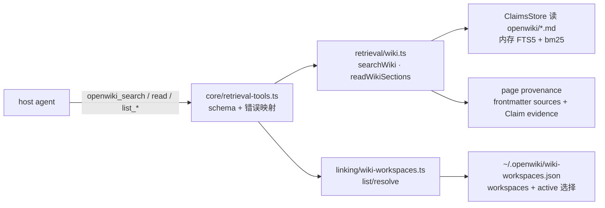

# 03 — 只读检索工具与 Wiki Workspace (Retrieval Tools & Workspaces)

v0.6.0（`0c0b35d` / #905）把「读 wiki」做成了一等协议面：`openwiki mcp` 不再只是 6 个生成工具，前面还挂了 4 个**只读检索工具**。它们不启动 run、不调用模型、不要求先 `openwiki_begin`，只把已经存在的 `openwiki/` 产物当作仓库记忆（repository memory）来查。v0.7.3（`7d0691c` / `47cb6a6`）又给 `openwiki_read` 补了 **page provenance**，并把整套工具同样投给了 Pi。本篇从**集成层**讲这 4 个工具：投递方式、上限来源、workspace 解析与错误映射；消费者视角的完整协议规格（含每个字段与边界值总表）见 15 区 03 号，生成侧协议见本区 02 号。

> **源码是唯一真相源。** 本文行号对应 `ethan` 分支基线 `b7027e3`（v0.9.0），引用前请重读源码核对。

> **30 秒版**：`search` 是「先给方向」——内存 FTS5 排名后只回紧凑摘要 + `page#anchor` ref；`read` 是「按 ref 精确取整节」，可选带上页面记录的前置 sources 与 Claim 证据版本；`list_workspaces` / `list_wikis` 负责把「这次该搜哪个 workspace」讲清楚。四个工具共用一条纪律：**不要在任务开始时无脑检索，问题落地即停**。



## 1. 为什么单独做 4 个工具

生成工具解决「把 wiki 写出来」，检索工具解决「让 agent 愿意先查再动手」。三个设计取向决定了它的形状：

- **无模型调用、无 run**：`search`/`read` 是纯本地读 + 内存索引，`HostSessionManager` 不参与，也不受单 run 串行化约束（02 号 §4.1）。因此 agent 可以在任何时刻、任意多次检索，成本远低于开一次生成 run。
- **渐进披露（progressive disclosure）**：`search` 不返回正文，只返回「页 + 节 + 摘要」的紧凑结果与可读 ref；真正需要全文时再 `read` 指定节。这样一次检索不会把整页塞进上下文。
- **先问归属再检索**：多仓库互读带来「搜哪个 wiki」的歧义。工具不猜，而是通过 `workspace_required` 把选择交还给对话（§5）。

边界很明确：**检索只覆盖仓库代码 wiki**（`openwiki/` 下的非隐藏路径），不覆盖 personal brain；host 驱动与检索都不做连接器上下文（README「What the coding-agent integration supports」同理）。

## 2. 四个工具与 schema

工具定义在 `src/integrations/core/retrieval-tools.ts`，由 `createRetrievalTools()`（`:128-199`）返回；`HostSessionManager.tools()` 把它展开在 6 个生成工具之前（`session-manager.ts:225-272`），Pi 原生包也复用同一个函数（04 号）。

| 工具 | schema | 输入 | 返回 |
|------|--------|------|------|
| `openwiki_list_workspaces` | `ListWorkspacesInput` `:64-75` | `root`；`wiki`（可选，已知 wiki ID，省略即当前仓库） | `{ wiki, activeWorkspace?, workspaces[] }`（`WikiWorkspaceList`，`wiki-workspaces.ts:237-252`） |
| `openwiki_list_wikis` | `ListWikisInput` `:80-91` | `root`；`workspace`（ID 或唯一名字） | `{ workspace, wikis[] }`（`WorkspaceWikiList`，`:257-267`） |
| `openwiki_search` | `SearchInput` `:29-59` | `root`；`query`；`paths?`（≤20 条源码路径加权）；`limit?`；`workspace?` | `{ results[], workspace?, wikis? }` 或 `{ status: "workspace_required", wiki, workspaces[] }` |
| `openwiki_read` | `ReadInput` `:96-121` | `root`；`page`；`sections[]`；`wiki?`；`includeProvenance?` | `{ page, sections[], provenance?, wiki? }` |

四点协议细节：

- 全部 `.strict()`——多一个字段即拒绝；`root` 统一要求「包含 `openwiki/` 的绝对 Git 仓库根」，由 `resolveRepositoryRoot` 解析（与 `openwiki_begin` 同一套守卫，见 01 号 §6）。
- 描述文本本身是契约的一部分：`openwiki_search` 的 description 明确写了「不要在任务开始时调用、不要预载 linked wiki、`workspace_required` 要问用户、ref 在 `#` 处切开、空结果合法」（`:163-171`）；`openwiki_read` 写了「用结果里的 wiki ID + 精确锚点」「`includeProvenance` 不声明新鲜度」（`:183-188`）。`retrieval-tools.test.ts` 对这些措辞有断言。
- **上限来自实现**：schema 的 `max(...)` 全部引用 `WIKI_RETRIEVAL_LIMITS`（`retrieval/wiki.ts:18-78`），schema 与实现不会漂移。关键值：query 2000 字符、`paths` ≤20 条且每条 ≤500 字符、`limit` 1-20（缺省 5）、`page` ≤1000 字符、`sections` 1-20 个且每个 ≤500 字符、wiki ID ≤64、workspace 引用 ≤80。
- **结果顺序有意义**：`read` 按请求的 `sections` 顺序返回（`wiki.ts:747-753`），`list_*` 的 workspace/wiki 顺序是确定性的（按名字/ID 排序，`containingWorkspaces` `:947-954`）。

## 3. `openwiki_search`：内存 FTS5 + BM25

实现分三段（`searchWiki`，`wiki.ts:507-591`）：

1. **参数校验**：query 非空且 ≤2000 字符、`limit` 整数 1-20、`paths` ≤20 条、`workspace` 引用合法，否则抛 `WikiRetrievalError`（含可照做的修正提示）。
2. **解析搜索范围**：`resolveWikiSearchScope(root, workspace?)` 决定搜当前 wiki 还是某个 workspace 的全部成员（§5）。
3. **逐 wiki 建索引**：对每个范围内的 wiki 找 `ClaimsStore.discoverPages()`，跳过隐藏路径页（`isRetrievableWikiPage` `:1138-1140`），把每页切成「节」单元（标题/description/正文/标识符/源码路径），然后 `rankSearchUnits`（`:606-673`）在 `node:sqlite` 的 `DatabaseSync(":memory:")` 里建 **FTS5 虚表**（`tokenize='porter unicode61'`），用 `bm25(units, 8, 4, 6, 1, 3)` 打分——title 权重最高，其次 heading，再次 identifiers，正文最低。

排名不是单纯 BM25：先按 **源码路径命中数** 降序，再按 **查询词覆盖率** 降序，然后才比 BM25 分数，最后用 rowid 兜底（`:657-670`）。于是 `paths` 是「加权」而非过滤：命中 hint 的节会浮上来，其他匹配不会消失。逐列的权重与摘录规则见 15 区 03 号 §2 的完整规格。

排序后取前 `limit` 条渲染成紧凑结果（`renderSearchResult` `:682-696`）：

```json
{
  "kind": "section",
  "ref": ["openwiki/architecture/jobs.md#retry-control"],
  "content": "<页标题>\nSection: <节标题>\n<description>\n<≤600 字符摘录>",
  "wiki": "<仅在 workspace 搜索时出现>"
}
```

三个易被误解的行为：

- **空结果合法**：查询词全是停用词、或 wiki 里确实没匹配时返回 `results: []`，不是错误（`wiki.ts:547-556`）。
- **`workspace` 搜索才带 `wiki`**：单仓库检索的结果不带 `wiki` 字段，`read` 时也省略它；workspace 检索的每条结果都带，`read` 必须原样传回。
- **索引是本次调用的**：`:memory:` 数据库随调用销毁，不落盘、不缓存，因此不会与磁盘上的 Markdown 版本脱节。

## 4. `openwiki_read`：整节读取与 provenance

`readWikiSections`（`wiki.ts:706-763`）只做四件事：

1. **归一化页路径**：过 `normalizeWikiPagePath` 并要求是「`openwiki/` 下的非隐藏 Markdown」——`index.md` 这类结构性页面与 `.claims` 之类隐藏路径都不能读（错误文案固定为 `Page must be a non-structural Markdown path below openwiki/.`，`INVALID_WIKI_PAGE_MESSAGE` `:92-93`）。
2. **归一化锚点**：去掉前导 `#`、拒绝含 `#`/`/`/控制字符或超长（`:1171-1185`）。锚点即 GitHub slug，纯符号标题（如 `## 🚀`）的可读锚点固定为 `section`，重复时 `section-1`、`section-2`（`SYMBOL_ONLY_HEADING_ANCHOR` `:95-98`、`:941-949`）。
3. **整节返回**：用 `marked` 解析正文，按标题切节；一节包含其标题、正文与所有子节（`:950-973`）。任一请求锚点不存在即整体失败并列出缺失项（`:740-745`）——不做「能读几个读几个」的部分成功。
4. **可选 provenance**（`includeProvenance: true`，`:754-760`）：附上两类**已记录**的信息——
   - `sources`：页面 frontmatter 里作者写的 source 资源；
   - `claims`：该页持久化 Claim 的 `id` + `evidence[{ resource, version }]`。

provenance 的语义被刻意收窄（`readPageProvenance` `:778-805`）：它只回答「页面当初记了什么证据、版本是多少」，**不解析、不重新校验**——不保证被引用的仓库字节仍存在或仍匹配，也不代表 Claim 经过语义验证。需要新鲜度判断时应看 `openwiki_next_page` 的 stale/unresolved 标记（02 号 §3），而不是 provenance。

## 5. workspace：三级解析与「不猜」

workspace 是「一组可以互相检索的仓库 wiki 的精确并集」，注册表持久化在 OpenWiki home 下的 `wiki-workspaces.json`（`WIKI_WORKSPACES_FILE` `wiki-workspaces.ts:17`，路径拼装在 `workspaceRegistryPath` `:1191-1196`，即默认 `~/.openwiki/wiki-workspaces.json`）。`openwiki link` / `openwiki workspace` 负责编辑它（03 区 04 号）。该文件是用户私有数据：目录按 `0o700` 建、文件经 `writeTextAtomic(..., 0o600)` 原子写入并 `chmod 0600`（`wiki-workspaces.ts:1171-1182`）。

检索侧的解析（`resolveWikiSearchScope`，`:680-735`）按顺序判定：

| 当前仓库状态 | 结果 |
|--------------|------|
| 不在注册表里（没 link 过） | 只搜当前仓库；显式传 `workspace` 直接报错 |
| 已注册，但不在任何 workspace | 只搜当前仓库 |
| 恰好在 1 个 workspace | 自动搜该 workspace 的全部成员 |
| 在多个 workspace，且配了 active | 用 active workspace |
| 在多个 workspace，没有 active | 返回 `{ status: "workspace_required", wiki, workspaces[] }` |

`workspace_required` 不是错误：它是给 agent 的**结构化提问许可**。INSTRUCTIONS 与 SKILL.md 都要求「问用户选哪个，再用其 ID 重试，并在本轮对话里记住」（02 号 §2.1、§5.1）；`openwiki_list_workspaces` 就是给用户看的候选清单。

可达性有硬边界：只能读**与当前仓库共享某个 workspace** 的 wiki（`findReachableWiki` `:887-911`）。`wiki` 传了不存在或不相交的 ID 会分别报「Unknown wiki ID…」「does not share a workspace with the current repository」——不是「全局能读任意仓库」。

## 6. 错误映射与排错

检索层不直接抛 `HostIntegrationError`，而是抛领域错误，再由 `runRetrieval`（`retrieval-tools.ts:209-237`）折进稳定三码（`src/integrations/core/errors.ts:4-5`）：

| 领域错误 | HostIntegrationError | 典型触发 |
|----------|----------------------|----------|
| `WikiRetrievalError` | `invalid_input` | query 太长/为空、limit 越界、路径 hint 非法、页或锚点不存在 |
| `WikiWorkspaceError` | `invalid_state` | 未 link 却传 `workspace`/`wiki`、workspace 不认识、wiki 不相交、注册表损坏或仓库已失效 |
| `ClaimsPageMissingError`（仅 read） | `invalid_input` | 请求的页不存在 → 「The requested OpenWiki page does not exist.」 |
| 其他 `ClaimsError` | `invalid_state` | wiki/claims 状态不可安全读取 → 「Unable to `<operation>` the repository OpenWiki safely. Check the wiki and retry.」（`:229-234`） |
| 其余未知异常 | 不吞 | 交给 server 层折叠成固定句（02 号 §2.3） |

常见返回与处置（集成层视角；逐条错误文案的完整表见 15 区 03 号 §4）：

| 现象 | 成因 | 处置 |
|------|------|------|
| `status: workspace_required` | 当前 wiki 属于多个 workspace 且无 active | 把 `workspaces[]` 给用户选，带 `workspace` 重试；或用 `openwiki workspace use <name>` 定一个 active |
| `results: []` 但 wiki 里明明有 | 查询词全是停用词、或词形未被 porter 归并 | 换成具体名词/行为描述重搜；不要以为 wiki 缺失 |
| `invalid_state: …not registered in a wiki workspace` | 仓库从未 `openwiki link` | 先在终端 link，再重试；纯单仓库场景直接省略 `workspace` |
| `invalid_input: Unknown section(s): …` | 锚点写错或页面改版 | 重新 `search` 取最新 ref，别手写锚点 |
| `invalid_input: Page must be a non-structural Markdown path…` | 传了 `index.md`、绝对路径、隐藏路径 | 只读实体页；`index` 是确定性生成物 |
| `invalid_state: The wiki-workspaces.json file is invalid…` | 注册表被手改成非法 JSON/越界引用 | 修好或删掉该文件后重新 link |

## 7. 投递面：一套工具，两种挂法

- **MCP**：`HostSessionManager.tools()` 把 `createRetrievalTools()` 展开在 6 个生成工具前（02 号 §3）；`createOpenWikiMcpServer` 不区分组别，按数组顺序注册。
- **Pi 原生包**：`src/integrations/pi/openwiki.ts:47-97` 用同一份 `createRetrievalTools()` 生成 Pi 的 tool 定义（`z.toJSONSchema` 转 draft-07），经 stdio 桥转发给同一套 MCP server（04 号 §3）。

因此**工具语义只有一份实现**：`retrieval/wiki.ts` + `linking/wiki-workspaces.ts`。换投递面不会产生第二套检索语义。

## 8. 测试佐证

- `retrieval-tools.test.ts:10`——4 个 schema 的边界（可选 workspace、`includeProvenance`）与工具描述措辞；
- `mcp-server.test.ts:96`——工具注册顺序含 4 个检索工具、INSTRUCTIONS 含检索纪律；
- `pi-extension.test.ts:72`——Pi 侧注册的工具名集合与 MCP 面完全一致（含 4 个检索工具）；
- `test/retrieval/wiki.test.ts:146` 与 `test/linking/wiki-workspaces.test.ts:107`——检索实现与 workspace 解析（本区不拥有，语义见 15 区 03 号、CLI 见 03 区 04 号）。

## Source Anchor

| 源文件 | 关键符号 | 说明 |
|--------|---------|------|
| `src/integrations/core/retrieval-tools.ts:29-59` | `SearchInput` | search 的 strict schema 与上限 |
| `src/integrations/core/retrieval-tools.ts:64-91` | `ListWorkspacesInput` / `ListWikisInput` | 两个列举工具的 schema |
| `src/integrations/core/retrieval-tools.ts:96-121` | `ReadInput` | 精确节读取 + `includeProvenance` |
| `src/integrations/core/retrieval-tools.ts:128-199` | `createRetrievalTools` | 4 个工具定义与面向模型的描述 |
| `src/integrations/core/retrieval-tools.ts:209-237` | `runRetrieval` | 领域错误 → 稳定三码 |
| `src/retrieval/wiki.ts:18-78` | `WIKI_RETRIEVAL_LIMITS` | 全部 schema 上限的唯一来源 |
| `src/retrieval/wiki.ts:507-591` | `searchWiki` | 范围解析 + 逐 wiki 建索引 |
| `src/retrieval/wiki.ts:606-673` | `rankSearchUnits` | 内存 FTS5、bm25 权重、路径/覆盖度重排 |
| `src/retrieval/wiki.ts:682-696` | `renderSearchResult` | 紧凑结果与 ref 形状 |
| `src/retrieval/wiki.ts:706-763` | `readWikiSections` | 整节读取、锚点校验、顺序保持 |
| `src/retrieval/wiki.ts:778-805` | `readPageProvenance` | sources + Claim evidence 版本，不校验新鲜度 |
| `src/linking/wiki-workspaces.ts:628-647` | `listWikiWorkspaces` | 当前/指定 wiki 的成员关系与 active |
| `src/linking/wiki-workspaces.ts:657-670` | `listWorkspaceWikis` | 一个 workspace 的成员 |
| `src/linking/wiki-workspaces.ts:680-735` | `resolveWikiSearchScope` | 三级自动选择与 `workspace_required` |
| `src/linking/wiki-workspaces.ts:745-759` | `resolveReadableWiki` | read 的目标 wiki 可达性 |
| `src/linking/wiki-workspaces.ts:887-911` | `findReachableWiki` | 必须与当前仓库共享 workspace |
| `src/linking/wiki-workspaces.ts:17,1191-1196` | `WIKI_WORKSPACES_FILE` / `workspaceRegistryPath` | `~/.openwiki/wiki-workspaces.json` |
| `src/integrations/core/session-manager.ts:225-272` | `tools()` | 检索组展开在生成组之前 |
| `src/integrations/mcp/server.ts:11-56` | `INSTRUCTIONS` | 检索纪律的 server 侧兜底（:12-29） |
| `integrations/openwiki/SKILL.md:8-50` | Read repository memory | 检索纪律的 skill 侧契约 |
| `src/integrations/pi/openwiki.ts:47-97` | `OPENWIKI_TOOLS` | Pi 复用同一份检索工具定义 |
