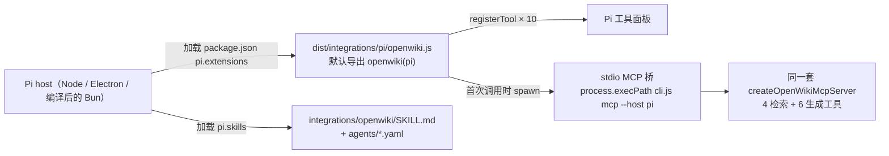

# 04 — Pi 原生包与 MCP 桥 (Native Pi Package)

v0.6.1（`d8ebf56` / #897）之后，`openwiki` 这个 npm 包同时也是一个**原生 Pi 包（native pi package）**：`pi install npm:openwiki` 之后，Pi 会加载包里的 agent 扩展与 skill，agent 直接拿到 4 个检索工具 + 6 个生成工具——既不需要预先全局安装 `openwiki`，也不需要 `openwiki integrations install`。

> **源码是唯一真相源。** 本文行号对应 `ethan` 分支基线 `b7027e3`（v0.9.0），引用前请重读源码核对。

> **30 秒版**：Pi 通过 `package.json` 的 `pi` 字段发现两件东西——`extensions` 里的编译产物 `dist/integrations/pi/openwiki.js` 与 `skills` 里的 `integrations/openwiki`。扩展被加载时注册 10 个工具；每个工具调用都转发给一个**由扩展自己 spawn 的** `openwiki mcp --host pi` 子进程（stdio 桥）。因此工具语义与 MCP 面完全同一套，只是投递方式不同。



## 1. 发布形态：package.json 里的四处声明

包要成为 Pi 包，需要这几件事同时成立（`package.json`）：

| 声明 | 值 | 作用 |
|------|-----|------|
| `keywords`（`:29`） | 含 `pi-package` | Pi 的包发现标记 |
| `pi.extensions`（`:38-41`） | `["./dist/integrations/pi/openwiki.js"]` | 扩展入口（编译产物，不是 `src/`） |
| `pi.skills`（`:42-45`） | `["./integrations/openwiki"]` | 直接把规范 skill 包交给 Pi |
| `files`（`:21-27`） | 含 `dist`、`integrations`、`skills` | 发布包必须真的带上这两类资产 |

两个容易踩的点：

- **`pi.extensions` 指向 `dist/`**：Pi 加载的是构建产物，因此从源码仓库直接 `pi install` 前必须先 `pnpm run build`（`prepack` 已绑定 `build`）。`test/integrations/pi-extension.test.ts` 也是 `import("../../dist/integrations/pi/openwiki.js")`，即测试跑在真实编译产物上。
- **`pi.skills` 复用同一份规范 skill 包**：Pi 装的是 `integrations/openwiki/`，与 `openwiki integrations install` 装给 Codex/Claude 等的是同一棵树。差别在**所有权机制**：Pi 走自己的安装，不写 `.openwiki-install.json` 回执，也不受 01 号的事务/receipt 约束。

安装命令与边界（README「Connect your coding agent」）：

```sh
pi install npm:openwiki              # 用户级
pi install --local npm:openwiki      # 项目级
```

**Pi 不是 `HostTargetId`**：`src/integrations/install/types.ts:4-13` 的 9 个目标里没有 `pi`，`openwiki integrations install pi` 会报「Unknown integration target」。Pi 也不在 registry 里，因此没有 `producerActor` 覆盖——运行时 host 名是字面量 `pi`（§3）。

**Pi ≠ Oh My Pi（omp）**：omp 是一个独立的 coding agent host，属于 9 个 install 目标之一（`registry.ts:108-124`）；Pi 是包管理器/agent 运行时，靠 `pi install` 消费本包。README 专门用一句话区分这两者。

## 2. 扩展入口与 10 个工具

`src/integrations/pi/openwiki.ts` 的默认导出是扩展入口：

```ts
export default function openwiki(pi: PiApi): void   // :225
```

它只依赖 Pi 的两个能力（`PiApi` 类型，`:37-40`）：`registerTool(tool)` 与 `on("session_shutdown", handler)`。入口做两件事：遍历 `OPENWIKI_TOOLS` 逐个注册（`:226-260`），并在 `session_shutdown` 时关桥（`:262`）。

工具表 `OPENWIKI_TOOLS`（`:47-97`）与 MCP 面的 10 个工具一一对应，但**不是从 `tools()` 复制的**：

- 前 4 个来自 `createRetrievalTools()`（`:48-54`），名称/描述/schema 全部复用——检索工具只有一份定义（03 号 §7）。因此 Pi 里同样能用 workspace 检索与跨 wiki read（`workspace`/`wiki` 参数、`workspace_required`），不存在 Pi 专属的检索实现（v0.7.3 的「Pi 获得 search/read/linked-workspace 工具」指的就是这条复用链路）。
- 后 6 个是手写的 Pi 版条目（`:55-96`），描述比 MCP 面短（如 begin 只写 "Start or resume an OpenWiki repository run."）。真正的行为描述仍由 MCP server 在 `initialize` 时通过 INSTRUCTIONS 下发，因此 Pi 侧描述短不损失协议语义。
- `parameters` 用 `z.toJSONSchema(schema, { target: "draft-07" })` 把同一份 zod schema 转成 Pi 需要的 JSON Schema（例如 `:59`、`:66`）——**校验仍发生在 MCP 服务端**，Pi 侧只是把参数透传。
- 所有工具都标 `executionMode: "sequential"`（`:53`、`:60` 等）：OpenWiki 的生命周期本就要求串行（02 号 §4.1），Pi 不应并发调度同一批工具。

调用与结果映射（`:227-258`）：

1. 取/建桥（`bridge()`），拿到 `Client`；
2. `client.callTool({ name, arguments: input }, undefined, signal ? { signal } : undefined)`——把 Pi 的 `AbortSignal` 一路透传；
3. 成功：把 `content` 里的所有 text 项拼成一段文本；没有 text 时退回 `JSON.stringify(structuredContent ?? result)`（`toolResultText`，`:105-117`）；`details` 字段放 `structuredContent ?? result`，供 Pi 的富渲染使用；
4. `isError: true`：**抛出** `new Error(text)`（`:253`）——MCP 的工具级错误在 Pi 侧表现为工具调用失败，错误文案就是 `code: message` 或固定句（02 号 §2.3）；
5. `callTool` 自身抛异常（桥坏了）：先 `discardBridge` 清掉这次失败的桥，再把异常抛给 Pi（`:243-246`）。

## 3. 桥：自 spawn 的 stdio MCP server

`startBridge`（`:150-178`）建立的连接就是「自己启动自己」：

```
process.execPath  <packageRoot>/dist/cli/cli.js  mcp  --host pi     （env: 见 §4 + OPENWIKI_CONFIG_DIR）
        │
        └─ StdioClientTransport（stderr: "inherit"）
              └─ Client({ name: "openwiki-pi", version: OPENWIKI_VERSION })
```

要点：

- **用 `process.execPath` 而不是 `"openwiki"`**：宿主可能是 Electron 或编译后的 Bun 可执行文件；用当前运行时再跑一次包内 CLI，是唯一不依赖 `PATH` 且版本自洽的方式（README：「so `openwiki` need not be on `PATH`」）。
- **`--host pi`**：`runMcpCommand` 查 registry 找不到 `pi`，于是 `producerActor` 退回 host 名（`src/cli/integrations.ts:91-95`），运行元数据里记 `host-agent/pi`。页面的 OKF producer 也会是 `pi`。
- **`OPENWIKI_CONFIG_DIR`**：显式把 `resolveOpenWikiHomeDir()` 的结果传给子进程（`:157`），这样 bridge 与宿主用同一个 OpenWiki home（workspace 注册表、skills 等）；`OPENWIKI_CONFIG_DIR` 本身支持 `~` 展开（`src/config/openwiki-home.ts:8-28`）。
- **单例且可重建**：`bridgePromise` 是模块级单例（`:99`），所有工具共享一个子进程；`transport.onclose` 被包了一层，关闭时把单例清空（`:169-172`），下一次调用自动重连。
- **`session_shutdown` 收尾**：`pi.on("session_shutdown", closeBridge)`（`:262`）→ `closeBridge`（`:206-215`）先清单例再关 client/transport，避免 Pi 退出后遗留子进程。

失败恢复有三条路径，合起来保证「一次桥故障不会永久毒化会话」：

| 触发 | 处理 | 出处 |
|------|------|------|
| `callTool` 抛错 | `discardBridge`：若是当前单例则清空，并关掉坏桥 | `:217-223`、`:243-246` |
| 子进程/传输关闭 | `onclose` 回调清空单例 | `:169-172` |
| 会话结束 | `closeBridge` 关闭并清空 | `:262`、`:206-215` |

`pi-extension-retry.test.ts:60-83` 用假的 MCP SDK 验证了完整链路：首次调用抛 "transport closed" → 第二次自动重建成功 → 触发 `onclose` → 第三次再次重建，最终 `sdk.clients` 恰好 3 个（说明没有泄漏、也没有复用坏桥）。

## 4. 为什么需要环境变量修复

这是全篇最容易踩的坑，值得单独讲。**MCP SDK 给子进程的默认环境是白名单**（`HOME`、`LOGNAME`、`PATH`、`SHELL`、`TERM`、`USER`），会丢掉宿主已有的运行时开关；而 `process.execPath` 在不同宿主里含义不同：

| 宿主 | `process.execPath` | 需要的事 | 不做的后果 |
|------|--------------------|----------|------------|
| 普通 Node | Node 二进制 | 无 | 正常 |
| Electron | Electron 二进制 | `ELECTRON_RUN_AS_NODE=1` | 子进程启动 Electron 应用而不是 CLI，随即退出 |
| 编译后的 Bun（`bun build --compile`） | Pi 自己的可执行文件 | `BUN_BE_BUN=1`（Bun ≥ 1.2.16） | 子进程重跑 Pi 的打包入口而不是 `cli.js` |

`bridgeEnvironment()`（`:140-148`）的判定顺序是刻意的：

1. 宿主已导出 `ELECTRON_RUN_AS_NODE` → 原样转交（白名单会丢，必须重导）；
2. 否则在 Electron 运行时（`process.versions.electron`）→ 注入 `"1"`；
3. 宿主已导出 `BUN_BE_BUN` → 原样转交；
4. 否则在 Bun 运行时（`process.versions.bun`）→ 注入 `"1"`；
5. 都不是 → 返回 `undefined`，保持 SDK 默认环境。

失败表现为典型的 `MCP error -32000: Connection closed`：子进程没跑成 server 就退出了。`pi-extension-bridge-env.test.ts:115-183` 逐个断言了五种情形下的最终 env（Electron 未设/已导出、Bun 未设/已导出、纯 Node；含 `OPENWIKI_CONFIG_DIR`），其中 Bun 那条注明了是在真实 `bun build --compile` 产物（Bun 1.4.3）上验证的行为。

## 5. 与安装面/协议面的边界

| 维度 | `openwiki integrations install`（01 号） | Pi 原生包（本篇） |
|------|------------------------------------------|-------------------|
| 触发 | 用户显式执行 CLI | `pi install` + Pi 启动时加载扩展 |
| 装了什么 | skill 包 + host MCP config 条目 | 整个 npm 包：扩展 + skill 包 |
| 所有权 | `.openwiki-install.json` 回执 + 事务/回滚 | 无回执，所有权归 Pi 的包管理 |
| 进程 | host 按 config 拉起 `openwiki mcp --host <target>` | 扩展自己 spawn `cli.js mcp --host pi` |
| 工具面 | 10 个（4 检索 + 6 生成） | 同样 10 个，检索工具定义复用 |
| 身份 | registry 的 `producerActor` | 字面量 `pi` |

因此排查时先分清层：Pi 里工具没出现 → 看 `pi.extensions`/构建产物；出现了但一调就 `-32000` → 看 §4 的环境变量；工具返回 `invalid_state`/`conflict` → 是协议层问题，回到 02/03 号。

## 6. 排错抓手

| 现象 | 根因 | 处置 |
|------|------|------|
| Pi 里完全没有 OpenWiki 工具 | 包未安装，或 `dist/integrations/pi/openwiki.js` 不存在（源码仓库没 build） | `pi install npm:openwiki`；本地开发先 `pnpm run build` |
| 一调用就 `MCP error -32000: Connection closed` | 子进程没跑成 CLI（Electron/Bun 开关缺失、或 `dist/cli/cli.js` 缺失） | 升级到含 §4 修复的版本；确认构建产物存在 |
| 首次调用失败，第二次成功 | 桥在首次 spawn/握手失败后未重建（旧版本缺陷） | 现版本由 `discardBridge` + `onclose` 兜住；仍复现则看 `pi-extension-retry` 的覆盖路径 |
| 工具报 `invalid_input`/`invalid_state` | 协议层拒绝，与桥无关 | 按 02 号 §4.5、03 号 §6 处置 |
| 页面 producer 显示 `pi` 而非某个 registry 目标 | 这是预期：`pi` 不在 registry，producerActor 缺省等于 host | 若需要别的身份，只能改 registry/CLI 侧，不在 Pi 包内 |

## 7. 测试佐证

- `pi-extension.test.ts:72`——「native Pi package extension」：工具名集合与 MCP 面完全一致（含 4 个检索工具）、`executionMode` 为 sequential、schema 转换可用、`session_shutdown` 关桥；
- `pi-extension-retry.test.ts:60`——桥故障后的重建与不泄漏（3 个 client 的断言）；
- `pi-extension-bridge-env.test.ts:115`——Electron/Bun/纯 Node 五种情形下的 spawn 参数与 env（`:116-183`）；
- `test/integrations/package-contents.test.ts:33`——发布包必须带上 `dist` 与 `integrations`（否则 Pi 包缺扩展或缺 skill）。

## Source Anchor

| 源文件 | 关键符号 | 说明 |
|--------|---------|------|
| `package.json:21-27` | `files` | 发布包必须含 `dist`、`integrations`、`skills` |
| `package.json:29` | `keywords: "pi-package"` | Pi 包发现标记 |
| `package.json:38-45` | `pi.extensions` / `pi.skills` | 扩展入口与规范 skill 包 |
| `src/integrations/pi/openwiki.ts:47-97` | `OPENWIKI_TOOLS` | 10 个 Pi 工具定义（检索组复用 `createRetrievalTools`） |
| `src/integrations/pi/openwiki.ts:99` | `bridgePromise` | 模块级单例桥 |
| `src/integrations/pi/openwiki.ts:105-117` | `toolResultText` | 文本/结构化结果的回退拼接 |
| `src/integrations/pi/openwiki.ts:140-148` | `bridgeEnvironment` | Electron/Bun 运行时开关注入 |
| `src/integrations/pi/openwiki.ts:150-178` | `startBridge` | `process.execPath` + `cli.js mcp --host pi` + `OPENWIKI_CONFIG_DIR` |
| `src/integrations/pi/openwiki.ts:180-192` | `bridge` | 懒加载/失败即清空的单例 |
| `src/integrations/pi/openwiki.ts:194-223` | `closeBridgeResources` / `closeBridge` / `discardBridge` | 三条关闭路径 |
| `src/integrations/pi/openwiki.ts:225-262` | `openwiki`（默认导出） | 注册工具、转发调用、挂 `session_shutdown` |
| `src/integrations/install/types.ts:4-13` | `HostTargetId` | 9 个目标，不含 `pi` |
| `src/integrations/install/registry.ts:108-124` | `omp` 条目 | Oh My Pi 与 Pi 的区分点 |
| `src/cli/integrations.ts:88-95` | `runMcpCommand` | registry 缺省 → producerActor = host 名 |
| `src/config/openwiki-home.ts:8-28` | `resolveOpenWikiHomeDir` | `OPENWIKI_CONFIG_DIR` 与 `~` 展开 |
| `integrations/openwiki/SKILL.md:1-4` | front matter | `pi.skills` 加载的同一份契约 |
| `test/integrations/pi-extension.test.ts:72` | — | 工具注册与 schema 契约 |
| `test/integrations/pi-extension-retry.test.ts:60-83` | — | 桥重建与 client 计数 |
| `test/integrations/pi-extension-bridge-env.test.ts:115-183` | — | 运行时环境注入矩阵 |
