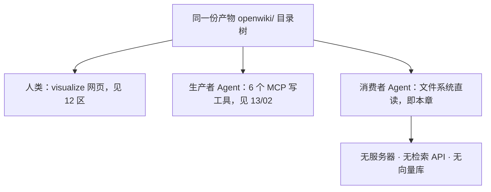
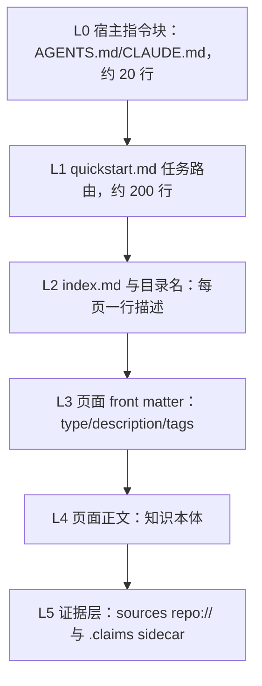

# 01 — Agent 怎么读这份 Wiki (How Agents Read the Wiki)

> 一句话结论：**消费者 Agent 用的是文件系统，不是网页，也不是检索服务**。宿主指令文件里的一小块引导文本让它知道 wiki 存在；`openwiki/quickstart.md` 的任务路由表把它送往正确的页；每页的 OKF front matter 提供「检索导向摘要」让它低成本判断相关性；每条论断都能沿 `repo://` 证据链回溯到源码行区间。网页可视化（12 区）是给人类的平行界面，消费者 Agent 完全不经过它。

产物自己声明了这个设计意图——`openwiki/quickstart.md:44-45`：

> "It is built for agents to read as **memory** and ships an interactive visualizer for **humans** to explore."

## 1. 三个读者，三种界面

先分清谁在读。同一份产物（`openwiki/` 目录树）面对三类读者，界面完全不同：

| 读者 | 界面 | 进入方式 |
|------|------|---------|
| 人类 | 可视化器（12 区）：live server / 静态导出网页 | `openwiki visualize` |
| 生产者 Agent（写 wiki） | 6 个 MCP 生命周期工具 + SKILL.md 写作协议 | `integrations/openwiki/SKILL.md`（160 行）+ `src/integrations/core/protocol.ts:14-24` |
| 消费者 Agent（读 wiki） | **裸文件树 + 宿主原生文件工具（Read/Grep/Glob）** | 宿主指令文件（AGENTS.md/CLAUDE.md）里的引导块 |



为什么消费者走文件系统？因为 coding agent 的「原生感官」就是文件工具：读文件、grep、glob 全是已具备的能力，零额外集成成本。OpenWiki 因此把全部接口预算花在**把文件组织得可被这些感官高效消费**上，而不是再造一个检索服务。

## 2. 消费者眼里的物理形态

消费者 Agent 看到的 `openwiki/` 长这样（以本仓库自生成产物为活实例）：

```text
openwiki/
├── index.md            # 确定性索引（deterministic index）：# Files + # Directories，管线生成、只读
├── quickstart.md       # 任务路由页：第一站（front matter type: orientation-guide）
├── INSTRUCTIONS.md     # wiki brief（生产侧输入，8 行；消费者一般不需要）
├── architecture/       # 按主题分组的目录（不是源码目录镜像）
├── concepts/
├── workflows/
├── operations/
├── integrations/
├── testing/
└── .claims/            # 证据 sidecar：每页一个 JSON（schemaVersion / pageVersion / claims[]）
    └── workflows/claims-reconciliation.json
```

两个关键点：

- **谁写的**：页面正文由生产者 Agent 写；`index.md` 由 finalize 管线的索引同步（index sync）确定性重生成——`src/okf/index-sync.ts:15` 把 `INDEX_FILE` 固定为 `index.md`，且写作契约明确禁止 agent 规划生成 index 页（`integrations/openwiki/SKILL.md:81`）；`.claims/` 由 claims 运行时持久化（07 区）。消费者对全部内容只读。
- **可 grep 性**：一切皆 UTF-8 Markdown/JSON，没有数据库、没有二进制格式。`grep -r "<术语>" openwiki/` 就是它的全文检索。

## 3. 渐进披露漏斗：六层

渐进披露（progressive disclosure）在这份产物里不是抽象原则，而是字面意义上的六层漏斗：Agent 从几十个 token 的引导块进入，每层只暴露下一层需要的元数据，直到全文与证据。



### L0 宿主指令块 —「这里有一份 wiki」

引导块由 code 模式 init 写入宿主指令文件（agent instruction files）：`CODE_MODE_AGENT_FILES = ["AGENTS.md", "CLAUDE.md"]`（`src/ingestion/code-mode.ts:48`），CLAUDE.md 只挂一行 `@AGENTS.md` 导入（`src/ingestion/code-mode.ts:50`）。刷新只替换 `<!-- OPENWIKI:START/END -->` 标记对之间的内容；标记缺失、重复或错位时拒绝写入而不是破坏文件（`src/ingestion/code-mode.ts:241-273`）。

块内文字极其克制——当前模板只有三句话（`src/ingestion/code-mode.ts:623-646`），第一句甚至是「**可选**的即时上下文，**不是**必读启动材料」（"optional just-in-time context, not required startup reading"）。这是渐进披露的第一刀：**先声明存在与位置，不强迫阅读**。本仓库 `AGENTS.md:13-24` 是该块的活实例（`AGENTS.md:1-11` 的 quickstart 指路段出自更早版本模板，文字与当前基线略有出入）。

### L1 quickstart 任务路由 —「你的任务该读哪页」

`openwiki/quickstart.md` 是唯一被计划（plan）强制要求的页面：init 必含；update 只要不增删/移动/重组页面就绝不能删，且页面结构一旦变化必须重刷它的路由图（`integrations/openwiki/SKILL.md:84-87`）。它自称「entry-point orientation for a coding agent」（front matter description，`openwiki/quickstart.md:3-7`），正文第 112 行起是任务路由（task routing）表：「Find your task on the left, then read the page on the right」——按「理解系统 / 学核心概念 / 走工作流 / 运维配置 / 集成 / 测试」六组意图各给一张「我想要…→ 读哪页」表（`openwiki/quickstart.md:112-163`）。

这一层解决的是检索里最贵的决策：「我预算有限，先打开哪个文件」。

### L2 index.md + 目录名 —「全集清单，每页一行」

`index.md` 结构是 `# Files`（每页一行带描述的链接）+ `# Directories`（`openwiki/index.md:7-16`），由 finalize 的索引同步在每轮收尾时对齐磁盘现状。目录名本身也是导航信号：architecture/concepts/workflows/operations/integrations/testing。

### L3 页面 front matter —「这页值不值得读」

每页头部是机器可读摘要（页面文件契约，`integrations/openwiki/SKILL.md:144-156`）：

```yaml
type: orientation-guide       # 短概念类型
title: OpenWiki Quickstart    # 运行语言的人类标题
description: Entry-point orientation for a coding agent...   # ← 检索导向摘要
tags: [openwiki, quickstart, cli, orientation, task-routing] # 稳定英文标签
```

`description` 的契约原文是「一到两句**检索导向摘要**（retrieval-oriented summary）」（`integrations/openwiki/SKILL.md:148`）——写的就是给消费者浏览/grep 时判断相关性用的。`generated`、`verified`、`sources` 等控制字段由 OpenWiki 拥有，agent 不得伪造（`integrations/openwiki/SKILL.md:153-154`）。

### L4 页面正文 — 知识本体

到这里才读全文。页内 wiki 链接（`](xxx.md)` 形式）与计划阶段的 relatedPages 契约（要求为每页声明概念/工作流邻居，`integrations/openwiki/SKILL.md:82-83`）把相邻知识缝起来，Agent 可以横向跳转而不必回 index。

### L5 证据层 —「这句话凭什么可信」

见 §5。每页 front matter 的 `sources` 列出 `repo://` 证据资源；`.claims/<page>.json` sidecar 存每条证据命题（claim）的陈述与带版本 token 的行区间证据。

## 4. 知识组织的三个 consumer-first 原则

1. **按系统组织，不按目录镜像**。规划契约要求「围绕有意义的系统与工作流设计仓库专属分类法（taxonomy），而不是镜像源码目录」，并「用层级路径做有意义的分组，不要 flat 堆砌」（`integrations/openwiki/SKILL.md:77-81`）。
2. **每页自带检索摘要**。description 契约（L3）把「判断相关性」的成本压到一两句话；tags 用稳定英文词，保证 grep 命中。
3. **导航双向编织**。relatedPages 在规划期声明、页间 wiki 链接在正文互联、index.md 在 finalize 全量收口——三个入口指向同一批页面，不产生孤岛页。

## 5. 不只是「能读」，还要「敢信」：证据与新鲜度

消费者视角最独特的部分：wiki 的每条实质论断都可回溯到源码行区间，且新鲜度是显式状态而非默认信任。

front matter 尾部（OpenWiki 生成，实例 `openwiki/quickstart.md:6-37`）：

```yaml
sources:
  - id: openwiki-source-8037e2358a2c4f9b2c722a11
    resource: repo://AGENTS.md
generated: { by: "openwiki/0.5.0", at: "2026-09-09T08:09:59.193Z" }
verified:
  - by: openwiki/0.5.1
    at: 2026-09-10T08:09:53.024Z
```

每页的证据 sidecar（实例 `openwiki/.claims/workflows/claims-reconciliation.json:1-10`）：

```json
{
  "schemaVersion": 1,
  "pageVersion": "sha256:afa8a5ededac9e0c3cc93e925b082c0a55b3242f94ac9ec113b817622eb3b4d5",
  "claims": [
    {
      "id": "claim_b4fc5fda11a9482d91f562eef48a86f6",
      "statement": "…一条可独立证伪的系统事实…",
      "evidence": [
        {
          "resource": "repo://src/claims/brains/code/store.ts#L38-L57",
          "version": "repo-lines-v1:sha256:2db17ac7…:eyJzZWxlY3RlZExpbmVDb3VudCI6MjAs…"
        }
      ]
    }
  ]
}
```

对消费者的语义：

- 证据定位是 `repo://路径#L起-L止` 加内容哈希版本 token；preflight 重检时源码对不上就标记 stale/unresolved（`src/claims/brains/code/preflight.ts:83-97`）——「页面说的话」与「源码现状」的偏差被**显式化**，消费者 Agent 遇到可疑论断可以查 sidecar 状态而不是盲信。
- `verified` 块给出最近一次全页校验的时间与校验者版本，是新鲜度的一级信号。
- 机制与校验管线的完整描述在 07 区：模型见 `07-claims-and-okf/01-claims-model.md`，版本/歧义语义见 `07-claims-and-okf/02-evidence-versions-and-preflight.md`。

## 6. 读侧为什么「没有 API」——一个刻意的取舍

本基线的 6 个 MCP 工具（`src/integrations/core/protocol.ts:14-24`：begin / submit_plan / next_page / inspect_page_claims / submit_page / finish）**全部是生产协议**。没有 read-page、没有 search、没有 retrieval 工具；上游存在 `codex/openwiki-retrieval-tools` 探索分支但未合入本基线。

| 若做成服务/检索工具 | 文件系统直读（现状） |
|------|------|
| 需要进程、端口、生命周期管理 | 零集成：宿主已有 Read/Grep/Glob |
| 结果依赖服务状态、非逐字节确定 | 同一 commit 下完全确定 |
| 与 git 版本化脱节 | 与代码同库、同 commit、同评审 |
| 只服务 Agent | 同一份文件人类也能直接读（双读者） |

代价也要诚实记录：(1) 没有语义检索，「找哪页」完全靠任务路由表 + 关键词 grep，超大 wiki 上会先撞 L1/L3 摘要质量的瓶颈；(2) `.claims` 证据层对消费者是「可查但非必查」——信任机制是增强而非强制门。两者都是当前版本的有意取舍，上游 retrieval 分支是后续演进方向的信号。具体到「实际用起来有哪几种打法」，见 `02-agent-usage-patterns.md`（四种阅读策略 + graph.json 全图复用 + 不存在清单）。

## 7. 两个场景走查

**场景 A：新会话，修一个 bug。**

1. 宿主加载 AGENTS.md → 引导块说「有份 wiki，入口 quickstart」（约百 token 量级）。
2. 打开 `openwiki/quickstart.md` → Task-routing map「Understand the system」行 → `architecture/overview.md`。
3. 读概览；front matter description 确认相关后，沿 relatedPages 跳到对应 workflows 页。
4. 机制页正文给出入口与文件路径 → 直接改源码。

全程没有启动任何服务；进入正文前只花了两个文件的阅读量。

**场景 B：质疑 wiki 里的一句话。**

1. 在某页正文看到论断 X。
2. 查该页 front matter：`verified.at`（新鲜度）与 `sources`（证据资源）。
3. 需要更强证据 → 打开 `openwiki/.claims/<page>.json`，找到对应 statement 的 `evidence.resource`（`repo://...#L38-L57`）。
4. 用文件工具读源码那几行，并核对 version token 是否已 stale；可疑则以源码为准，并可在反馈里引用 claim id。

## 8. 与其他区的边界

| 主题 | 归属 |
|------|------|
| 生成侧生命周期协议（6 工具、SKILL.md 写作契约） | `13-integrations/02-mcp-lifecycle-protocol-and-skills.md`、`05-generation-lifecycle/` |
| OKF front matter 校验/投影管线 | `07-claims-and-okf/03-okf-frontmatter-and-projections.md` |
| index 同步管线实现（本章只讲「读到的形态」） | `05-generation-lifecycle/03-finalize-pipeline.md` |
| 可视化器（人类界面） | `12-visualizer/` |
| wiki 产物作为消费接口的读取协议 | 本章 |

## Source Anchor

| 源文件 | 关键符号/内容 | 说明 |
|--------|--------------|------|
| `src/ingestion/code-mode.ts:22-23` | `OPENWIKI_AGENTS_SNIPPET_START/END` | AGENTS.md 管理块标记 |
| `src/ingestion/code-mode.ts:48-50` | `CODE_MODE_AGENT_FILES`、`CLAUDE_AGENTS_IMPORT` | 引导块落点；CLAUDE.md 只挂 `@AGENTS.md` |
| `src/ingestion/code-mode.ts:241-273` | 管理块刷新守卫 | 标记缺失/重复即拒绝写入 |
| `src/ingestion/code-mode.ts:623-646` | `createCodeModeAgentsSnippet` | 「optional just-in-time context」最小模板 |
| `src/integrations/core/protocol.ts:14-24` | `ProtocolToolName` | 6 个工具全为生产协议，无读/检索工具 |
| `src/okf/index-sync.ts:15` | `INDEX_FILE` | index.md 由管线确定性生成 |
| `src/claims/brains/code/preflight.ts:83-97` | stale/unresolved 分类 | 证据新鲜度显式化 |
| `integrations/openwiki/SKILL.md:77-83` | taxonomy / relatedPages 契约 | 系统化分组 + 跨页导航 |
| `integrations/openwiki/SKILL.md:84-87` | quickstart 强制规则 | init 必含；update 结构变化必含 |
| `integrations/openwiki/SKILL.md:144-156` | 页面文件契约 | description = 检索导向摘要；控制字段 OpenWiki 拥有 |
| `openwiki/quickstart.md:3-7` | orientation-guide front matter | 活实例 |
| `openwiki/quickstart.md:44-45` | "agents to read as memory" | 产物设计自述 |
| `openwiki/quickstart.md:112-163` | Task-routing map | 任务路由表 |
| `openwiki/index.md:7-16` | `# Files` / `# Directories` | 确定性索引形态 |
| `openwiki/.claims/workflows/claims-reconciliation.json:1-10` | sidecar 结构 | schemaVersion/pageVersion/claims/evidence |
| `AGENTS.md:13-24` | 管理块活实例 | 本仓库自产物 |
