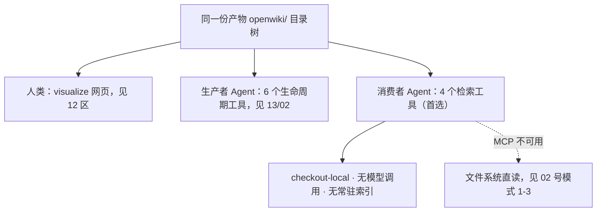
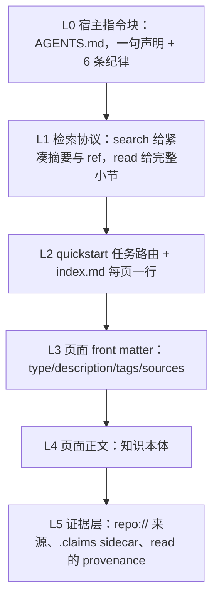

# 01 — Agent 怎么读这份 Wiki (How Agents Read the Wiki)

> 一句话结论：**消费者 Agent 的第一入口是检索协议（retrieval protocol）——`openwiki_search` 缩小范围、`openwiki_read` 精读小节；文件系统直读（quickstart 路由 + index + grep）是第二入口，也是 MCP 不可用时的兜底。** 宿主指令块告诉 Agent「有份 wiki，但不要预加载」；检索只返回命中小节的紧凑摘要与 `openwiki/<page>.md#<anchor>` 引用；`openwiki_read` 按锚点返回完整小节，并可选带回页面记录在案的来源与 Claim 证据版本。网页可视化（12 区）是给人类的平行界面，消费者 Agent 不经过它。

## 1. 三个读者，四种界面

同一份产物（`openwiki/` 目录树）面对三类读者，界面不同；消费者 Agent 有两个入口，**检索优先、文件系统兜底**：

| 读者 | 界面 | 进入方式 |
|------|------|---------|
| 人类 | 可视化器（12 区）：live server / 静态导出网页 | `openwiki visualize` |
| 生产者 Agent（写 wiki） | 6 个生命周期 MCP 工具 + SKILL.md 写作协议 | `integrations/openwiki/SKILL.md`（212 行）+ `src/integrations/core/protocol.ts:14-24` |
| 消费者 Agent（首选） | **4 个检索 MCP 工具**：`openwiki_search` / `openwiki_read` / `openwiki_list_workspaces` / `openwiki_list_wikis` | `src/integrations/core/retrieval-tools.ts:128-199` |
| 消费者 Agent（兜底） | 裸文件树 + 宿主原生文件工具（Read/Grep/Glob） | `openwiki/quickstart.md` + `openwiki/index.md` |



落地形态值得先记住：4 个检索工具与 6 个生命周期工具装在**同一个 stdio MCP server** 里。`ProtocolToolName` 联合类型列全 10 个名字（`src/integrations/core/protocol.ts:14-24`），`HostSessionManager.tools()` 按「4 检索 + 6 生命周期」的顺序返回（`src/integrations/core/session-manager.ts:225-272`），MCP server 逐个注册（`src/integrations/mcp/server.ts:76-94`）。所以宿主只要接上 `openwiki mcp`，检索能力就随生成能力一起在位，不需要额外安装或授权。pi 原生包走另一条投递路径：扩展把同样 10 个工具注册给 pi，执行时统一转发给子进程里的同一个 MCP server（`src/integrations/pi/openwiki.ts:47-97`、`:225-263`）。

为什么检索是首选：消费者要回答的是「这个行为在哪、为什么」，不是「wiki 里有什么」。一次检索默认只回 5 条紧凑摘要（`src/retrieval/wiki.ts:512`），精读时再按锚点取单个小节——上下文成本按「命中的小节」计，而不是按「页」计。文件系统直读仍然不可替代：检索不产出 index 全清单与 graph 结构图、MCP 不可用的环境、以及需要逐字节引用原文时都靠它。

## 2. 消费者眼里的物理形态

```text
openwiki/
├── index.md              # 确定性索引：一行一页，管线生成、只读
├── quickstart.md         # 任务路由页（front matter type: orientation-guide）
├── INSTRUCTIONS.md       # wiki brief（生产侧输入，8 行；消费侧一般不需要）
├── .claims/              # 证据 sidecar：每页一个 JSON（schemaVersion / pageVersion / claims[]）
│   └── workflows/claims-reconciliation.json
├── .page-manifest.json   # 页面清单与源检查点（管线状态；消费侧一般不需要）
├── .last-update.json     # 最近一次 update 的元数据（工作区链接据此判定「这是有 wiki 的仓库」）
├── architecture/         # 按主题分组的目录（不是源码目录镜像）
├── concepts/
├── workflows/
├── operations/
├── integrations/
└── testing/
```

四个关键点：

- **谁写的**：页面正文由生产者 Agent 写；`index.md` 由 finalize 管线的索引同步（index sync）确定性重生成——`src/okf/index-sync.ts:15` 把 `INDEX_FILE` 固定为 `index.md`，`:17` 把 index / log / INSTRUCTIONS 从条目里排除；写作契约明确禁止 agent 规划生成 index 页（`integrations/openwiki/SKILL.md:81`）；`.claims/` 由 claims 运行时持久化（07 区）；`.page-manifest.json` / `.last-update.json` 是管线状态（`src/config/constants.ts:2-3`），`openwiki link` 用后者判定仓库「已有 wiki」（`src/linking/wiki-workspaces.ts:1444-1446`）。消费者对全部内容只读。
- **检索看得见哪些页**：`openwiki_search` 只遍历 `ClaimsStore.discoverPages()` 找出的生成页（排除 `index.md` / `log.md` / `instructions.md` 与 `.claims/`），再跳过路径含隐藏段（如 `.private.md`）与 front matter `status: deprecated` 的页面（`src/retrieval/wiki.ts:559-566`、`:823`、`:1138-1140`）。
- **可 grep 性**：一切皆 UTF-8 Markdown/JSON，没有数据库、没有二进制格式。`grep -r "<术语>" openwiki/` 仍是最低成本的全文检索。
- **工作区形态不变**：多个仓库 wiki 用 `openwiki link` 连成命名工作区后，每个仓库的产物仍是各自独立的一棵树；「互读」发生在检索层，不在磁盘上（见 03 号与 03-cli-and-tui/04）。

## 3. 渐进披露漏斗：六层

渐进披露（progressive disclosure）在这份产物里不是抽象原则，而是字面意义上的六层漏斗：Agent 从十几行的引导块进入，每层只暴露下一层需要的元数据，直到全文与证据。



### L0 宿主指令块 —「这里有一份 wiki，但别预加载」

引导块由 code 模式 init 写入宿主指令文件（agent instruction files）：`CODE_MODE_AGENT_FILES = ["AGENTS.md", "CLAUDE.md"]`（`src/ingestion/code-mode.ts:48`）。AGENTS.md 承载完整块；CLAUDE.md **不存在时不会被创建**，存在时只维护一行 `@AGENTS.md` 导入（`src/ingestion/code-mode.ts:251-273`、模板 `:663-670`；导入常量在 `:49`）。刷新只替换 `<!-- OPENWIKI:START/END -->` 标记对之间的内容；标记缺失、重复或错位时拒绝写入而不是破坏文件，写入前还会先剥掉 0.0.x 时代无标记的旧 section（`src/ingestion/code-mode.ts:280-332`）。

当前模板（`src/ingestion/code-mode.ts:633-649`）已不是「三句话」，而是**一句定位 + 6 条纪律**，前四条就是检索协议本身：

1. 首句仍是「**可选**的即时上下文，**不是**必读启动材料」（"optional just-in-time context, not required startup reading"）——渐进披露的第一刀：先声明存在与位置，不强迫阅读。
2. 第一条纪律反向约束：**不要在任务开始时枚举/预加载/搜索 wiki**，只在「用户要求、陌生架构或依赖行为实质影响任务、源码排查后仍有重要不确定」时检索，拿到 grounding 就停。
3. 第二条给出调用方式与工作区歧义的处置（`workspace_required` 时问用户再带 `workspace` 重试）。
4. 第三条指向 `openwiki_list_workspaces` / `openwiki_list_wikis`；第四条给出兜底：「检索工具不可用时，读 `openwiki/quickstart.md` 并顺着链接走」。

本仓库 `AGENTS.md:1-16` 就是该模板的活实例；`CLAUDE.md:1-7` 是只有 `@AGENTS.md` 的导入形态。

### L1 检索协议 —「哪一小节最相关」

这是 v0.6.0 起新增的一层，也是现在默认的「第一站」。两个工具形成固定句式：

1. `openwiki_search({ root, query, paths?, limit?, workspace? })`：返回排名后的紧凑结果，每条 `{ kind: "section", ref: ["openwiki/…/page.md#anchor"], content, wiki? }`；`content` 是「标题 + `Section: <标题>` + description + ≤600 字符摘录」，不含完整小节（`src/retrieval/wiki.ts:682-696`）。
2. `openwiki_read({ root, page, sections, wiki?, includeProvenance? })`：把 `ref` 按 `#` 拆成 page 与 anchor，取回完整小节（标题连同子节），按请求顺序返回（`src/retrieval/wiki.ts:706-763`）。

这一层解决的正是检索里最贵的决策：「我预算有限，先读哪一段」。它把候选从「页」缩到「小节」，并且**不需要模型、不启动 generation run、不写盘**。参数、返回形状、边界值与工作区选择规则见 `03-search-and-read-protocol.md`；工具在 MCP 注册面上的位置见 `08-connectors-and-data-sources/11-mcp-subsystem.md` §11。

### L2 quickstart 任务路由 + index.md —「全集清单」

`openwiki/quickstart.md` 是唯一被计划（plan）强制要求的页面：init 必含；update 只要不增删/移动/重组页面就绝不能删，且页面结构一旦变化必须重刷它的路由图（`integrations/openwiki/SKILL.md:84-87`）。它自称「entry-point orientation for a coding agent」（front matter description，`openwiki/quickstart.md:4`），正文 `## Task-routing map` 从第 157 行起：「Find your task on the left, then read the page on the right」，按「理解系统 / 学核心概念 / 走工作流 / 运维配置 / 集成 / 测试」六组意图各给一张「我想要…→ 读哪页」表（`openwiki/quickstart.md:157-211`）。检索不可用时，这一层就是主入口。

`index.md` 结构是 `# Files`（每页一行带描述的链接）+ `# Directories`（`openwiki/index.md:5-16`），由 finalize 的索引同步在每轮收尾时对齐磁盘现状。目录名本身也是导航信号：architecture/concepts/workflows/operations/integrations/testing。

### L3 页面 front matter —「这页值不值得读」

每页头部是机器可读摘要（页面文件契约，`integrations/openwiki/SKILL.md:144-156`）：

```yaml
type: orientation-guide       # 短概念类型
title: OpenWiki Quickstart    # 运行语言的人类标题
description: Entry-point orientation for a coding agent...   # ← 检索导向摘要
tags: [openwiki, quickstart, cli, orientation, task-routing] # 稳定英文标签
```

`description` 的契约原文是「一到两句**检索导向摘要**（retrieval-oriented summary）」（`integrations/openwiki/SKILL.md:148`）。检索层也确实消费这些元数据：页面的可检索标识是「相对路径 + tags + `repo://` 来源路径」，写入 FTS 的 `identifiers` 列（`src/retrieval/wiki.ts:856`），标题/描述与标识各自按 camelCase、路径分隔符切词后再入索引（`src/retrieval/wiki.ts:1059-1064`）。`generated`、`verified`、`sources` 等控制字段由 OpenWiki 拥有，agent 不得伪造（`integrations/openwiki/SKILL.md:153-154`）。

### L4 页面正文 — 知识本体

到这里才读全文。页内 wiki 链接（`](xxx.md)` 形式）与计划阶段的 relatedPages 契约（要求为每页声明概念/工作流邻居，`integrations/openwiki/SKILL.md:82-83`）把相邻知识缝起来，Agent 可以横向跳转而不必回 index。

### L5 证据层 —「这句话凭什么可信」

见 §5。每页 front matter 的 `sources` 列出 `repo://` 证据资源；`.claims/<page>.json` sidecar 存每条证据命题（claim）的陈述与带版本 token 的行区间证据；`openwiki_read` 加 `includeProvenance: true` 时，这两者会随小节一起返回（`src/retrieval/wiki.ts:778-795`）。

## 4. 知识组织的三个 consumer-first 原则

1. **按系统组织，不按目录镜像**。规划契约要求「围绕有意义的系统与工作流设计仓库专属分类法（taxonomy），而不是镜像源码目录」，并「用层级路径做有意义的分组，不要 flat 堆砌」（`integrations/openwiki/SKILL.md:77-81`）。
2. **每页自带检索摘要**。description 契约（L3）把「判断相关性」的成本压到一两句话；tags 用稳定英文词，保证 grep 与检索标识都能命中。
3. **导航双向编织**。relatedPages 在规划期声明、页间 wiki 链接在正文互联、index.md 在 finalize 全量收口——三个入口指向同一批页面，不产生孤岛页；检索层则以「小节 ref」作为第四个入口指向同一批正文。

## 5. 不只是「能读」，还要「敢信」：证据与新鲜度

消费者视角最独特的部分：wiki 的每条实质论断都可回溯到源码行区间，且新鲜度是显式状态而非默认信任。

front matter 尾部（OpenWiki 生成，实例 `openwiki/quickstart.md:6-46`，18 条 `repo://` 来源）：

```yaml
generated: { by: "openwiki/0.8.0", at: "2026-11-05T08:06:42.707Z" }
verified:
  - by: openwiki/0.8.0
    at: 2026-11-05T08:06:42.707Z
```

每页的证据 sidecar（实例 `openwiki/.claims/workflows/claims-reconciliation.json:1-11`，`pageVersion`/`statement`/`version` 均已截断）：

```json
{
  "schemaVersion": 1,
  "pageVersion": "sha256:aeb71268…",
  "claims": [
    {
      "id": "claim_b4fc5fda11a9482d91f562eef48a86f6",
      "statement": "…一条可独立证伪的系统事实…",
      "evidence": [
        {
          "resource": "repo://src/claims/brains/code/store.ts#L38-L57",
          "version": "repo-lines-v1:sha256:2db17ac7…"
        }
      ]
    }
  ]
}
```

对消费者的语义：

- 证据定位是 `repo://路径#L起-L止` 加内容哈希版本 token；preflight 重检时源码对不上就标记 unresolved/stale（`src/claims/brains/code/preflight.ts:83-96`）——「页面说的话」与「源码现状」的偏差被**显式化**，消费者 Agent 遇到可疑论断可以查 sidecar 状态而不是盲信。
- `verified` 是**校验事件列表**，不是单一时间戳：投影器保留人类与其他生产者写入的事件，只维护 `openwiki/<version>` 这一族事件（`src/okf/claims-verification.ts:27-58`）。读到多个 `by` 时按事件逐条理解。
- `openwiki_read` 的 `includeProvenance: true` 把「记录在案的来源 + 每条 Claim 的证据资源与版本」直接带回，省掉一次读 sidecar 的往返；但工具描述与实现都明确：**它只定位 provenance，不宣称证据仍然新鲜或已被验证**（`src/integrations/core/retrieval-tools.ts:114-119`、`src/retrieval/wiki.ts:765-777`）。
- 机制与校验管线的完整描述在 07 区：模型见 `07-claims-and-okf/01-claims-model.md`，版本/歧义语义见 `07-claims-and-okf/02-evidence-versions-and-preflight.md`。

## 6. 有检索，但为什么仍不是「检索服务」

v0.6.0 之后读侧确实有了 API，但它的形态是**同在 MCP server 里的只读工具**，不是独立服务：

| 若做成常驻检索服务 | 检索工具（现状） |
|------|------|
| 需要进程、端口、生命周期管理 | 随 `openwiki mcp` 一起在位；一次调用内完成 |
| 索引需要持久化与增量更新 | 每次调用在内存里现建 FTS5 表（`src/retrieval/wiki.ts:606-673`），调用结束即 `close()`，不会与 Markdown 不一致 |
| 结果依赖服务状态、可能过期 | 直接读 checkout 里的 Markdown；同一 commit 下结果可复现 |
| 与 git 版本化脱节 | 与代码同库、同 commit、同评审 |
| 只服务 Agent | 同一批 Markdown 人类也能直接读（双读者） |

代价也要诚实记录：

1. **只有词法检索，没有语义检索**。排名是 SQLite FTS5 的 BM25（title 8 / description 4 / heading 6 / prose 1 / identifiers 3，`src/retrieval/wiki.ts:637`），再加来源路径加权与词项覆盖率（`:652-661`）；同义词、跨语言改写、模糊意图都靠命中的字面词。
2. **每次检索都是全 wiki 线性重建**。索引不持久化，`searchWiki` 会读遍所有可检索页面的 Markdown（`:558-566`），超大 wiki 上单次检索的 I/O 成本随页数增长。
3. **检索不参与信任判断**。它只读页面 Markdown，不读 `.claims`；「这页是否 stale」仍要消费者自己看 provenance/preflight（§5）。

具体到「实际用起来有哪几种打法」，见 `02-agent-usage-patterns.md`（五种阅读策略 + 不存在清单 + 选型表）。

## 7. 两个场景走查

**场景 A：新会话，修一个 bug。**

1. 宿主加载 AGENTS.md → 引导块说「有份 wiki，别预加载；需要时先 search」。
2. 判断问题涉及陌生模块 → `openwiki_search({ root, query: "retry budget circuit breaker" })` → 5 条紧凑结果，第一条 `ref: ["openwiki/architecture/payments.md#retry-control"]`。
3. `openwiki_read({ root, page: "openwiki/architecture/payments.md", sections: ["retry-control"] })` → 该小节的完整 Markdown；顺带 `includeProvenance: true` 拿到源码路径。
4. 机制页正文给出入口与文件路径 → 直接改源码。若检索发生在工作区里，每条结果都带 `wiki`；读别的仓库时把它原样传给 `openwiki_read`。

全程没有启动服务、没有触发模型；进入正文前只读了「一条摘要 + 一个小节」。

**场景 B：质疑 wiki 里的一句话。**

1. 在某页正文看到论断 X。
2. `openwiki_read({ …, includeProvenance: true })`：`provenance.sources` 给 front matter 的 `repo://` 来源，`provenance.claims[].evidence` 给该页 Claim 的证据资源与记录版本。
3. 需要更强证据 → 用文件工具读源码那几行，核对 `version` token 是否已 stale（对照 `openwiki/.claims/<page>.json` 与 preflight 结论）；可疑则以源码为准，并可在反馈里引用 claim id。
4. sidecar 与源码对不上时不要沿用 wiki 结论——这正是 preflight 把偏差显式化的目的。

## 8. 与其他区的边界

| 主题 | 归属 |
|------|------|
| search/read 的逐字段规格、工作区解析、limits | `15-agent-consumption/03-search-and-read-protocol.md` |
| 消费用法盘点与选型 | `15-agent-consumption/02-agent-usage-patterns.md` |
| MCP 注册面（10 工具、begin 封顶、transport） | `08-connectors-and-data-sources/11-mcp-subsystem.md` §11 |
| 集成层的四工具投递、错误映射与 Pi 桥 | `13-integrations/03-retrieval-tools-and-workspaces.md`、`13-integrations/04-pi-native-package.md` |
| 生成侧生命周期协议（6 工具、SKILL.md 写作契约） | `13-integrations/02-mcp-lifecycle-protocol-and-skills.md`、`05-generation-lifecycle/` |
| 工作区注册表与 `openwiki link` / `openwiki workspace` | `03-cli-and-tui/04-link-and-workspaces.md` |
| OKF front matter 校验/投影管线 | `07-claims-and-okf/03-okf-frontmatter-and-projections.md` |
| index 同步管线实现（本章只讲「读到的形态」） | `05-generation-lifecycle/03-finalize-pipeline.md` |
| 可视化器（人类界面） | `12-visualizer/` |
| wiki 产物作为消费接口的读取协议 | 本章 |

## Source Anchor

| 源文件 | 关键符号/内容 | 说明 |
|--------|--------------|------|
| `src/integrations/core/protocol.ts:14-24` | `ProtocolToolName` | 10 个 MCP 工具名（4 检索 + 6 生命周期） |
| `src/integrations/core/session-manager.ts:225-272` | `HostSessionManager.tools()` | 检索工具排在生命周期工具之前 |
| `src/integrations/mcp/server.ts:76-94` | `createOpenWikiMcpServer` | 逐个注册 `provider.tools()`，text + structuredContent |
| `src/integrations/core/retrieval-tools.ts:128-199` | `createRetrievalTools` | 四个只读检索工具定义 |
| `src/integrations/core/retrieval-tools.ts:114-119` | `includeProvenance` 描述 | provenance 只定位，不断言新鲜度/已验证 |
| `src/retrieval/wiki.ts:507-591` | `searchWiki` | 查询校验 → 工作区解析 → 建单元 → 排名 |
| `src/retrieval/wiki.ts:606-673` | `rankSearchUnits` | 每次调用新建内存 FTS5 索引，BM25 排序 |
| `src/retrieval/wiki.ts:682-696` | `renderSearchResult` | `kind/ref/content/wiki` 的紧凑形状 |
| `src/retrieval/wiki.ts:706-763` | `readWikiSections` | 按锚点返回完整小节；可选 provenance |
| `src/retrieval/wiki.ts:778-795` | `readPageProvenance` | front matter sources + Claim 证据版本 |
| `src/integrations/pi/openwiki.ts:47-97` | `OPENWIKI_TOOLS` | pi 扩展暴露的 10 个工具（含 4 个检索） |
| `src/integrations/pi/openwiki.ts:225-263` | `openwiki()` 注册循环 | 全部工具经 stdio bridge 转发到同一个 MCP server |
| `src/ingestion/code-mode.ts:48-49` | `CODE_MODE_AGENT_FILES`、`CLAUDE_AGENTS_IMPORT` | 引导块落点；CLAUDE.md 只挂 `@AGENTS.md` |
| `src/ingestion/code-mode.ts:280-332` | 管理块刷新守卫 | 先剥旧 section，再校验标记对；错位/重复即拒绝写入 |
| `src/ingestion/code-mode.ts:633-649` | `createCodeModeAgentsSnippet` | 「可选上下文 + 检索纪律」模板 |
| `src/okf/index-sync.ts:15` | `INDEX_FILE` | index.md 由管线确定性生成 |
| `src/okf/index-sync.ts:17` | `EXCLUDED_FILES` | index/log/INSTRUCTIONS 不进索引条目 |
| `src/claims/brains/code/preflight.ts:83-96` | stale/unresolved 分类 | 证据新鲜度显式化 |
| `src/okf/claims-verification.ts:27-58` | `synchronizeClaimsVerification` | `verified` 是事件列表，只维护 OpenWiki 事件族 |
| `integrations/openwiki/SKILL.md:8-46` | 「Read repository memory」 | 检索优先的宿主侧行为契约 |
| `integrations/openwiki/SKILL.md:77-83` | taxonomy / relatedPages 契约 | 系统化分组 + 跨页导航 |
| `integrations/openwiki/SKILL.md:84-87` | quickstart 强制规则 | init 必含；update 结构变化必含 |
| `integrations/openwiki/SKILL.md:144-156` | 页面文件契约 | description = 检索导向摘要；控制字段 OpenWiki 拥有 |
| `openwiki/quickstart.md:2-5` | orientation-guide front matter | 活实例（type/title/description/tags） |
| `openwiki/quickstart.md:54-55` | "agents to read as memory" | 产物设计自述 |
| `openwiki/quickstart.md:157-211` | Task-routing map | 六组任务路由表 |
| `openwiki/index.md:5-16` | `# Files` / `# Directories` | 确定性索引形态 |
| `openwiki/.claims/workflows/claims-reconciliation.json:1-11` | sidecar 结构 | schemaVersion/pageVersion/claims/evidence |
| `AGENTS.md:1-16` | 管理块活实例 | 本仓库自产物（含检索纪律） |
