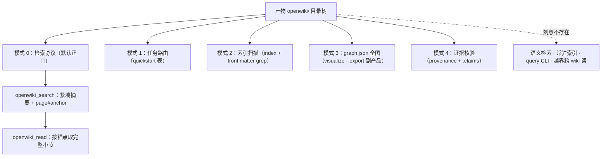

# 02 — Agent 的消费用法盘点 (Agent Usage Patterns)

> **30 秒版（直答）**：**默认正门是检索协议**——`openwiki_search` 找小节、`openwiki_read` 读小节；文件系统直读（任务路由 / index / grep / `graph.json`）是并行的第二入口，也是 MCP 不可用时的兜底。两种入口合计**五种具体打法**，按任务选用、成本递增；此外还有一组**看起来该有、实际刻意没有**的用法——把边界说清楚同样是知识。

## 1. 用法全景



五种模式不是五个独立系统，而是**同一份产物上的五种阅读策略**：模式 0 是默认路径，1–3 在检索不可用或需要全局视野时接手，模式 4 叠加在前四者之上。

## 2. 模式 0：检索协议读法（默认）

**做法**：

```text
openwiki_search({ root: "/abs/repo", query: "retry budget circuit breaker", paths: ["src/payments/service.ts"] })
  → results[0] = { kind: "section", ref: ["openwiki/architecture/payments.md#retry-control"],
                   content: "Payment Runtime\nSection: Retry control\n<≤600 字符摘录>" }
openwiki_read({ root: "/abs/repo", page: "openwiki/architecture/payments.md", sections: ["retry-control"] })
  → { page: "openwiki/architecture/payments.md", sections: [{ section: "retry-control", content: "## Retry control\n\n…" }] }
```

四个必须记住的用法要点：

- **`ref` 是单元素数组**（`ref: [unit.ref]`，`src/retrieval/wiki.ts:689`）：取 `ref[0]`，按 `#` 拆成 `page` 与 `sections`，原样传给 `read`。锚点必须完全一致，`read` 不做模糊匹配。
- **`content` 是摘要不是正文**：标题 + 小节名 + description + 命中词最多的一个普通段落（≤600 字符，`src/retrieval/wiki.ts:996-1031`）。判断相关性靠它，写代码前要 `read`。
- **`paths` 只加权不过滤**：给仓库相对路径会提升引用这些文件的页面/小节，但其它命中照常返回（`src/retrieval/wiki.ts:1149-1162`）。
- **工作区歧义会中断流程**：`openwiki_search` 可能返回 `status: "workspace_required"` 而不是结果；此时问用户选哪个工作区，再用返回列表里的 `workspace` ID 重试（语义见 `03-search-and-read-protocol.md` §5）。工作区检索的结果都带 `wiki` 字段；读**其它仓库**的结果时必须把它一起传回，读本仓库可省略。

**何时用**：任务能用一句话描述（修 bug、加功能、理解某个子系统），且知道要查什么概念——这是绝大多数场景。

**成本**：1 次 `search`（默认 5 条摘要）+ 1–3 次 `read`（每次一个小节）。比模式 1 少读几个整页；`search` 每次调用都会线性读一遍可检索页面（无常驻索引），但它不回传全文，token 成本仍然最低。

## 3. 模式 1：任务路由读法（检索不可用时的主入口）

**做法**：AGENTS.md 引导块 → `openwiki/quickstart.md` 的 `## Task-routing map`（`openwiki/quickstart.md:157-211`，六组意图各一张表）按任务找页 → 读页 → 沿页内链接横向跳。

**何时用**：
- 宿主没接 MCP（SKILL.md 的兜底指令就是「检索工具不可用时直接读 `openwiki/quickstart.md` 并顺着链接走」，`integrations/openwiki/SKILL.md:44-46`）；
- 还说不清要查什么词，只想先看全局结构；
- 需要向人类解释「这个仓库的 wiki 怎么组织」。

**成本**：进入正文前只花两个文件的阅读量（引导块 + quickstart）；比模式 0 贵在它会把你带进整页，而不是一个小节。

## 4. 模式 2：索引扫描读法（跨页调研时自建目录）

**做法**：跳过路由表，直接对机器可读元数据做一次扫描，自己组装「临时目录」：

```sh
grep -rn "^description:" openwiki --include="*.md"   # 每页一句检索导向摘要
grep -rn "tags: \[.*claims" openwiki --include="*.md" # 按稳定英文 tag 找页
cat openwiki/index.md                                 # # Files + # Directories 全清单
```

**为什么可行**：`description` 的契约就是「检索导向摘要」、`tags` 契约要求稳定英文词（`integrations/openwiki/SKILL.md:144-156`）——元数据就是为 grep 而设计的；`index.md` 由管线确定性重生成（`src/okf/index-sync.ts:15`），永远与磁盘一致。

**何时用**：任务横跨多页（写综述、盘点某主题全部页）、或检索的排序没覆盖你的角度。比模式 1 多花一轮扫描，但换来全局视野；它是模式 0 之外最直接列出「全集」的读法（graph.json 也能列出全部节点，但要先导出）。

## 5. 模式 3：graph.json 全图读法（非 obvious 的机器可读副产品）

**做法**：

```sh
openwiki visualize --export <目录>   # 静态导出五件套之一就是 graph.json
# 然后直接读 <目录>/graph.json —— 一次拿到全 wiki 的结构化图
```

`graph.json` 是给人看的可视化器的产物，但**天然机器可读**：`exportStaticVisualizer` 用 `JSON.stringify(graph, null, 2)` + 换行写出（`src/visualize/static-export.ts:46-80`，JSON 写入在 `:72-76`），同目录还有 index.html / client.js / client-lib.js / styles.css。

`WikiGraph` 的形状（`src/visualize/graph-types.ts:102-127`）是 `{ root, generatedAt, types, nodes, edges }`；每页 `WikiNode`（`src/visualize/graph-types.ts:37-82`）含

- `id`：相对路径去 `.md`；
- `title`：front matter → 首个 H1 → 文件名兜底（index 页优先用所在目录名，`src/visualize/graph.ts:158-162`）；
- `type` / `description` / `tags`：front matter 对应字段（缺省 `"Reference"` / `""` / `[]`，index 页 type 为 `"Section"`）；
- `body` / `size`：该页完整 Markdown 正文（已去 front matter）与字符数；
- `links` / `backlinks`：出边与入边。

边的解析在 `linkNodes`（`src/visualize/graph.ts:181-206`）：只认相对 `.md` 链接，自链接、指向未知页、重复边三重过滤后写入 `edges` 与两端节点的 `links`/`backlinks`。

**何时用**：
- 「改了 X，wiki 里哪些页会受影响」——查 backlinks 一次拿全，不用逐页 grep；
- 找孤岛页/断链（某页没有任何入边）；
- 需要「全 wiki 长什么样」的结构化回答，而不是逐文件读。

**注意**：这是**副产品复用**，不是专用 API——`--export` 会同时写出人用资产；graph 反映的是构建时刻的链接结构，且**每个 `WikiNode.body` 携带该页完整 Markdown 正文**（`src/visualize/graph.ts:154-174` 的 `readNode`，序列化见 `src/visualize/static-export.ts:72-76`）——按页分发产物时把它当作含正文/元数据的导出来对待（隐私与体积）。

## 6. 模式 4：证据核验读法（高 stakes 决策前）

**做法**（两条路，先轻后重）：

1. `openwiki_read({ …, includeProvenance: true })`：直接拿到该页 front matter 的 `repo://` 来源，以及每条 Claim 的证据资源与记录版本（`src/retrieval/wiki.ts:778-795`）。工具描述明确它只定位 provenance、不断言新鲜度（`src/integrations/core/retrieval-tools.ts:114-119`）。
2. 需要更强证据时读 `openwiki/.claims/<page>.json`，取 `evidence[].resource`（`repo://路径#L起-L止`）与 `version`，用文件工具比对源码；preflight 的 stale/unresolved 结论是最终判据（`src/claims/brains/code/preflight.ts:83-96`）。

**何时用**：wiki 论断与源码直觉冲突时、做不可逆操作前、引用 wiki 结论写进评审意见时。机制详见 01 号 §5 与 07 区。

**注意**：检索本身不参与信任判断——`openwiki_search` 只读页面 Markdown，不读 `.claims`，stale 页面照样会被检索命中。

## 7. 刻意不存在的用法（同样需要知道）

| 看起来该有 | 实际 | 证据 |
|-----------|------|------|
| 语义/向量检索、模糊改写 | **没有**——词法检索，FTS5 BM25 排序 | `src/retrieval/wiki.ts:637` |
| 常驻/增量索引 | **没有**——每次调用在内存里新建 FTS5 表，结束即关 | `src/retrieval/wiki.ts:606-673` |
| CLI 读/查询命令 | **没有**——11 个用户命令 kind（integrations/mcp/link/workspace/auth/ngrok/visualize/ingest/cron/help/run）+ 解析失败的 `error`，无一面向消费 | `src/cli/commands.ts:169-228` |
| 未共享工作区的跨 wiki 读 | **没有**——只允许读同一工作区里的成员 wiki | `src/linking/wiki-workspaces.ts:887-911` |
| `search` 返回整页正文 | **没有**——只回紧凑摘要，正文必须 `read` | `src/retrieval/wiki.ts:682-696` |
| 人类网页通道（agent 该用吗） | **不用**——`openwiki visualize` 是人类界面 | `openwiki/quickstart.md:54-55` |

一处容易误解的边界：`openwiki_read` 读 **H1 锚点**时返回的是整页正文（含所有子节），因为小节边界按「下一个同级或更高级标题」划分（`src/retrieval/wiki.ts:950-972`）。所以「只读一个小节」要选 `search` 命中的 H2 锚点，别拿页面标题锚点当省上下文的捷径。

## 8. 模式选型表

| 任务 | 用哪种 |
|------|--------|
| 带着明确问题进仓库（修 bug/加功能/理解某子系统） | 模式 0（默认） |
| 宿主没接 MCP，或还不知道该查什么词 | 模式 1 |
| 写某主题综述、盘点全部相关页 | 模式 2（+模式 0 定位入口） |
| 回答「哪些页引用了 X」「wiki 结构长什么样」 | 模式 3 |
| 论断可疑 / 不可逆操作前 / 引用结论进评审 | 模式 4（叠加在 0–3 之上） |
| 想让 agent 调一个「语义搜索 wiki」的工具 | 没有这回事——只有词法检索；回到模式 0 的关键词挑选 |
| 想跨到没有共享工作区的另一个 wiki | 先 `openwiki link` 建工作区，否则 `read` 会拒绝 |

## Source Anchor

| 源文件 | 关键符号/内容 | 说明 |
|--------|--------------|------|
| `src/integrations/core/retrieval-tools.ts:128-199` | `createRetrievalTools` | 四个检索工具的输入契约与描述 |
| `src/integrations/core/retrieval-tools.ts:29-121` | `SearchInput`/`ReadInput` 等 | `.strict()` schema：未知字段与越界值直接拒 |
| `src/retrieval/wiki.ts:682-696` | `renderSearchResult` | `ref`/`content` 的紧凑形状；`ref` 单元素数组 |
| `src/retrieval/wiki.ts:606-673` | `rankSearchUnits` | 内存 FTS5 + BM25 + 路径加权 |
| `src/retrieval/wiki.ts:996-1031` | `relevantExcerpt` | ≤600 字符摘录 |
| `src/retrieval/wiki.ts:950-972` | 小节边界 | 标题 + 全部子节；H1 锚点=整页 |
| `src/retrieval/wiki.ts:778-795` | `readPageProvenance` | sources + Claim 证据版本 |
| `src/linking/wiki-workspaces.ts:887-911` | `findReachableWiki` | 跨 wiki 读限于共享工作区 |
| `integrations/openwiki/SKILL.md:144-156` | 页面文件契约 | description/tags 为 grep 与检索而设计 |
| `src/okf/index-sync.ts:15` | `INDEX_FILE` | index.md 确定性生成 |
| `src/visualize/static-export.ts:46-80` | `exportStaticVisualizer` | 五件套静态导出（含 graph.json） |
| `src/visualize/graph-types.ts:37-82` | `WikiNode` | id/title/type/description/tags/body/size/links/backlinks |
| `src/visualize/graph.ts:181-206` | `linkNodes` | 链接边 + backlinks 三重过滤 |
| `src/cli/commands.ts:169-228` | `CliCommand` 联合 | 11 个用户命令 kind + `error`，无一面向消费 |
| `openwiki/quickstart.md:54-55` | "agents to read as memory" | 可视化器是人类的，agent 不走网页 |
| `openwiki/quickstart.md:157-211` | Task-routing map | 任务路由表 |
