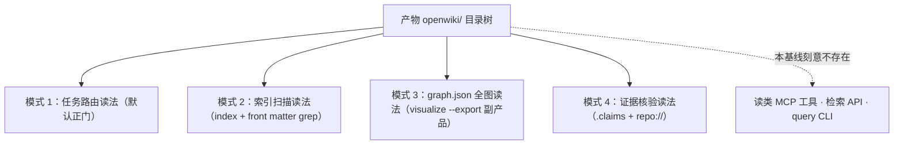

# 02 — Agent 的消费用法盘点 (Agent Usage Patterns)

> **30 秒版（直答）**：是的——**把按 wiki 组织的文件系统直接读进来，就是唯一正门、也是最自然的用法**。本基线没有任何「读 API」：没有 read 类 MCP 工具、没有检索服务、CLI 也没有 query 命令。但「正门」之内有**四种具体打法**，按任务选用；另有一个非 obvious 的机器可读副产品（`graph.json` 全图），以及一组**看起来该有、实际刻意没有**的用法——把边界说清楚同样是知识。

## 1. 用法全景



四种模式不是四个入口，而是**同一个文件系统上的四种阅读策略**，成本递增、按需叠加。

## 2. 模式 1：任务路由读法（默认，90% 的场景）

**做法**：AGENTS.md 引导块 → `openwiki/quickstart.md` 的 Task-routing map 按任务找页 → 读页 → 沿 `relatedPages` 横向跳。

**何时用**：任务能被「一句话描述」（修 bug、加功能、理解某个子系统）——这正是路由表设计的靶心。完整漏斗论证见 01 号 §3。

**成本**：进入正文前只花两个文件的阅读量；是所有模式里 token 最省的。

## 3. 模式 2：索引扫描读法（跨页调研时自建目录）

**做法**：跳过路由表，直接对机器可读元数据做一次扫描，自己组装「临时目录」：

```sh
grep -rn "^description:" openwiki --include="*.md"   # 每页一句检索导向摘要
grep -rn "tags: \[.*claims" openwiki --include="*.md" # 按稳定英文 tag 找页
cat openwiki/index.md                                 # # Files + # Directories 全清单
```

**为什么可行**：`description` 的契约就是「检索导向摘要」、`tags` 契约要求稳定英文词（`integrations/openwiki/SKILL.md:92-104`）——元数据就是为 grep 而设计的；`index.md` 由管线确定性重生成（`src/okf/index-sync.ts:14`），永远与磁盘一致。

**何时用**：任务横跨多页（写综述、盘点某主题全部页）、或路由表没覆盖你的角度。比模式 1 多花一轮扫描，但换来全局视野。

## 4. 模式 3：graph.json 全图读法（非 obvious 的机器可读副产品）

**做法**：

```sh
openwiki visualize --export <目录>   # 静态导出五件套之一就是 graph.json
# 然后直接读 <目录>/graph.json —— 一次拿到全 wiki 的结构化图
```

`graph.json` 是给人看的可视化器的产物，但**天然机器可读**（`src/visualize/static-export.ts:46-70`，2 空格缩进 JSON + 换行）：`WikiGraph` 含每页 `WikiNode`（`id`=相对路径去 `.md`、`title`（frontmatter→首个标题→文件名兜底）、`type`，`src/visualize/graph.ts:40-56`）与链接边（`linkNodes` 三重过滤后写入 links + backlinks，`src/visualize/graph.ts:302-320`）。

**何时用**：
- 「改了 X，wiki 里哪些页会受影响」——查 backlinks 一次拿全，不用逐页 grep；
- 找孤岛页/断链（某页没有任何入边）；
- 需要「全 wiki 长什么样」的结构化回答，而不是逐文件读。

**注意**：这是**副产品复用**，不是专用 API——`--export` 会同时写出 index.html/client.js 等人用资产；graph 反映的是构建时刻的链接结构，不含正文内容。

## 5. 模式 4：证据核验读法（高 stakes 决策前）

**做法**：wiki 说法 → 查该页 front matter `verified.at`（新鲜度）→ 需要更强证据时读 `openwiki/.claims/<page>.json`，取 claim 的 `evidence.resource`（`repo://路径#L起-L止`）与 `version` token，用文件工具读源码那几行比对；对不上即 stale。

**何时用**：wiki 论断与源码直觉冲突时、做不可逆操作前、引用 wiki 结论写进评审意见时。机制详见 01 号 §5 与 07 区。

## 6. 刻意不存在的用法（同样需要知道）

| 看起来该有 | 实际 | 证据 |
|-----------|------|------|
| read/search 类 MCP 工具 | **没有**——6 个工具全是生产协议 | `src/integrations/core/protocol.ts:14-20` |
| wiki 检索/查询 API 或服务 | **没有**——无服务器、无向量库 | 01 号 §6 的取舍论证 |
| CLI 读/查询命令 | **没有**——9 个命令 kind（run/auth/integrations/mcp/visualize/ingest/cron/help/error）无一面向消费 | `src/cli/commands.ts:107-164` |
| 人类网页通道（agent 该用吗） | **不用**——`openwiki visualize` 是人类界面 | `openwiki/quickstart.md:44-45` |

上游 `codex/openwiki-retrieval-tools` 探索分支表明检索工具是候选演进方向；合入前，「没有读 API」不是缺陷而是设计立场：文件系统直读零集成、逐字节确定、与代码同 git 化（01 号 §6）。

## 7. 模式选型表

| 任务 | 用哪种 |
|------|--------|
| 带着明确任务进仓库（修 bug/加功能） | 模式 1（默认） |
| 写某主题综述、盘点全部相关页 | 模式 2（+模式 1 定位入口） |
| 回答「哪些页引用了 X」「wiki 结构长什么样」 | 模式 3 |
| 论断可疑 / 不可逆操作前 / 引用结论进评审 | 模式 4（叠加在前三者之上） |
| 想让 agent 调一个「read wiki」的工具 | 没有这回事——回到模式 1-4 |

## Source Anchor

| 源文件 | 关键符号/内容 | 说明 |
|--------|--------------|------|
| `integrations/openwiki/SKILL.md:92-104` | 页面文件契约 | description/tags 为 grep 而设计 |
| `src/okf/index-sync.ts:14` | `INDEX_FILE` | index.md 确定性生成 |
| `src/visualize/static-export.ts:46-70` | `exportStaticVisualizer` | graph.json 机器可读五件套之一 |
| `src/visualize/graph.ts:40-56` | `WikiNode` | id/title/type 字段形状 |
| `src/visualize/graph.ts:302-320` | `linkNodes` | 链接边 + backlinks 三重过滤 |
| `src/integrations/core/protocol.ts:14-20` | `ProtocolToolName` | 6 工具全为生产协议 |
| `src/cli/commands.ts:107-164` | `CliCommand` 联合 | 9 命令 kind 无一面向消费 |
| `openwiki/quickstart.md:44-45` | "agents to read as memory" | 可视化器是人类的，agent 不走网页 |
