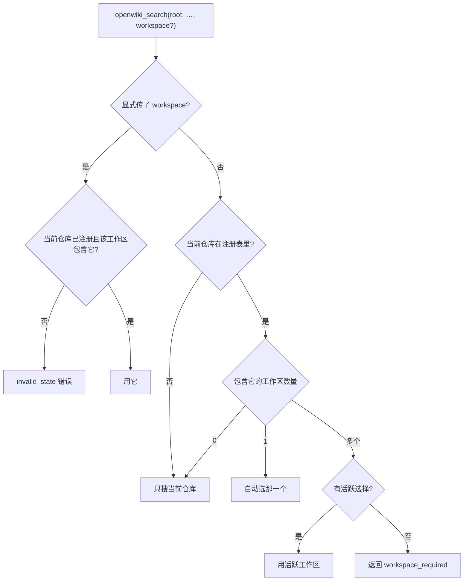

# 03 — 检索/读取协议 (Search and Read Protocol)

> 一句话结论：`openwiki_search` 回答「哪一小节相关」并返回 `openwiki/<page>.md#<anchor>` 引用；`openwiki_read` 用该引用回答「这一小节到底写了什么」。两者都是 checkout-local 的只读工具：不调模型、不启动 generation run、不写盘；工作区（workspace）只改变 **search 的搜索范围**与 **read 的目标仓库**。

本篇是消费者视角的协议规格。工具在 MCP 面上怎么注册、`openwiki_begin` 怎么封顶结果，归 `08-connectors-and-data-sources/11-mcp-subsystem.md` §11；工作区怎么用 CLI 建、注册表长什么样，归 `03-cli-and-tui/04-link-and-workspaces.md`。

## 1. 工具面：4 个只读工具，与生成工具同一个 server

| 工具 | 输入 | 回答的问题 |
|------|------|-----------|
| `openwiki_search` | `root`、`query`；可选 `paths`、`limit`、`workspace` | 哪些小节的正文/元数据命中这个问题？ |
| `openwiki_read` | `root`、`page`、`sections`；可选 `wiki`、`includeProvenance` | 这几小节完整写了什么？记录在案的来源是什么？ |
| `openwiki_list_workspaces` | `root`；可选 `wiki` | 当前（或指定）wiki 属于哪些命名工作区？ |
| `openwiki_list_wikis` | `root`、`workspace` | 某个工作区包含哪些仓库 wiki？ |

四个 schema 都是 zod `.strict()`（`src/integrations/core/retrieval-tools.ts:29-121`），未知字段直接拒；它们与 6 个生命周期工具装在**同一个 stdio MCP server** 里，由 `ProtocolToolName` 收口成 10 个名字（`src/integrations/core/protocol.ts:14-24`），`HostSessionManager.tools()` 把 4 个检索工具排在前面（`src/integrations/core/session-manager.ts:225-272`），server 逐个注册并把同一份 schema 交给 SDK 做入参校验（`src/integrations/mcp/server.ts:76-94`）。pi 原生包把同样 10 个工具注册给 pi，执行时统一转发给子进程里的同一个 server（`src/integrations/pi/openwiki.ts:47-97`、`:225-263`）。

**`root` 的语义**（四个工具都有）：必须是**绝对路径**，且位于一个 Git 仓库内；实现取 `git rev-parse --show-toplevel` 的结果，所以传子目录也等价（`src/integrations/core/repository-root.ts:20-34`）。文件系统根与用户 home 会被显式拒绝（`src/integrations/core/repository-root.ts:122-133`）；而检索读取的固定是 `<root>/openwiki/`（`ClaimsStore` 的 wiki 目录约定），personal 模式的知识库却写在 `~/.openwiki/wiki`（`src/config/openwiki-home.ts:49`）。两条加起来：**检索只服务仓库 wiki，personal brain 不在检索面内**。

检索调用不依赖任何 run 状态：没有 `begin`、没有 runId，也不需要模型凭据。

## 2. `openwiki_search`

### 2.1 参数

| 参数 | 约束 | 语义 |
|------|------|------|
| `root` | 绝对路径，Git 顶层 | 检索从哪个仓库发起（也决定工作区解析的「当前 wiki」） |
| `query` | 非空，≤ 2 000 字符 | 自然语言问题/行为/概念；按词项命中，不做语义理解 |
| `paths` | ≤ 20 条，每条 ≤ 500 字符 | 仓库相对源码路径，**只加权不过滤** |
| `limit` | 1–20 的整数，默认 5 | 返回条数 |
| `workspace` | ≤ 80 字符 | 显式指定工作区 ID 或唯一名，覆盖自动选择 |

（约束在 `src/retrieval/wiki.ts:18-78` 的 `WIKI_RETRIEVAL_LIMITS` 与 `:511-543` 的二次校验里。）

`paths` 的每一项会被规范化：反斜杠转 `/`、去掉 `./`、转小写；绝对路径、含 `:`、含 `..`、含通配符、含控制字符、长度超限都直接报错（`src/retrieval/wiki.ts:1073-1092`）。匹配时允许后缀等价——`src/api/x.ts` 能命中 `packages/a/src/api/x.ts`（`:1149-1162`）。它参与**排序第一优先级**，不参与过滤。

### 2.2 检索单元：什么会被索引

`searchWiki` 先把每个可检索页面拆成若干「小节单元」（`src/retrieval/wiki.ts:816-877`）：

- **H2 小节**：每个 H2 连同它的子节成为一个单元；标题命中 `related pages|related reading|related links|see also|navigation`（大小写不敏感）的 H2 被排除，避免把导航块当知识检索（`:834-840`）。
- **引言单元**：H1 之后、第一个 H2 之前的正文单独成单元；为了不让「标题/描述命中」误报整页引用，引言单元的 title/description/identifiers 在 FTS 里被写成空串，只按正文命中（`:841-870`、`:622-631`）。
- **页级回退**：页面没有 H2 时，整页正文作为一个单元，锚点用 H1 的 slug（`:873-875`）。
- **只有既无 H1 又无 H2 的页面不会被索引**（`:873-877` 以 `firstH1` 存在为前提）；有 H2 无 H1 的页面照常按 H2 建单元，只是没有引言单元。

页面范围与可见性：只遍历 `ClaimsStore.discoverPages()` 的结果（排除 `index.md` / `log.md` / `instructions.md` 与 `.claims/`），跳过路径含隐藏段的页面与 front matter `status: deprecated` 的页面（`src/retrieval/wiki.ts:559-566`、`:823`、`:1138-1140`）。

### 2.3 排名

排名是**词法检索**：查询先切词、去停用词（整句都是停用词时保留全部词项，`:1041-1051`），然后在一次调用内新建的内存 FTS5 表里按 BM25 排名（`src/retrieval/wiki.ts:606-673`）：

1. 索引列与权重：`title(8) / description(4) / heading(6) / prose(1) / identifiers(3)`，tokenizer 为 `porter unicode61`（`:617`、`:637`）。
2. `identifiers` = 相对路径 + tags + `repo://` 来源路径；入库前对全部列做 camelCase / 路径分隔符切分，让 `readWikiSections` 这类符号名与 `src/retrieval/wiki.ts` 这类路径也能被词项命中（`:856`、`:1059-1064`）。
3. 最终排序键依次是：`paths` 命中数降序 → 查询词项覆盖率降序 → BM25 升序（越小越相关）→ rowid 升序（`:652-661`）。

索引只在本次调用内存在：`DatabaseSync(":memory:")` 建表、查完即 `close()`（`:613-614`、`:670-672`）。同一份 Markdown 得到同一个结果，但它不会热启动，也不会过期。

### 2.4 返回形状

成功响应（示例是工作区检索；独立 wiki 只会有 `results`）：

```json
{
  "results": [
    {
      "kind": "section",
      "ref": ["openwiki/architecture/payments.md#retry-control"],
      "content": "Payment Runtime\nSection: Retry control\n…≤600 字符摘录…",
      "wiki": "control-plane"
    }
  ],
  "workspace": { "id": "payments", "name": "Payments", "wikiCount": 2 },
  "wikis": [{ "id": "control-plane", "name": "control-plane" }]
}
```

- `kind` 目前恒为 `"section"`，是给未来检索种类预留的判别字段（`src/retrieval/wiki.ts:129-133`）。
- `ref` 是**单元素数组**（`:689`）：取 `ref[0]`，按 `#` 拆成 page 与 anchor。
- `content` 是「页面 title + `Section: <小节标题>` + description + 摘录」，摘录取该小节里命中查询词最多的一个**非标题块**，压成纯文本并截到 600 字符（`:682-696`、`:996-1031`）。它不是完整正文。
- `wiki` 只在**工作区检索**时出现（`includeWiki = scope.workspace !== undefined`，`:582`、`:694`）；工作区里的每条结果都带，包括当前仓库自己的结果。
- `workspace` / `wikis` 同理只在工作区检索时出现（`:584-590`）；`wikis` 是该次检索实际覆盖的**全部**成员 wiki。
- 空结果是合法返回：仓库没有 wiki、词项全被过滤、页面都被隐藏/弃用、FTS 运算符当数据（`" OR * NOT (`）都返回 `{ "results": [] }`（`src/retrieval/wiki.ts:548-556`、`:567-575`；测试 `test/retrieval/wiki.test.ts:833-872`）。

### 2.5 歧义：`workspace_required`

当当前仓库同时属于多个工作区、且没有持久化的活跃选择（active workspace）时，`openwiki_search` **不返回结果**，而是返回结构化歧义（`src/retrieval/wiki.ts:546`、`src/linking/wiki-workspaces.ts:307-322`、`:730-734`）：

```json
{
  "status": "workspace_required",
  "wiki": { "id": "shared", "name": "shared" },
  "workspaces": [
    { "id": "payments", "name": "Payments", "wikiCount": 2 },
    { "id": "platform", "name": "Platform", "wikiCount": 2 }
  ]
}
```

`workspaces` 按名称、再按 ID 排序（`src/linking/wiki-workspaces.ts:947-954`）。这是**会话性中断点**：协议要求 Agent 问用户选哪个，再带 `workspace`（ID 或唯一名）重试，并在同一会话里记住这个选择（`integrations/openwiki/SKILL.md:22-28`）。它也是一种成功响应，不是错误——不要用 try/catch 当异常处理。

## 3. `openwiki_read`

### 3.1 参数

| 参数 | 约束 | 语义 |
|------|------|------|
| `root` | 绝对路径，Git 顶层 | 同 search：确定「当前 wiki」，也是权限边界 |
| `page` | ≤ 1 000 字符 | 必须来自 search 的 ref，含 `openwiki/` 前缀（如 `openwiki/architecture/jobs.md`） |
| `sections` | 1–20 个锚点，每个 ≤ 500 字符 | 来自 ref 的 `#` 后半段；可带一个前导 `#` |
| `wiki` | ≤ 64 字符 | search 结果里的 `wiki`；省略=读当前仓库 |
| `includeProvenance` | 布尔，默认 false | 附带页面记录在案的来源与 Claim 证据版本 |

`page` 不做「裸 wiki 相对路径」补全：`architecture/jobs.md` 会被当成非法页面拒掉，必须是 `openwiki/architecture/jobs.md` 或带前导 `/` 的等价形式（`src/retrieval/wiki.ts:1116-1130` + `src/claims/brains/code/paths.ts:24-43`）。页面还必须是非结构页：`index.md` / `log.md` / `instructions.md` 与任何隐藏路径段（`.foo/`、`.bar.md`）以及 `.claims/` 都会被拒（`src/claims/brains/code/paths.ts:12-16`、`src/retrieval/wiki.ts:1138-1140`）。

### 3.2 小节与锚点规则

`read` 用与 `search` 完全相同的锚点算法（`src/retrieval/wiki.ts:912-973`、`:1198-1203`）：

- 锚点等价于 GitHub slug：取标题可见文本（丢弃 HTML token）→ 小写 → 去掉 `\p{L}`/`\p{M}`/`\p{N}`/`_`/空格/`-` 之外的字符 → 空格换 `-`。
- **组合字符（combining marks）保留**，印地语/泰文元音符号与分解重音不会被吞（`:1198-1203`，v0.7.3 起）；emoji 变体选择符仍被丢弃。
- 重复标题按 GitHub 规则探测后缀：`retry-control`、`retry-control-1`、`retry-control-2`……探测的是「候选锚点是否已被占用」，而不是简单计数——所以一个标题自带的 `-1` 不会被后来的同名标题复用（`:914-940`）。
- slug 为空的纯符号标题（`## 🚀`）得到一个可读回退锚点 `section`（被占用时 `section-1`……），且不回退占用任何真实 GitHub 锚点；只有**第一个**空 slug 会被别名化，第二个仍保留 GitHub 的 `-1` 形式（`:941-949`、`:98`）。
- `sections` 里的锚点接受一个前导 `#`，但不能再含 `#`、`/` 或控制字符（`:1171-1185`）。

`read` 的「小节」边界是**下一个同级或更高级标题**，返回标题连同全部子节（`WikiReadSection.content` 的契约，`src/retrieval/wiki.ts:287-297`、`:950-972`）。由此有个实用推论：

> **读 H1 锚点 = 读整页**。H1 小节一直延伸到下一个 H1 或文件末尾，所以页面标题锚点会带回整页正文（含所有 H2/H3）。想省上下文就只读 search 命中的 H2 锚点；反过来，想一次拿整页，读 H1 锚点即可。

### 3.3 返回形状

```json
{
  "page": "openwiki/architecture/payments.md",
  "sections": [
    { "section": "retry-control", "content": "## Retry control\n\n…完整小节…" }
  ],
  "wiki": "control-plane",
  "provenance": { "sources": [], "claims": [] }
}
```

- `sections` **按请求顺序**返回；同一锚点重复请求会重复返回（`:747-753`）。
- `content` 是原始 Markdown 切片（含标题行），不做渲染或改写。
- `wiki` 只在请求里带了 `wiki` 时回显（`:761`）；本地读不带该字段，便于调用方区分。
- 未知锚点会让整次调用失败，而不是跳过：`Unknown section: missing` / `Unknown sections: a, b`（`:740-745`）。

### 3.4 provenance（`includeProvenance: true`）

```json
{
  "sources": [{ "id": "openwiki-source-…", "resource": "repo://src/payments/service.ts" }],
  "claims": [
    { "id": "claim_b4fc5fda…", "evidence": [
      { "resource": "repo://src/claims/brains/code/store.ts#L38-L57", "version": "repo-lines-v1:sha256:…" }
    ]}
  ]
}
```

- `sources` 来自页面 front matter 的 `sources[]`（保留 `id`（可选）与 `resource`，按作者顺序，`src/retrieval/wiki.ts:1242-1254`）。
- `claims` 来自 `.claims/<page>.json`，只投影 `id` 与 `evidence[].resource/version`——不返回 statement（`src/retrieval/wiki.ts:778-795`）。
- 页面没有 sidecar 时 `claims: []`，不是错误。
- **语义边界**：这些字段只说明「当时记录了什么」，不校验仓库字节是否仍匹配、也不代表 Claim 已被语义验证（`src/integrations/core/retrieval-tools.ts:114-119`、`src/retrieval/wiki.ts:765-777`）。新鲜度仍要看 `openwiki_begin`/preflight 的 stale-unresolved 结论（07 区）。

### 3.5 跨 wiki 读取

- 省略 `wiki`，或用当前仓库的 ID：读当前仓库（`src/linking/wiki-workspaces.ts:751-757`）。
- 其它 wiki 的 ID：必须与当前仓库**共享至少一个工作区**（`findReachableWiki`，`:887-911`）；未知 ID 报 `Unknown wiki ID…`，不共享报 `The requested wiki does not share a workspace with the current repository.`
- 未注册进任何工作区的仓库不能借 `wiki` 越界：先用 `openwiki link` 把它并进工作区（`:873-878`）。

## 4. 错误与纠正

`runRetrieval` 把内部错误按类型映射成 host 可见的 `code: message`（`src/integrations/core/retrieval-tools.ts:209-237`）：

| 触发 | 消息（节选） | host code |
|------|------------|-----------|
| 查询为空 / 超 2 000 字符 | `Use a non-empty search query of at most 2000 characters.` | `invalid_input` |
| `limit` 越界 | `Search limit must be an integer from 1 to 20.` | `invalid_input` |
| `paths` 非法 | `Source hints must be repository-relative paths without traversal or globs.` | `invalid_input` |
| 工作区引用非法/不存在 | `Use a valid workspace ID or name returned by openwiki_list_workspaces.` / `Unknown workspace for this repository…` | `invalid_input` / `invalid_state` |
| `sections` 为空或超 20 | `Provide at least one section anchor.` / `Read accepts at most 20 section anchors.` | `invalid_input` |
| 页面结构页/隐藏路径 | `Page must be a non-structural Markdown path below openwiki/.` | `invalid_input` |
| 页面不存在 | `The requested OpenWiki page does not exist.` | `invalid_input` |
| 锚点不存在 | `Unknown section: <anchor>` | `invalid_input` |
| 当前仓库未注册 | `The current repository is not registered in a wiki workspace…` | `invalid_state` |
| wiki ID 未知 / 不共享工作区 | `Unknown wiki ID…` / `The requested wiki does not share a workspace…` | `invalid_state` |
| 其它 Claims/IO 失败 | `Unable to <op> the repository OpenWiki safely. Check the wiki and retry.` | `invalid_state` |

两点补充：

- 表里的 schema 级约束（`query` 长度、`limit` 范围、`paths` 条数、`sections` 数量、`page` 长度）同时写在工具 schema 里，MCP server 把同一份 schema 作为 `inputSchema` 交给 SDK（`src/integrations/mcp/server.ts:82-91`）。所以从 MCP 调用时，越界/未知字段会先在入参校验阶段失败，未必走到 `runRetrieval` 的文案；上表的消息对**直接调用** `searchWiki`/`readWikiSections` 的调用方才是稳定契约。
- 工具 handler 也会用同一份 `.strict()` schema 再 `parse` 一次（`src/integrations/core/retrieval-tools.ts:139-196`），检索逻辑不会看到未校验的输入。

## 5. 工作区解析（workspace resolution）

工作区是「一组可以互相检索的仓库 wiki 的精确并集」，持久化在 `<OpenWiki home>/wiki-workspaces.json`（schema 版本 1，字段 `{version, wikis, workspaces, active}`；`src/linking/wiki-workspaces.ts:17`、`:22`、`:147-167`）。检索侧只读它；无法确定搜索范围时的表现全部落在 §4 的错误表里。

### 5.1 search 的自动选择顺序



实现即 `resolveWikiSearchScope`（`src/linking/wiki-workspaces.ts:680-735`），顺序是**显式 > 唯一 > 活跃 > 歧义**。四个容易踩的点：

1. **未注册仓库带 `workspace` 会报错**，不会退化成「只搜自己」（`:686-688`）。
2. **显式 workspace 必须包含当前仓库**；否则报 `Unknown workspace for this repository. Use openwiki_list_workspaces to choose one.`（`:920-938`）。
3. **ID 优先于名称**：先按 ID 精确匹配（引用统一小写），再按名称大小写不敏感匹配；因此一个工作区改名后与另一个工作区 ID 撞名，ID 仍然赢（v0.7.1 起，`:926-931`）。
4. **活跃选择是持久化的**：`openwiki workspace use <ws>` 写入注册表 `active[]`，之后 search 默认用它；`clear` 删除（`src/linking/wiki-workspaces.ts:769-783`、`:792-804`；CLI 侧见 03-cli-and-tui/04）。

### 5.2 三个列表/歧义响应

| 调用 | 返回 |
|------|------|
| `openwiki_list_workspaces` | `{ wiki: {id,name}, activeWorkspace?, workspaces: [{id,name,wikiCount}] }`；未注册仓库返回 `workspaces: []`（`:628-647`） |
| `openwiki_list_wikis` | `{ workspace: {id,name,wikiCount}, wikis: [{id,name}] }`；`workspace` 必须包含当前仓库（`:657-670`） |
| `openwiki_search`（歧义） | `{ status: "workspace_required", wiki, workspaces }`（`WikiWorkspaceRequired`，`:307-322`） |

`openwiki_list_workspaces` 的 `wiki` 参数用来查看**另一个可达 wiki** 的成员关系；可达性规则与 read 相同（共享工作区，`:634` → `:887-911`）。`activeWorkspace` 只有配置过才出现。

### 5.3 pi 场景的一个实现细节

pi 扩展拉起子进程时显式传入 `OPENWIKI_CONFIG_DIR`（`src/integrations/pi/openwiki.ts:150-160`），因此检索工具读到的是**同一个** `wiki-workspaces.json`——用户在终端里 `openwiki workspace use` 的结果，对 pi 会话立即生效。

## 6. 边界值总表

| 名称 | 值 | 出处 |
|------|----|------|
| `queryCharacters` | 2 000 | `src/retrieval/wiki.ts:22` |
| `sourcePathHints` | 20 条 | `:27` |
| `sourcePathCharacters` | 500 | `:32` |
| `searchResults`（上限） | 20 | `:37` |
| `defaultSearchResults` | 5 | `:42` |
| `pageCharacters` | 1 000 | `:47` |
| `sectionAnchors` | 20 | `:52` |
| `sectionAnchorCharacters` | 500 | `:57` |
| `excerptCharacters` | 600 | `:62` |
| `queryTerms` | 64 | `:67` |
| `wikiIdCharacters` | 64 | `:72` |
| `workspaceReferenceCharacters` | 80 | `:77` |
| 注册表文件 | 2 MiB / 10 000 wiki / 1 000 工作区 | `src/linking/wiki-workspaces.ts:32`、`:37`、`:42` |
| 检索最大跨度 | 单次调用内、单/多 wiki 的全量 Markdown | `src/retrieval/wiki.ts:558-566` |

## 7. 划界

| 主题 | 归属 |
|------|------|
| 集成层：4 个工具的投递面、schema 来源、错误映射与测试佐证 | `13-integrations/03-retrieval-tools-and-workspaces.md` |
| Pi 原生包如何启动 MCP 桥、Electron/Bun 环境修复 | `13-integrations/04-pi-native-package.md` |
| 生成生命周期工具、begin 封顶、MCP transport | `08-connectors-and-data-sources/11-mcp-subsystem.md` §11 |
| 工作区注册表结构、`openwiki link` / `openwiki workspace`、TUI | `03-cli-and-tui/04-link-and-workspaces.md` |
| 渐进披露漏斗、宿主引导块、证据层全貌 | `15-agent-consumption/01-how-agents-read-the-wiki.md` |
| 五种阅读策略与选型 | `15-agent-consumption/02-agent-usage-patterns.md` |
| claims 模型、证据版本、preflight | `07-claims-and-okf/` |

## Source Anchor

| 源文件 | 关键符号/内容 | 说明 |
|--------|--------------|------|
| `src/integrations/core/retrieval-tools.ts:128-199` | `createRetrievalTools` | 四个工具的定义与描述文案 |
| `src/integrations/core/retrieval-tools.ts:29-121` | `SearchInput`/`ListWorkspacesInput`/`ListWikisInput`/`ReadInput` | `.strict()` schema 与字段约束 |
| `src/integrations/core/retrieval-tools.ts:209-237` | `runRetrieval` | 错误 → `invalid_input`/`invalid_state` |
| `src/retrieval/wiki.ts:18-78` | `WIKI_RETRIEVAL_LIMITS` | 全部边界值 |
| `src/retrieval/wiki.ts:507-591` | `searchWiki` | 校验 → scope → 单元 → 排名 → 响应 |
| `src/retrieval/wiki.ts:606-673` | `rankSearchUnits` | 内存 FTS5、BM25 权重、四段排序 |
| `src/retrieval/wiki.ts:816-877` | `searchUnits` | H2 单元 / 引言单元 / 页级回退 |
| `src/retrieval/wiki.ts:912-973` | `headingSections` | 锚点去重、子节边界、符号标题回退 |
| `src/retrieval/wiki.ts:682-696` | `renderSearchResult` | `kind/ref/content/wiki` |
| `src/retrieval/wiki.ts:706-763` | `readWikiSections` | 精确小节读取与请求顺序 |
| `src/retrieval/wiki.ts:778-795` | `readPageProvenance` | sources + Claim 证据版本 |
| `src/retrieval/wiki.ts:1116-1140` | `normalizeRetrievableWikiPage`/`isRetrievableWikiPage` | 页面范围与隐藏段拒绝 |
| `src/retrieval/wiki.ts:1171-1185` | `normalizeSectionAnchor` | 锚点规范化 |
| `src/linking/wiki-workspaces.ts:680-735` | `resolveWikiSearchScope` | 显式 > 唯一 > 活跃 > 歧义 |
| `src/linking/wiki-workspaces.ts:745-759` | `resolveReadableWiki` | read 的目标仓库解析 |
| `src/linking/wiki-workspaces.ts:887-911` | `findReachableWiki` | 共享工作区才是可读边界 |
| `src/linking/wiki-workspaces.ts:307-322` | `WikiWorkspaceRequired` | 歧义响应形状 |
| `src/linking/wiki-workspaces.ts:628-670` | `listWikiWorkspaces`/`listWorkspaceWikis` | 两个列表工具的实现 |
| `src/integrations/core/repository-root.ts:20-34` | `resolveRepositoryRoot` | `root` 必须是 Git 顶层 |
| `src/integrations/core/repository-root.ts:122-133` | `assertSafeRepositoryRoot` | 拒绝文件系统根与 home |
| `src/integrations/core/protocol.ts:14-24` | `ProtocolToolName` | 4 检索 + 6 生命周期 |
| `src/integrations/pi/openwiki.ts:150-160` | `startBridge` 环境 | 子进程共享 `OPENWIKI_CONFIG_DIR` |
| `src/retrieval/wiki.ts:287-297` | `WikiReadSection` | 「完整小节，含子节」契约 |
