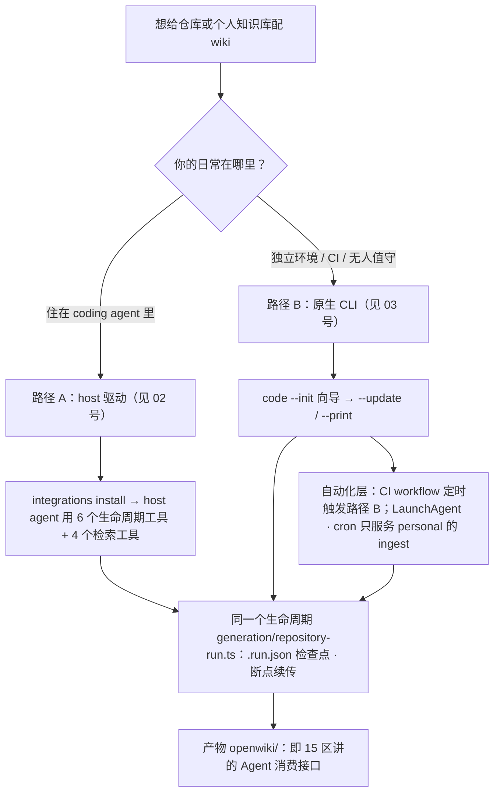

# 01 — Wiki 生产路径总览与选型 (Ways to Produce a Wiki)

> **30 秒版**：生产一份 OpenWiki 有**两条一等公民路径**——
> **路径 A（host 驱动）**：装进现有 coding agent，宿主模型干活，**零 provider API key**。细节见 `02-host-driven-production.md`。
> **路径 B（原生 CLI）**：`openwiki code --init/--update`，自带 DeepAgents agent 干活，需 provider 凭据。细节见 `03-native-cli-production.md`。
> 两条路径**殊途同归**：同一个生命周期、同一份 `.run.json` 检查点——谁先 begin 谁就接到同一个 run。

## 1. 全景：两条路径 + 自动化层，一个生命周期

「两条路径」不是两套实现——它们是**同一个生命周期的两个驱动方**（`src/generation/repository-run.ts:401` 的 `beginRepositoryRun` 是共同入口；完整论证见 13-integrations/02 §4.2）。区别只在「谁出模型、谁出界面」。

## 2. 路径 A：host 驱动（推荐给住在 coding agent 里的人）

- 三步：`openwiki integrations install <host>` → 重启宿主 → 对 agent 说 "Initialize OpenWiki for this repository"（官方三步指引，`src/cli/integrations.ts:63-74`）。
- `<host>` 现有 9 个目标：Bob / Codex / Claude Code / OpenCode / Cursor / Kiro / Oh My Pi / Antigravity CLI / GitHub Copilot CLI（`HOST_TARGETS`，`src/integrations/install/registry.ts:10`；类型 `HostTargetId` 见 `src/integrations/install/types.ts:4-13`）。
- 核心优势：**零 provider 配置**——调研与写作由宿主自己的模型完成，OpenWiki 运行时零 LLM 调用（唯一的 "model" 是元数据身份串，`src/integrations/core/session-manager.ts:347-349`）。
- 边界：单 run 单操作在途；生成期间 host agent 被页循环占用且禁用子 agent；**不改源码**（靠 SKILL.md 纪律，不是运行时强制）；**定向更新**（只处理相关页、把无关 stale Claim 页留给下次全量）只有这条路径能给（`deferUnplannedClaimIssues`，见 05 号）。
- **端到端细节（scope 决策、8 步展开、begin 结果封顶、语言/溯源、排错）→ `02-host-driven-production.md`**。

## 3. 路径 B：原生 CLI（推荐给 CI 与无人值守）

- 首跑 `openwiki code --init` 触发向导（凭据 → provider/模型 → wiki brief；**code 形态没有 cron 步**，定时靠 init 生成的 GitHub Actions），日常只剩 `openwiki code --update`；`--print` 供脚本/CI。
- 自带 DeepAgents 文档 agent 干活（`src/agent/repository-runner.ts:363-417`），**需要 15 个 provider 之一的凭据**（`OpenWikiProvider`，`src/config/constants.ts:139-154`；默认 `DEFAULT_PROVIDER="openai"` 在 `:136`）。
- no-op 门 + fast-forward 让 update 经常「秒完成」；`.run.json` 检查点保证任何中断可续。
- **仓库是只读输入**：repository 模式一律 docs-only，写 `openwiki/` 之外由 backend 直接拒绝（v0.7.3 起 `outputMode === "repository"` 即强制，`src/agent/docs-only-backend.ts:245-246`）。
- 页可并行：`OPENWIKI_PAGE_CONCURRENCY`（1–8，默认 1）让多个 page worker 同时干活（时序见 05 号）。
- **端到端细节（向导、旗标、no-op 门、CI 模板逐段、断点续传、排错）→ `03-native-cli-production.md`**。

## 4. 自动化层（附着在路径 B 上）

| 层 | 入口 | 详情 |
|----|------|------|
| GitHub Actions | `openwiki-update.yml`（`--init` 生成；SHA 锁定 action + provider secrets；生成模板不含 fork guard 恢复步） | `03-native-cli-production.md` §7.1、11/02 |
| 本地定时 | cron / macOS LaunchAgent——只服务 **personal 形态的 ingest 定时**（`ingestionSchedule`），code 形态的定时由上面的 workflow 负责 | 11/01 |
| 防重入/断点 | `.last-update.json` complete/interrupted 语义 | 11/03 |

CI 里没有宿主 agent 可用，所以自动化跑的是**路径 B**——workflow 模板的 `Run OpenWiki` 步就是 `openwiki code --update --print`（`src/ingestion/code-mode.ts:571`），provider secrets 是硬前置。

## 5. 殊途同归：为什么「选哪条路」不会锁死你

- 两条路径是同一生命周期的两个驱动方：CLI 经 `src/agent/repository-runner.ts`，host 经 `HostSessionManager`（13/02 §4.2）；SKILL.md 第 2 步明确「always continue the durable run and queue returned by openwiki_begin」——**它可能由原生 CLI 或另一个 host 开启**（`integrations/openwiki/SKILL.md:56-58`）。
- 因此切换零成本：今天 Claude Code 干了一半的 wiki，明天 CI 或另一台机器可以接上；已完成页 fast-forward 不重复烧 token。
- 产出的产物形态完全一致，就是 15 区讲的消费接口。
- **但两条路径看到的「数据量」不同**：host 侧的 `openwiki_begin` 结果被刻意封顶——变更路径最多 200 条、Claim 问题最多 50 条，另给精确总数（`changedPathCount`/`claimIssueCount`）与截断标志（`changedPathsTruncated`/`claimIssuesTruncated`），`claimIssuePages` 则始终给全（`src/integrations/core/begin-view.ts:9-14,84-109`）；所以截断时 host 要用 `git diff` 自己补齐，而原生 CLI 读自己的 run state 不受此限。封顶只影响「一次看多少」，不改变「必须做哪些页」。

## 6. 选型决策表

| 场景 | 推荐 | 细节 |
|------|------|------|
| 我天天在 Claude Code/Codex 里写代码，想顺手维护仓库文档 | **A** | 02 号 |
| 不想（或不能）配任何 provider API key | **A** | 02 号 |
| 只想更新受影响的几页，无关的 stale Claim 页留到以后 | **A**（`deferUnplannedClaimIssues`） | 05 号 §3 |
| 要在 CI / 定时任务里全自动保持最新 | **B** | 03 号 §7 |
| 服务器/脚本环境，一次生成 | **B**（`--print`） | 03 号 |
| 仓库大、想缩短一轮 update 的墙钟时间 | **B**（`OPENWIKI_PAGE_CONCURRENCY`） | 05 号 §2 |
| 想用 OpenWiki 不装任何东西、纯手动体验 | **B**（临时） | 03 号 §1 |
| 知识库对象不是代码仓库，是个人信息流 | **模式轴 personal** | 03 号 §3、02/03 |
| 已有半截 run（中断/换机器/换工具） | **任意路径重新 begin** | 02 号 §7、03 号 §8 |

## 7. 与其他区的边界

| 主题 | 归属 |
|------|------|
| 路径 A 端到端操作 | 本章区 `02-host-driven-production.md` |
| 路径 B 端到端操作 | 本章区 `03-native-cli-production.md` |
| 一轮 run 怎么推进（页并行 / 定向更新） | 本章区 `05-parallel-pages-and-focused-updates.md` |
| 生命周期本体（状态机/检查点/恢复） | `05-generation-lifecycle/` |
| 安装事务、9 目标路径表、回执 | `13-integrations/01` |
| 6 生命周期工具 + 4 检索工具协议、SKILL.md 契约、单 run 语义 | `13-integrations/02` |
| CI 模板与定时调度 | `11-scheduling-and-ci/` |
| 输入与证据源盘点（Git 仓库/连接器） | 本章区 `04-inputs-and-evidence-sources.md` |
| 产物如何被 Agent 消费 | `15-agent-consumption/` |
| 全景与选型（本文） | 本章 |

## Source Anchor

| 源文件 | 关键符号/内容 | 说明 |
|--------|--------------|------|
| `src/generation/repository-run.ts:401` | `beginRepositoryRun` | 两条路径的共同入口 |
| `src/cli/integrations.ts:63-74` | install 三步指引 | 路径 A 官方动作序列 |
| `src/integrations/install/registry.ts:10` | `HOST_TARGETS` | 9 个宿主目标与 producerActor |
| `src/integrations/core/session-manager.ts:347-349` | `getHostAgentIdentity` | 路径 A 零 LLM 调用的证据 |
| `src/integrations/core/begin-view.ts:9-14,84-109` | `toHostActiveBeginView` 封顶 | host 侧 begin 结果的 200/50 上限与精确总数 |
| `src/agent/repository-runner.ts:363-417` | 自研驱动方 | 路径 B 的 DeepAgents 驱动 |
| `src/config/constants.ts:136,139-154` | `DEFAULT_PROVIDER` / `OpenWikiProvider` | 路径 B 需要 15 个 provider 之一的凭据 |
| `src/config/constants.ts:94-100` | `OPENWIKI_PAGE_CONCURRENCY` / `DEFAULT_PAGE_CONCURRENCY` / `MAX_PAGE_CONCURRENCY` | 路径 B 的页并行旋钮 |
| `src/ingestion/code-mode.ts:571` | `openwiki code --update --print` | 自动化层跑的是路径 B |
| `integrations/openwiki/SKILL.md:56-58` | "always continue the durable run" | 殊途同归的契约表述 |
