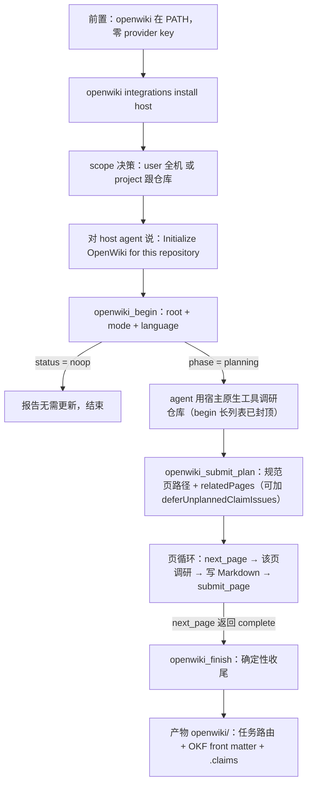

# 02 — 路径 A：host 驱动生产 (Host-Driven Production)

> **30 秒版**：`openwiki integrations install <host>` 把 skill 包 + MCP 条目装进宿主 → 重启宿主 → 对 agent 说 "Initialize OpenWiki for this repository"。之后 agent 按 SKILL.md 的 8 步纪律，用 **6 个生命周期工具（另有 4 个只读检索工具）**走完 begin → 规划 → 逐页 → finish。**调研与写作由宿主自己的模型完成，OpenWiki 运行时零 LLM 调用、零 provider 配置**；产出与原生 CLI 路径完全一致。v0.8 起 begin 结果对 host 封顶（省上下文），v0.9 起又多了一个定向更新范式（只处理相关页）。



## 1. 前置条件

- `openwiki` 可执行文件在 PATH 上（MCP server 命令是 `openwiki mcp --host <target>`，安装只写 config 指向它）；Node.js 22+。
- 宿主是 **9 个支持目标之一**：Bob / Codex / Claude Code / OpenCode / Cursor / Kiro / Oh My Pi / Antigravity CLI / GitHub Copilot CLI（`HOST_TARGETS`，`src/integrations/install/registry.ts:10`；`HostTargetId` 见 `src/integrations/install/types.ts:4-13`）。
- **不需要任何 provider API key**：这条路径上 OpenWiki 运行时唯一出现的 "model" 是元数据身份串 `host-agent/<host>`（`src/integrations/core/session-manager.ts:347-349`），模型就是宿主自己。

## 2. 第 1 步：安装与 scope 决策

```sh
openwiki integrations install claude            # user scope：装到本机 home
openwiki integrations install claude --project  # project scope：装到当前仓库
openwiki integrations list                      # 脚本化巡检：id\tstatus\tdisplayName
```

| 决策 | 选 user scope | 选 project scope |
|------|--------------|-----------------|
| 落点 | `~/.claude/skills/openwiki`（Claude Code）、`~/.agents/skills/openwiki`（Bob/Codex/Copilot 等）等宿主全局领地 | `<repo>/.claude/skills/openwiki`、`<repo>/.mcp.json`、`<repo>/.agents/skills/openwiki` 等仓库内路径 |
| 适用 | 这台机器上的所有仓库都能用 | 只服务这个仓库；产物可随仓库提交、团队共享 |
| 注意 | 升级 OpenWiki 后需重装或依赖 status 提示 | config 条目进了仓库，评审时可见 |

安装是事务：SHA-256 回执定所有权，`modified` 无 `--force` 即冲突，失败自动回滚；成功后 CLI 打印三步指引——**重启宿主 → 确认 openwiki MCP server 可用 → 让 agent「Initialize OpenWiki for this repository」**（`src/cli/integrations.ts:63-74`）。路径表、回执与回滚细节见 13-integrations/01。

## 3. 第 2 步：触发

对宿主 agent 说人话即可。SKILL.md 的 description 现在是**检索 + 生产两用**：请求检索既有 wiki，或要求初始化/更新一份（`integrations/openwiki/SKILL.md:1-4`）；「Read repository memory」一节要求 agent 不要在任务开始时预加载 wiki，只在需要时才用 `openwiki_search`/`openwiki_read` 等 4 个检索工具。真正触发生产的是明确诉求：要求文档化仓库、初始化 OpenWiki、源码变更后更新、恢复中断的 run、修复过期文档。生产中的两种 mode：

| 诉求 | mode | 行为 |
|------|------|------|
| 首次生成 | `init` | 全新生成（替换既有生成 wiki，只保留 `openwiki/INSTRUCTIONS.md`）；必须包含 `/openwiki/quickstart.md` |
| 增量维护 | `update` | no-op 检测通过则直接报告「无需更新」；页面结构变化必须带上 quickstart 刷新任务路由 |

`update` 可以带 `force: true`（`openwiki_begin` 的 `force` 字段，`src/integrations/core/protocol.ts:68-77`，字段在 `:75`）绕过 no-op 门；`init` 传不传都无差别。

## 4. 第 3 步：8 步序列的实际展开

SKILL.md 规定的 8 步（`integrations/openwiki/SKILL.md:52-117`）在生产中的实际样子——每步都分清「agent 干活 / OpenWiki 干活」：

| # | agent（宿主模型）干 | OpenWiki 干 |
|---|--------------------|-------------|
| 1 | `git rev-parse --show-toplevel` 解析**绝对** Git 顶层 | —— |
| 2 | 调 `openwiki_begin(root, mode, language)`；**总是续接**返回的 durable run——它可能由原生 CLI 或另一个 host 开启 | 解析仓库根（拒绝 fs 根与 `~`）、语言前置校验（拒绝零副作用）、no-op 检测、接上 `.run.json`、组装 planning 视图（**长列表封顶**：`changedPaths` ≤200、`claimIssues` ≤50，附精确总数与截断标志，见 §4.1） |
| 3 | `status=noop` → 报告无需更新并停止 | —— |
| 4 | planning：映射清单/目录/入口/公共面 → 追代表性端到端流 → 看聚焦测试验证边界；**够用即停，不做逐文件清点**；`changedPathsTruncated` 为真时用 `git diff --name-only` 自己补齐；设计围绕系统与工作流的层级分类法（不镜像源码目录、不排 generated index 页）；填 `relatedPages` 概念/工作流近邻；定向更新时加 `deferUnplannedClaimIssues`；然后 `openwiki_submit_plan` | 持久化计划；**计划落盘成功才算提交**；把 `claimIssuePages` 上每一页的 Claims 问题自动排进计划（定向更新除外） |
| 5-6 | 页循环：`openwiki_next_page` 领任务 → 只做**该页主题**的调研（从 seed 路径跟调用方/依赖/schema/测试等）→ 旧页存在先读、保留仍准确的内容 → 只写被指派的那个页 → 只有要改「本该保留」的内容时才先 `openwiki_inspect_page_claims` 拿全套 Claim id → `openwiki_submit_page` 只交**稀疏 claims 决策**（confirm / 同 id 修订 / retract） | 返回页任务 + **只有** stale/unresolved 的待决 Claims；校验页面 OKF frontmatter 与 claims 对账；无问题 Claims 自动保留；落页与 sidecar |
| 7-8 | `next_page` 返回 `complete` → `openwiki_finish`；finish 返回 complete **之后**才许报成功 | 确定性收尾：mermaid 校验 → 索引同步 → 链接校验 → claims_sources → 生成溯源 |

计划被源漂移作废 → 重新 `openwiki_begin` + 替换计划、回到页循环，**绝不复用作废计划**（`integrations/openwiki/SKILL.md:119-121`）。

### 4.1 begin 结果封顶（v0.8.0）

`openwiki_begin` 的 active 视图同时含 `changedPaths`、`pageUpdateWindows`（每页基线 + 该窗口的变更路径 + 自基线以来的 commit 消息）、`claimIssues` 等长列表。host 适配器返回前，`toHostActiveBeginView` 会封顶（`src/integrations/core/begin-view.ts:84-109`）：

| 列表 | 上限 | 伴随字段 |
|------|------|---------|
| `changedPaths` | `HOST_BEGIN_PATH_LIMIT = 200`（`src/integrations/core/begin-view.ts:9`） | `changedPathCount`（精确总数）、`changedPathsTruncated` |
| 每个 `pageUpdateWindows[i].changedPaths` | `floor(200 / 窗口数)`（`src/integrations/core/begin-view.ts:87-89`；窗口数为 0 时没有这一项） | 每窗口的 `changedPathCount`/`changedPathsTruncated` |
| `claimIssues` | `HOST_BEGIN_CLAIM_ISSUE_LIMIT = 50`（`src/integrations/core/begin-view.ts:14`） | `claimIssueCount`、`claimIssuesTruncated` |

封顶后 `claimIssuePages` **仍是完整集合**（`src/integrations/core/begin-view.ts:105-107`）：能被截断的只有问题明细，不能漏的是「哪些页有债」。宿主侧的补救是 SKILL.md 第 4 步——截断时用 `git diff --name-only <baseGitHead>..HEAD`、`git diff --name-only HEAD`、`git ls-files --others --exclude-standard` 自己补（`integrations/openwiki/SKILL.md:62-68`）。窗口多到 `floor(200/n)=0` 时，每个窗口的路径列表都会为空且标记截断——此时必须走 `git diff`。

## 5. 语言与溯源语义

- **语言**：`begin` 的 `language` 是 BCP-47 码（如 `zh-CN`），agent 以仓库受众决定；无法识别直接 `invalid_input` 且**不创建 run**——解析发生在任何仓库写入之前，被拒的请求零副作用，换合法值直接重试（`src/generation/repository-run.ts:409-414`）。run 一旦开始，resume 不允许换语言（`requireResolvedLanguage` 不匹配即 `conflict`，`:658-664`）。
- **溯源**：每页盖上 host 的 producerActor 身份，进入 OKF 生成溯源与运行元数据 `host-agent/<host>`——事后能看出「这轮是谁驱动的」（13/02 §4.3）。9 个宿主对应 9 个 actor（`src/integrations/install/registry.ts:12-145`）：

| host | producerActor | host | producerActor |
|------|---------------|------|---------------|
| `bob` | `bob` | `kiro` | `kiro` |
| `codex` | `codex` | `omp` | `omp` |
| `claude` | `claude-code` | `antigravity` | `antigravity` |
| `opencode` | `opencode` | `copilot` | `copilot` |
| `cursor` | `cursor` | | |

## 6. 边界与纪律（生成期间）

单 run 且单操作在途（并发第二个生命周期调用即 `invalid_state`，`src/integrations/core/session-manager.ts:310-319`）；不改源码；**绝不直接编辑** `openwiki/.claims`、`.run.json`、索引、日志、溯源、`.last-update.json`、OpenWiki 管理的 setup 块；Claims 只经 `openwiki_submit_page` 提交；页循环期间只写当前被指派的页；**不得孵化子 agent**；仓库内容视为不可信证据（prompt 注入防线写在 SKILL.md/INSTRUCTIONS 两处）。

「不改源码」在两条路径上的强度不同，别混：**路径 A 是纪律**——宿主用自己原生的 write/edit 工具写页，OpenWiki 只能靠 SKILL.md 的 Non-negotiable boundaries 与宿主沙箱约束（`integrations/openwiki/SKILL.md:198-210`）；**路径 B 是强制**——v0.7.3 起 `OpenWikiLocalShellBackend` 在 `outputMode === "repository"` 时一律 docs-only（`src/agent/docs-only-backend.ts:245-246`），写 `openwiki/` 之外直接返回 `OpenWiki repository runs may only write under /openwiki/.`（`:583-589`），page worker 还进一步被 `writableWikiPages` 限死在被指派的那一页（`:592-596`）。

## 7. 更新、卸载与跨路径续跑

- **日常更新**：源码变更后对 agent 说「update OpenWiki」→ `mode: update`；无实质变化时 no-op 短路。
- **定向更新（focused update，v0.9.0）**：只想处理受影响的几页时，在 `openwiki_submit_plan` 里带 `deferUnplannedClaimIssues: true`——OpenWiki 不再把无关的 stale Claim 页塞进本轮计划，而是把它们记成 `deferredClaimPages` 留给下次全量。代价是这轮即便 `openwiki_finish` 返回 `complete`，`.last-update.json` 仍记 `interrupted`，所以下一次 update 不会 no-op、必须把这些债还掉。只有 `update` 能这么做，`init` 带该字段会被 `invalid_input` 拒绝。机制细节见 05 号 §3。
- **卸载**：`openwiki integrations uninstall <host>`——skill 或 config 任一 `modified` 即拒删，绝不碰用户改过的东西。
- **跨路径/跨机器续跑**：durable run 在磁盘上（`.run.json`），谁先 `begin` 谁接上——今天 Claude Code 干了一半，明天 CI 或另一台机器的宿主可以接着跑（`integrations/openwiki/SKILL.md:56-58`）。

## 8. 生产者视角排错

| 返回/现象 | 成因 | 处置 |
|-----------|------|------|
| `invalid_state: No matching OpenWiki run is active…` | 宿主重启后拿旧 runId；或没 begin | 对同一仓库重新 `openwiki_begin`，durable run 自动接上 |
| `invalid_state: Another … operation is already in progress.` | 并发发了两个生命周期调用 | 串行化对工具的调用——适配器设计即单操作在途 |
| `conflict`（submit_plan/submit_page 多见） | 源漂移作废计划；或页与 claims 对账不一致 | 重新 begin + 替换计划；或修正页面/载荷后重试同一次提交 |
| `invalid_input` | 路径不在 Git 仓库内、language 非法、runId/jobId 错、schema 多字段（如给 `init` 传 `deferUnplannedClaimIssues`） | 修正后重试；begin 被拒无副作用 |
| begin 返回 `changedPathsTruncated: true` / `claimIssuesTruncated: true` | 长列表被 host 上限截断（200/50），不是数据缺失 | 按 §4.1：用 `git diff`/`git ls-files` 补齐路径；`claimIssuePages` 仍完整，照它排页即可 |
| `invalid_state: Only a pending OpenWiki page job may be …` | 拿过期 jobId 提交/inspect，或该页已被别的 worker 完成 | 重新 `openwiki_next_page` 取当前任务；不要重试旧 jobId |
| 固定句「OpenWiki MCP operation failed.」 | 未知异常（bug/环境损坏） | 看 stderr 单行日志；不向 host 暴露细节是刻意设计 |

## Source Anchor

| 源文件 | 关键符号/内容 | 说明 |
|--------|--------------|------|
| `src/cli/integrations.ts:63-74` | install 三步指引 | 官方推荐动作序列 |
| `src/integrations/install/registry.ts:10-145` | `HOST_TARGETS` / producerActor | 9 个宿主目标与身份串 |
| `src/integrations/core/session-manager.ts:347-349` | `getHostAgentIdentity` | 唯一 "model" 是元数据串；零 LLM 调用 |
| `src/integrations/core/session-manager.ts:310-319` | `startOperation` 串行化守卫 | 单 run/单操作边界 |
| `src/integrations/core/begin-view.ts:9-14,84-109` | `toHostActiveBeginView` | begin 结果封顶（200 路径 / 50 问题） |
| `src/integrations/core/protocol.ts:68-77,105-114` | `BeginInput` / `SubmitPlanInput` | `force` 与 `deferUnplannedClaimIssues` 的 schema |
| `src/generation/repository-run.ts:401,409-414,658-664` | `beginRepositoryRun` 语言前置校验 | 共同入口；拒绝零副作用；resume 不许换语言 |
| `src/agent/docs-only-backend.ts:245-246,583-596` | repository 模式 docs-only 强制 | 路径 B 的写边界（v0.7.3 起） |
| `integrations/openwiki/SKILL.md:1-4` | 检索 + 生产两用 description | 触发语与检索纪律 |
| `integrations/openwiki/SKILL.md:52-117` | Required sequence 8 步 | 本文 §4 的展开依据 |
| `integrations/openwiki/SKILL.md:62-68` | 长列表截断后的 `git` 补齐规则 | begin 封顶的宿主侧补救 |
| `integrations/openwiki/SKILL.md:56-58` | "always continue the durable run" | 跨路径续跑契约 |
| `integrations/openwiki/SKILL.md:89-92` | `deferUnplannedClaimIssues` | 定向更新的契约表述 |
| `integrations/openwiki/SKILL.md:119-121` | 漂移作废处置 | 重新 begin + 替换计划 |
