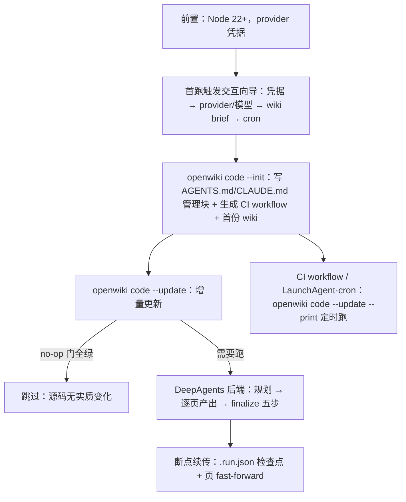

# 03 — 路径 B：原生 CLI 生产 (Native CLI Production)

> **30 秒版**：`openwiki code --init` 触发交互向导（凭据 → provider/模型 → wiki brief → cron），一次配齐后日常只剩 `openwiki code --update`。OpenWiki 自带的 DeepAgents 文档 agent 干活，**需要 13 个 provider 之一的凭据**。CI 与本地定时跑的都是这条路径的 `--print` 形态；`.run.json` 检查点让任何中断都可续跑，已完成页 fast-forward。



## 1. 前置条件

- Node.js 22+，`openwiki` 已安装（`npm install --global openwiki`，或源码 `pnpm run dev`）。
- **provider 凭据**：13 个 provider 之一（`src/config/constants.ts:105` `DEFAULT_PROVIDER="openai"`；全表与回退链见 06/01）。凭据进 env 或由向导写入受管配置。
- 模型工厂按 provider 七分支创建模型并**强制 streaming**（`src/agent/index.ts:1077-1264`，06/02）；推理力度经 `OPENWIKI_REASONING_EFFORT` 等入口可调（06/03）。

## 2. 首跑：交互式向导

第一次运行会触发向导（启动门 `needsCredentialSetup()`，`src/setup/credentials/steps.ts:68-92`），步骤顺序（`src/setup/credentials/steps.ts:201-249`）：

1. **凭据**——所选 provider 的 API key / OAuth；
2. **provider/模型**——13 个 provider 与模型清单；
3. **wiki brief**——这份 wiki 该覆盖什么（写入 `INSTRUCTIONS.md`，生成与后续更新都读它）；
4. **cron**——是否顺手配定时更新。

向导内部**没有「选模式」屏**：CLI 以 `allowModeSelection={false}` 挂载（`src/cli/app/app.tsx:743-749`），模式完全由命令行决定（`--mode personal|code`，`src/cli/commands.ts:814-829`）。

## 3. 两种运行形态

| | code 形态 | personal 形态 |
|---|----------|--------------|
| 命令 | `openwiki`（裸命令默认 code）/ `openwiki code` / `openwiki --init` | `openwiki personal` / `openwiki personal --init` |
| 产物 | `<仓库>/openwiki/` | `~/.openwiki/wiki/` |
| 证据 | Git 仓库（源码、变更） | 外部连接器数据源（Gmail/Slack/Notion 等，08 区） |
| 适用 | 代码仓库文档 | 个人知识 brain（02/03 有专篇） |

两条形态共用同一套 agent 引擎与生命周期，下面以 code 形态为主线。

## 4. 命令旗标与运行模式

```sh
openwiki code --init          # 首次：向导 + 写入管理块 + 生成 CI workflow + 首份 wiki
openwiki code --update        # 日常：源码变更后增量更新（交互 TUI）
openwiki code --update --print # 非交互一次性（CI 即用这个；-p 等价）
openwiki --mode personal      # 模式轴切换（personal|code）
```

`--init` 额外做的事：写 `AGENTS.md`/`CLAUDE.md` 管理块（15 区 L0 引导层）+ **生成 CI workflow**（`createWorkflow` 只在 init 设 true，`src/generation/repository-run.ts:334-335`；`--update` 与 chat 运行绝不覆盖既有 workflow，`src/ingestion/code-mode.ts:82-89`）。`--print` 走 `runPrintCommand`（`src/cli/runners.ts:261`），无 TUI、跑完即退。

## 5. no-op 门与 fast-forward：update 为什么经常「什么都不做」

`--update` 且未 `--force` 时有严格前置门（`src/generation/repository-run.ts:409-458`）：**preflight 判定可跳过 + claims 零问题 + 基线覆盖完整**三者同时成立才直接 finalize 完成——注意 claims 校验先于 no-op 检测，「Git 干净」骗不过过期的证据状态。反语义保护：上次 run 是 `interrupted` 时**拒绝** no-op（`src/agent/utils.ts:137-139`）。

真正要跑时，已完成且仍然有效的页 fast-forward 跳过重写（三条件，`src/generation/repository-run.ts:846-874`，详见 05/02）。源漂移使计划失效 → 计划作废、重新规划（`src/generation/repository-run.ts:608-616`）。

## 6. 运行内部（30 行版）

自研驱动方 `src/agent/repository-runner.ts:205-254` 起 DeepAgents 文档 agent（docs-only backend，11 个工具覆写划界，04/04），走与 host 路径**同一个** `beginRepositoryRun` 生命周期；页任务产出后 finalize 五步定序：mermaid → index_sync → link_validation → claims_sources → generated_provenance（`src/agent/wiki-finalizer.ts:263-284`）。机制细节全部在 05 区，此处不重复。

## 7. 自动化层

### 7.1 GitHub Actions（`--init` 生成的 `openwiki-update.yml`）

模板由 `createCodeModeWorkflow` 生成（`src/ingestion/code-mode.ts:341-421`），逐段：

- checkout：**SHA 锁定** action + `fetch-depth: 0`（diff HEAD 需要全历史，`:361,366`）；
- 安装：`npm install --global openwiki@<版本> mermaid@… jsdom@…`（`:375`）；
- provider env 块：init 时从本机凭据推导 secrets/vars（`:287-339`）——**CI 跑的是本路径，所以必须有 provider secrets**；
- 执行：`openwiki code --update --print`（`:380`）；
- 收尾：`rm -f -- openwiki/.run.json`（`:392-394`）、create-pull-request 提 PR（`:398`）、失败显式 `exit 1`（`:417-419`）；
- fork guard：模板自带 `Restore protected workflow file` 恢复步骤；CLI 侧「文件存在即 early-return」保证再生成不冲掉手工补丁（11/02）。

`.last-update.json` 记 complete/interrupted：中断写入四处（begin/worker 失败/finish 部分完成/fail-fast，`src/generation/repository-run.ts:501-509,:1130-1138,:1562-1571`），成功 finish 清除（`:1572-1582`）。

### 7.2 本地定时

cron / macOS LaunchAgent（`openwiki schedule`，`src/scheduling/schedules.ts`）；LaunchAgent 的 day+weekday 双限制语义与 plist `EnvironmentVariables` 注入见 11/01。定时任务与 CI 一样跑 `ingest all --scheduled --print` 形态（11/01）。

## 8. 断点续传

- 检查点：`.run.json`（`src/generation/run-state.ts:14`）——每页状态、队列、计划落盘；
- 中断恢复：对同一仓库重跑 `openwiki code --update`（或任何路径重新 begin），生命周期接上未完 run；
- 已完成页 fast-forward，不重复烧 token；
- 页级账本：`.page-manifest.json` + claims pageVersion 一致性门（05/02）。

## 9. 生产者视角排错

| 现象 | 成因 | 处置 |
|------|------|------|
| 首跑直接弹向导 | 凭据未配置（设计行为） | 走完向导四步 |
| update 秒退、无新页 | no-op 门全绿（源码无实质变化） | 正常；确认变了源码却没跑 → 查 `.openwikiignore` 与 claims preflight 结果 |
| 计划被作废、要求重规划 | run 期间源码漂移 | 正常语义：重规划后继续 |
| no-op 被拒绝 | 上次 run interrupted | 重跑 update 接上检查点 |
| CI 中 PR 无变更 | no-op（符合预期）或 `.run.json` 清理顺序问题 | 看 workflow 的 no-op 日志与 11/02 运维注意 |

## Source Anchor

| 源文件 | 关键符号/内容 | 说明 |
|--------|--------------|------|
| `src/config/constants.ts:105` | `DEFAULT_PROVIDER` | 13 provider 体系入口（06/01） |
| `src/agent/index.ts:1077-1264` | `createModel` 七分支 | 强制 streaming（06/02） |
| `src/setup/credentials/steps.ts:68-92,201-249` | 启动门 / 有序步骤 | 向导触发与步骤序 |
| `src/cli/app/app.tsx:743-749` | `allowModeSelection={false}` | 模式只由命令行决定 |
| `src/cli/commands.ts:814-829` | `--mode personal\|code` | 模式轴旗标 |
| `src/cli/runners.ts:261` | `runPrintCommand` | `--print` 非交互形态 |
| `src/generation/repository-run.ts:334-335` | `createWorkflow: mode==="init"` | 仅 init 生成 workflow |
| `src/generation/repository-run.ts:409-458,846-874,608-616` | no-op 门 / fast-forward / 漂移作废 | update 语义三件 |
| `src/generation/run-state.ts:14` | `RUN_STATE_PATH` | `.run.json` 检查点 |
| `src/agent/repository-runner.ts:205-254` | 自研驱动方 | DeepAgents 驱动同一生命周期 |
| `src/agent/wiki-finalizer.ts:263-284` | finalize 五步 | mermaid→index_sync→link_validation→claims_sources→provenance |
| `src/ingestion/code-mode.ts:82-89,287-339,341-421` | workflow 守卫 / provider env / 模板 | CI 自动化层全部出处 |
| `src/agent/utils.ts:137-139` | interrupted 拒绝 no-op | `.last-update.json` 语义 |
