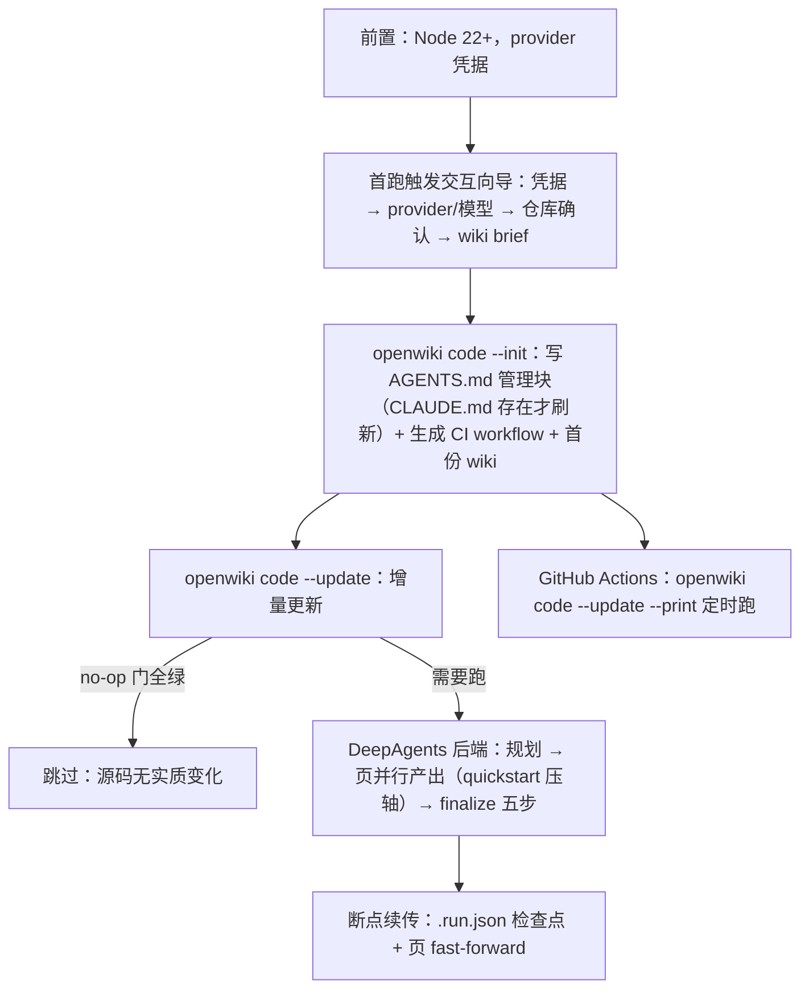

# 03 — 路径 B：原生 CLI 生产 (Native CLI Production)

> **30 秒版**：`openwiki code --init` 触发交互向导（凭据 → provider/模型 → 仓库确认 → wiki brief；code 形态没有 cron 步），一次配齐后日常只剩 `openwiki code --update`。OpenWiki 自带的 DeepAgents 文档 agent 干活，**需要 15 个 provider 之一的凭据**。CI 跑的是这条路径的 `--print` 形态；`.run.json` 检查点让任何中断都可续跑，已完成页 fast-forward，页还能并行。



## 1. 前置条件

- Node.js 22+，`openwiki` 已安装（`npm install --global openwiki`，或源码 `pnpm run dev`）。
- **provider 凭据**：15 个 provider 之一（`OpenWikiProvider`，`src/config/constants.ts:139-154`；默认 `DEFAULT_PROVIDER="openai"` 在 `:136`；全表与回退链见 06/01）。凭据进 env 或由向导写入受管配置。
- 模型工厂按 provider 分支创建模型（`src/agent/index.ts:1123-1357` 的一串 `if (provider === ...)`，06/02）；**强制 streaming**：openai-chatgpt 无条件（`src/agent/index.ts:1262` `streaming: true`），copilot 与 bob 经 `providerUsesStreaming`（`src/config/constants.ts:612-636`），openai-compatible 由 `OPENWIKI_OPENAI_COMPATIBLE_STREAMING` 选择（`resolveOpenAiCompatibleStreaming`，`:1301`）；推理力度经 `OPENWIKI_REASONING_EFFORT` 等入口可调（06/03）。
- **性能旋钮**：`OPENWIKI_PAGE_CONCURRENCY`（1–8，默认 1，`src/config/constants.ts:94-100`）+ `OPENWIKI_PROVIDER_RETRY_ATTEMPTS`（默认 3；并行时默认 5，`src/config/constants.ts:86-92,1199-1228`）。

## 2. 首跑：交互式向导

第一次运行会触发向导（启动门 `needsCredentialSetup()`，`src/setup/credentials/steps.ts:74-98`）。**凭据主干**的步骤由 `orderedSetupSteps` 推导（`src/setup/credentials/steps.ts:229-290`）：

1. **provider**——15 个 provider 之一；
2. **凭据**——API key / OAuth / AWS-SDK / 外部 CLI（按 provider 追加 auth-mode、secret-key、gcp-project、gcp-location、base-url、entra-scope、region 条件步）；
3. **model**——该 provider 下的模型清单（固定模型的 provider 跳过）；
4. **langsmith**——可选 tracing 接入。

主干之后按形态分叉（`src/setup/credentials/use-init-setup.ts:2280-2315,2322-2346`）：

| 形态 | 后续步骤 |
|------|---------|
| **code** | `code-repo-confirm`（确认仓库根，可编辑路径）→ `source-menu`（可选补 LangSmith trace 源）→ `wiki-goal`（写进仓库 `openwiki/INSTRUCTIONS.md`）→ `final` |
| **personal** | `template`（未定模板时）→ `wiki-goal`（写进 `~/.openwiki/INSTRUCTIONS.md`）→ `global-cron`（配 ingest 定时）→ `source-menu`（连接器源）→ 收尾 |

重走向导是幂等的：已完成的步骤会跳过（`isOnboardingComplete`/`walkAllSteps` 的条件在 `src/setup/credentials/use-init-setup.ts:2270-2319`），所以第二次 `--init` 不会再从头问一遍。

**code 形态走完 wiki brief 直接到 `final`，没有 cron 屏**（`src/setup/credentials/use-init-setup.ts:1818-1841`：`isCodeMode` 为真即 `setStep("final")`）；它的定时更新由 `--init` 生成的 GitHub Actions 负责，`openwiki cron` 只管 personal 的 `ingestionSchedule`（`src/scheduling/schedules.ts:205-213`）。

向导内部**没有「选模式」屏**：CLI 以 `allowModeSelection={false}` 挂载（`src/cli/app/app.tsx:746`），模式完全由命令行决定（`--mode personal|code`，`src/cli/commands.ts:909-957`）。

## 3. 两种运行形态

| | code 形态 | personal 形态 |
|---|----------|--------------|
| 命令 | `openwiki`（裸命令=交互 code chat）/ `openwiki code`（一次性生成）/ `openwiki --init` / `openwiki --update` | `openwiki personal` / `openwiki personal --init` |
| 产物 | `<仓库>/openwiki/` | `~/.openwiki/wiki/` |
| 证据 | Git 仓库（源码、变更） | 外部连接器数据源（Gmail/Slack/Notion 等，08 区） |
| 适用 | 代码仓库文档 | 个人知识 brain（02/03 有专篇） |

裸 `openwiki` 与 `openwiki code` 是两个入口：前者 `command=chat`（交互对话，不设 `--init/--update` 时不启动生成），后者才是一次性生成；`openwiki --init` 因为带了 init 旗标同样走生成（`shouldStart` 在 `src/cli/commands.ts:1060`；`command` 默认就是 `chat`，见 `:841`）。

两条形态共用同一套 agent 引擎与生命周期，下面以 code 形态为主线。

## 4. 命令旗标与运行模式

```sh
openwiki code --init          # 首次：向导 + 写入管理块 + 生成 CI workflow + 首份 wiki
openwiki code --update        # 日常：源码变更后增量更新（交互 TUI）
openwiki code --update --print # 非交互一次性（CI 即用这个；-p 等价）
openwiki --mode personal      # 模式轴切换（personal|code）
```

`--init` 额外做的事：写 `AGENTS.md` 管理块（15 区 L0 引导层；**不再新建 `CLAUDE.md`**，只有仓库里已有该文件时才原地刷新它的 `@AGENTS.md` 导入块，`src/ingestion/code-mode.ts:45-49,255-262`）+ **生成 CI workflow**（`createWorkflow` 只在 init 设 true，`src/generation/repository-run.ts:416-418`；`--update` 与 chat 运行绝不覆盖既有 workflow，`src/ingestion/code-mode.ts:94-121`）+ 首份 wiki。`--init` 会**替换**既有生成 wiki，只保留 `openwiki/INSTRUCTIONS.md`。`--print` 走 `runPrintCommand`（`src/cli/runners.ts:261`），无 TUI、跑完即退。

## 5. no-op 门与 fast-forward：update 为什么经常「什么都不做」

`--update` 且没有「强制」时有严格前置门（`src/generation/repository-run.ts:493-540`）：**preflight 判定可跳过 + claims 零问题 + 基线覆盖完整**三者同时成立才直接 finalize 完成——注意 claims 校验先于 no-op 检测，「Git 干净」骗不过过期的证据状态。反语义保护：上次 run 是 `interrupted` 时**拒绝** no-op（`src/agent/utils.ts:130-131`）。

「强制」的入口有两个，都不是 `--force` 旗标：CLI 把非空用户消息当 `force`（`openwiki code --update "先文档化 API 路由"`，`src/agent/index.ts:220`），host 则在 `openwiki_begin` 里传 `force: true`。`--force` 只属于 `integrations install` / `auth configure`（`src/cli/commands.ts:670-685`）。

真正要跑时，已完成且仍然有效的页 fast-forward 跳过重写（三条件，`src/generation/repository-run.ts:933-968`，详见 05/02）：当前 `HEAD` 存在、该页 manifest 条目记着更旧的 `gitHead`、该基线 commit 可读且自它以来零变更。v0.7.3/0.8.0 加了两道护栏——基线 commit 不可读（浅克隆/历史被改写）时**不做** fast-forward（`:948-957`），且同一基线的判定按 baseline 缓存、只查一次（`:943-957`）。源漂移使计划失效 → 计划作废、重新规划（`src/generation/repository-run.ts:690-698`）。

## 6. 运行内部（30 行版）

自研驱动方 `src/agent/repository-runner.ts:363-417` 起 DeepAgents 文档 agent（docs-only backend，11 个工具覆写划界，04/04），走与 host 路径**同一个** `beginRepositoryRun` 生命周期；页任务产出后 finalize 五步定序：mermaid → index_sync → link_validation → claims_sources → generated_provenance（`src/agent/wiki-finalizer.ts:263-284`）。机制细节全部在 05 区，此处不重复。

**v0.6.0 起一轮 run 的推进可以并行**（细节见 05 号 §2）：planner 单独跑完并 submit_plan，然后 `pageConcurrency` 个 worker loop 同时领页（默认 1，即历史顺序行为）。超过 1 时：

- `/openwiki/quickstart.md` 被压到**第二轮**单独跑（`runPendingPageAgents` 用 `heldBack`，`src/agent/repository-runner.ts:633-676`），保证任务路由表链接到的页都已存在；
- 每页仍是一个**全新 agent**、只写自己那一页，共享状态（run 检查点/page manifest/Claims session）由进程内锁串行化（`withRunMutation`，`src/generation/repository-run.ts:332-348`）；
- 进度事件从「page i of N」切换成「completed / N · K in flight」（`src/agent/repository-runner.ts:802-826`、`src/cli/run-log/progress.ts:78-81`）；
- 某个 worker 撞到 provider 限流就以「跳过 + 降一档并发」收场，不会把整轮 run 打死（`src/agent/repository-runner.ts:745-755`、`isRateLimitError` `:840-869`）。

## 7. 自动化层

### 7.1 GitHub Actions（`--init` 生成的 `openwiki-update.yml`）

模板由 `createCodeModeWorkflow` 生成（`src/ingestion/code-mode.ts:532-623`），逐段：

- checkout：**SHA 锁定** action + `fetch-depth: 0`（diff HEAD 需要全历史，`src/ingestion/code-mode.ts:551-557`）；
- 安装：`npm install --global openwiki@<版本> mermaid@11.16.0 jsdom@29.1.1`（`:564-566`）；
- provider env 块：init 时从本机 provider 配置推导 `OPENWIKI_PROVIDER` + `secrets.*`（API key/secret key）与 `vars.*`（base url/project/region），并写 `OPENWIKI_MODEL_ID`；OAuth provider 只留注释、Entra ID 走 `azure/login` 式无人值守（`createWorkflowProviderEnv`，`:469-530`）——**CI 跑的是本路径，所以必须有 provider secrets**。同一段还固定写 LangSmith 相关 env（`OPENWIKI_LANGSMITH_API_KEY` 以及可选的 `LANGSMITH_API_KEY`/`LANGCHAIN_PROJECT`/`LANGCHAIN_TRACING_V2`，`:572-581`）；
- 执行：`openwiki code --update --print`（`:568-571`）；
- 收尾：`rm -f -- openwiki/.run.json`（`:583-585`）；
- 提 PR：先由 `List OpenWiki update paths` 步算出 `add-paths`（`openwiki,AGENTS.md,.github/workflows/openwiki-update.yml`，`CLAUDE.md` **存在才加**，`:587-595`），再 create-pull-request（`:597-613`），然后 `::notice` 把 PR URL 贴进 job annotation（`:615-617`），失败显式 `exit 1`（`:619-621`）；
- fork guard：**生成模板不含恢复步骤**——`Restore protected workflow file` 只存在于手工维护的 dogfood workflow（`.github/workflows/openwiki-update.yml:68-76`；该文件注释自述 CLI 模板丢弃了该守卫，upstream issue #423 待修）。当前防线只剩 CLI 侧「文件存在即 early-return」保证再生成不冲掉手工补丁（`src/ingestion/code-mode.ts:94-121`，11/02）；需要 fork guard 时须手工把恢复步骤加进生成的 workflow。dogfood 另有一道调度期守卫：非 origin 仓库要显式打开 `OPENWIKI_ENABLE_SCHEDULED_UPDATE` 才会跑（`.github/workflows/openwiki-update.yml:19`）。

`.last-update.json` 记 complete/interrupted：中断写入三处——新 run 落盘后的 durability point（`src/generation/repository-run.ts:583-591`）、页 worker 放弃该页（`:1251-1259`）、finish 有 skipped/deferred 页或源漂移（`:1760-1768`）；进程级崩溃还有 fail-fast 兜底（`src/agent/crash-guard.ts:133-141`）。成功 finish 写 `complete` 清掉 interrupted（`src/generation/repository-run.ts:1770-1778`）。

### 7.2 本地定时（personal 形态专用）

**code 形态没有本地 cron**：它的定时更新就是 §7.1 的 GitHub Actions（`--init` 生成）。cron / macOS LaunchAgent 服务的是 personal 形态的 ingest 定时：本地调度只有 `ingestionSchedule` 一个配置项（`src/setup/onboarding.ts:56`；消费方见 `src/scheduling/schedules.ts:205-213`），由向导的 global-cron 步安装，日常用 `openwiki cron list|pause|resume|delete` 管理（`src/cli/commands.ts:583-619`）。LaunchAgent 的 day+weekday 双限制语义与 plist `EnvironmentVariables` 注入见 11/01；定时任务跑的是 `ingest all --scheduled --print` 形态（11/01）。

## 8. 断点续传

- 检查点：`.run.json`（`src/generation/run-state.ts:14` `REPOSITORY_RUN_STATE_BASENAME`）——每页状态、队列、计划落盘；页并行只发生在**进程内**，durable 状态仍只有 pending/skipped/complete，resume 时 worker 归属全部重建（`src/agent/repository-runner.ts:568-612` `PageWorkerPool` 注释）。
- 中断恢复：对同一仓库重跑 `openwiki code --update`（或任何路径重新 begin），生命周期接上未完 run；被跳过的页会重置回 pending 重新尝试（`resumeRepositoryRun` 的 `resetSkippedPages` 分支，`src/generation/repository-run.ts:672-687`）。
- 已完成页 fast-forward，不重复烧 token。
- 页级账本：`.page-manifest.json` + claims pageVersion 一致性门（05/02）。v0.5.2 起只有**本轮真正重生成**的页才重打基线，未触及的页保留原 source checkpoint（`regeneratedPages`/`preserveSourcePages`，`src/generation/repository-run.ts:1744-1755`；`replaceRepositoryPageManifest`，`src/generation/page-manifest.ts:251-319`）——这正是 per-page update window 与 fast-forward 能按页生效的前提。

## 9. 生产者视角排错

| 现象 | 成因 | 处置 |
|------|------|------|
| 首跑直接弹向导 | 凭据未配置（设计行为） | 走完向导各步（§2） |
| update 秒退、无新页 | no-op 门全绿（源码无实质变化） | 正常；确认变了源码却没跑 → 查 `.openwikiignore` 与 claims preflight 结果 |
| 计划被作废、要求重规划 | run 期间源码漂移 | 正常语义：重规划后继续 |
| no-op 被拒绝 | 上次 run interrupted——页 worker 放弃过某页、做过定向更新、或上次 finish 时源还在变 | 重跑 update 接上检查点；定向更新欠下的 stale Claim 页会在这次被排进计划 |
| 同页反复被跳过、日志出现 `Reduced page concurrency to N` | worker 撞上 provider 限流（429/ThrottlingException） | 正常降档，不是数据损坏；调低 `OPENWIKI_PAGE_CONCURRENCY` 或调高 `OPENWIKI_PROVIDER_RETRY_ATTEMPTS` 后重跑 |
| 日志出现 `… was restored after its worker exited without submitting` | 该页 worker 两次都没 submit，页已回滚到运行前快照 | 本轮跳过该页，`.last-update.json` 记 interrupted；下次 update 重试 |
| 日志出现 `… page(s) still carry code-derived frontmatter` / `have no description yet` | 确定性收尾发现页缺描述或仍是代码生成的 frontmatter | 不阻塞完成；下次 update 时由 agent 补写（`emitFrontmatterReportEvent`，`src/generation/repository-run.ts:1798-1818`） |
| CI 中 PR 无变更 | no-op（符合预期）或 `.run.json` 清理顺序问题 | 看 workflow 的 no-op 日志与 11/02 运维注意 |

## Source Anchor

| 源文件 | 关键符号/内容 | 说明 |
|--------|--------------|------|
| `src/config/constants.ts:136,139-154` | `DEFAULT_PROVIDER` / `OpenWikiProvider` | 15 provider 体系入口（06/01） |
| `src/config/constants.ts:94-100,1158-1186` | `OPENWIKI_PAGE_CONCURRENCY` / `resolvePageConcurrency` | 页并行旋钮（1–8，默认 1） |
| `src/config/constants.ts:86-92,1199-1228` | `DEFAULT_PROVIDER_RETRY_ATTEMPTS` / `PARALLEL_PROVIDER_RETRY_ATTEMPTS` | 并行时默认重试 5 次 |
| `src/agent/index.ts:1123-1357` | `createModel` provider 分支 | 06/02；chatgpt/copilot/bob 强制 streaming |
| `src/setup/credentials/steps.ts:74-98,229-290` | 启动门 / 有序步骤 | 向导触发与步骤序 |
| `src/setup/credentials/use-init-setup.ts:1818-1841,2280-2315,2322-2346` | wiki-goal 分流与形态分叉 | code 直接到 final（无 cron），personal 走 global-cron |
| `src/cli/app/app.tsx:746` | `allowModeSelection={false}` | 模式只由命令行决定 |
| `src/cli/commands.ts:909-957` | `--mode personal\|code` | 模式轴旗标 |
| `src/cli/commands.ts:583-619` | `openwiki cron` 解析 | 只操作 ingest 定时 |
| `src/cli/runners.ts:261` | `runPrintCommand` | `--print` 非交互形态 |
| `src/generation/repository-run.ts:416-418` | `createWorkflow: mode==="init"` | 仅 init 生成 workflow |
| `src/generation/repository-run.ts:493-540` | update no-op 门 | preflight + claims + 基线覆盖三条件 |
| `src/generation/repository-run.ts:933-968` | `fastForwardUnchangedRepositoryPageCoverage` | 按 baseline 缓存的页级 fast-forward |
| `src/generation/repository-run.ts:690-698` | 源漂移作废计划 | `delete nextState.plan` |
| `src/generation/repository-run.ts:332-348` | `withRunMutation` | 页并行下共享状态的进程内串行化 |
| `src/generation/repository-run.ts:1744-1755` | `preserveSourcePages` | 只重打本轮重生成页的基线 |
| `src/generation/run-state.ts:14` | `REPOSITORY_RUN_STATE_BASENAME` | `.run.json` 检查点 |
| `src/agent/repository-runner.ts:363-417` | 自研驱动方 | DeepAgents 驱动同一生命周期 |
| `src/agent/repository-runner.ts:633-676,802-826` | 页 worker 池 / 并行进度 | quickstart 压轴 + in-flight 列表 |
| `src/agent/repository-runner.ts:745-755,840-869` | 限流降档 / `isRateLimitError` | 并行遇到 429 的处理 |
| `src/agent/wiki-finalizer.ts:263-284` | finalize 五步 | mermaid→index_sync→link_validation→claims_sources→provenance |
| `src/ingestion/code-mode.ts:94-121,469-530,532-623` | workflow 守卫 / provider env / 模板 | CI 自动化层全部出处 |
| `src/agent/docs-only-backend.ts:245-246,583-596` | repository 模式 docs-only | v0.7.3 起的强制写边界 |
| `src/agent/utils.ts:130-131` | interrupted 拒绝 no-op | `.last-update.json` 语义 |
