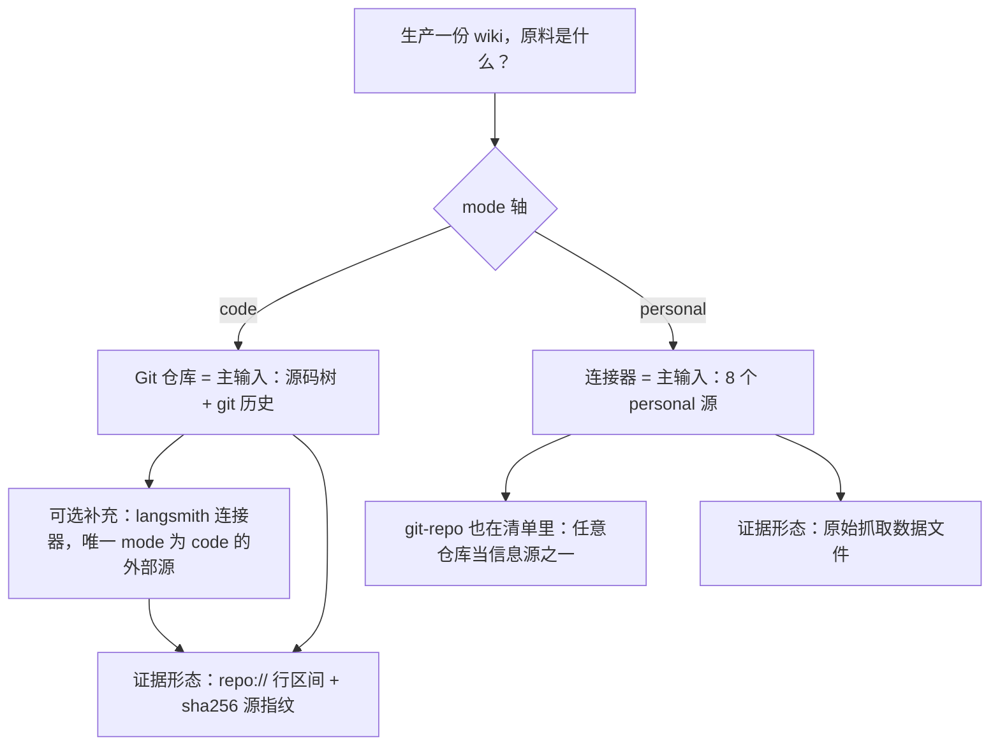

# 04 — 输入与证据源 (Inputs & Evidence Sources)

> **30 秒版（直答）**：输入有**两大形态**——
> ① **Git 仓库**（code mode 的主输入）：源码树 + git 历史，证据以 `repo://路径#行区间` 锚进 wiki；
> ② **连接器数据源**（personal mode 的主输入）：9 个连接器（Gmail、Slack、X、HackerNews、web-search、Notion、custom-MCP、git-repo、LangSmith）。
> 两个交叉点：**git-repo 也在连接器清单里**（personal 模式可把任意仓库当信息源之一）；**LangSmith 是唯一 mode:"code" 的连接器**（code mode 可补充 traces）。另有意图输入（brief/language）与控制输入（凭据/.openwikiignore）。

## 1. 输入全景

## 2. 数据输入形态 1：Git 仓库（code mode 主输入）

code 模式下**唯一的主角**是当前 Git 仓库，它以三种面贡献输入：

| 面 | 内容 | 机制 |
|----|------|------|
| 源码树 | 全部未被排除的文件 | 证据命题（claim）以 `repo://仓库相对路径#L起-L止` 锚定到行区间（07 区） |
| git 历史 | 变更检测与增量 | `getRepositoryChangedPaths`（`src/agent/utils.ts:946-1106`）+ sha256 源指纹（`SOURCE_FINGERPRINT_VERSION`，`:289`）；CI 里 `fetch-depth: 0` 就是为了 diff HEAD（`src/ingestion/code-mode.ts:557`） |
| 工作区状态 | 分支/语言/结构 | 首跑解析 Git 根（拒绝 fs 根与 `~`，`src/integrations/core/repository-root.ts:122-133`） |

输入范围由 `.openwikiignore` 圈定（gitignore 兼容语义 + last-match-wins，04/05）——它是 git 输入的「负空间」。

**边界**：connector 工具在 repository 模式下**零暴露**（`src/connectors/tools.ts:38-40` 返回空数组）——code mode 的生成 agent 本体不碰任何外部源，这是刻意门控（#444）。

## 3. 数据输入形态 2：连接器数据源（personal mode 主输入 + 1 个 code 例外）

9 个连接器（`ConnectorId`，`src/connectors/types.ts:1-10`；注册表 `src/connectors/registry.ts:24-52`）：

| id | 后端 | mode | 凭据要点 | 喂什么 |
|----|------|------|---------|--------|
| `git-repo` | local-git | personal | 无（本地 git） | **任意 git 仓库**当信息源之一，previousHead 增量 |
| `google`（Gmail） | direct-api | personal | OAuth | 邮件（13 类目，10/01） |
| `slack` | direct-api | personal | OAuth/secret | 频道消息（recent_messages / my_messages_search 默认，assistant_search 可选启用） |
| `x` | direct-api | personal | X API | 时间线/提及/书签等 5 stream |
| `hackernews` | direct-api | personal | 无 | 6 feeds + Algolia 搜索 |
| `web-search` | direct-api | personal | `OPENWIKI_TAVILY_API_KEY` | Tavily 搜索结果 |
| `notion` | mcp | personal | `OPENWIKI_NOTION_MCP_ACCESS_TOKEN` | Notion 页面（hosted MCP server） |
| `custom-mcp` | mcp | personal | 无硬性（transport 引用 env 名） | **任意只读 MCP server**——万能扩展点 |
| `langsmith` | direct-api | **code** | API key（repo 提交配置） | traces/runs——唯一能进 code mode 的外部源 |

三个交叉规则：

1. **git 仓库在两种 mode 都出现，角色不同**：code mode 里它是唯一主输入兼证据锚；personal mode 里 `git-repo` 只是 9 分之 1 的普通信息源。
2. **LangSmith 是唯一 mode:"code" 连接器**（`src/connectors/sources/langsmith/index.ts:92`）：code mode 摄取阶段可拉 traces 拼进 agent 指导；配置走**仓库提交**的 `<repo>/openwiki/.langsmith.json`（`src/connectors/sources/langsmith/repo-config.ts:66-68`）——团队成员共享同一份外部源声明。
3. **personal 的 config 在家目录**：`~/.openwiki/connectors/<id>/config.json`（`src/config/openwiki-home.ts:57-59`）——与 code mode 的仓库提交配置构成**双 config 通路**（08/02）。

连接器产出的原始抓取数据先落盘，再经摄取管线（置信标签、contested 纪律）拼进 agent 指导——管线细节见 10/01。

## 4. 意图输入：告诉 OpenWiki「写什么、用什么语言写」

| 输入 | 形态 | 进出 |
|------|------|------|
| wiki brief（`INSTRUCTIONS.md`） | 自然语言一段 | 首跑向导第 3 步写入；每轮生成/更新都读，决定覆盖面与侧重（10/02） |
| language | BCP-47 码 | `openwiki_begin` 参数；无法识别零副作用拒绝，run 开始后不可改（`src/generation/repository-run.ts:403-410`） |

## 5. 控制输入

- **provider 凭据**：模型从哪来（code mode 必需；host 路径不需要，见 16/02）。
- **connector 凭据**：上表各源的 secrets/env。
- **`.openwikiignore`**：git 输入的排除规则。
- **`--force` / no-op 门**：控制「要不要把输入跑一遍」（16/03 §5）。

## 6. 选输入速查

| 你想喂什么 | 走哪条 |
|-----------|--------|
| 一个代码仓库的文档 | code mode + Git 仓库（16/03） |
| 代码仓库 + LangSmith traces | code mode，仓库提交 `.langsmith.json` |
| 个人邮件/聊天/搜索流的知识库 | personal mode + 对应连接器（16/03 §3） |
| 把另一个 git 仓库当个人资料源 | personal mode + `git-repo` 连接器 |
| 自建内部系统（任意只读 MCP） | personal mode + `custom-mcp` 连接器 |
| 宿主 agent 出模型、零凭据生产 | 不换输入，换路径 A（16/02）——输入形态与路径正交 |

## 7. 与其他区的边界

| 主题 | 归属 |
|------|------|
| 连接器后端实现、双 config 通路细节、MCP env 白名单 | `08-connectors-and-data-sources/` |
| 摄取管线（置信标签/contested/单源隔离） | `10-ingestion-and-personal-mode/01` |
| personal brain wiki 形态 | `02-architecture/03-personal-mode.md` |
| 证据版本/歧义/preflight | `07-claims-and-okf/02` |
| `.openwikiignore` 语义 | `04-agent-and-prompting/05` |
| 两条生产路径 | 本章区 `02`/`03` 号 |
| 输入盘点（本文） | 本章 |

## Source Anchor

| 源文件 | 关键符号/内容 | 说明 |
|--------|--------------|------|
| `src/connectors/types.ts:1-10` | `ConnectorId` | 9 连接器封闭集合 |
| `src/connectors/registry.ts:24-52` | `createConnectorRegistry` | 9 工厂与凭据要求 |
| `src/connectors/tools.ts:38-40` | repository 零暴露门 | code mode agent 不碰外部源（#444） |
| `src/connectors/sources/langsmith/index.ts:92` | `mode: "code"` | 唯一 code mode 连接器 |
| `src/connectors/sources/langsmith/repo-config.ts:66-68` | repo 提交配置 | `<repo>/openwiki/.langsmith.json` |
| `src/config/openwiki-home.ts:57-59` | personal config 路径 | `~/.openwiki/connectors/<id>/config.json` |
| `src/agent/utils.ts:277,909-949` | `SOURCE_FINGERPRINT_VERSION` / `getRepositoryChangedPaths` | git 输入的变更检测 |
| `src/ingestion/code-mode.ts:557` | `fetch-depth: 0` | CI 全历史 diff |
| `src/integrations/core/repository-root.ts:122-133` | `assertSafeRepositoryRoot` | Git 根守卫 |
| `src/generation/repository-run.ts:403-410` | language 前置校验 | 意图输入的零副作用拒绝 |
