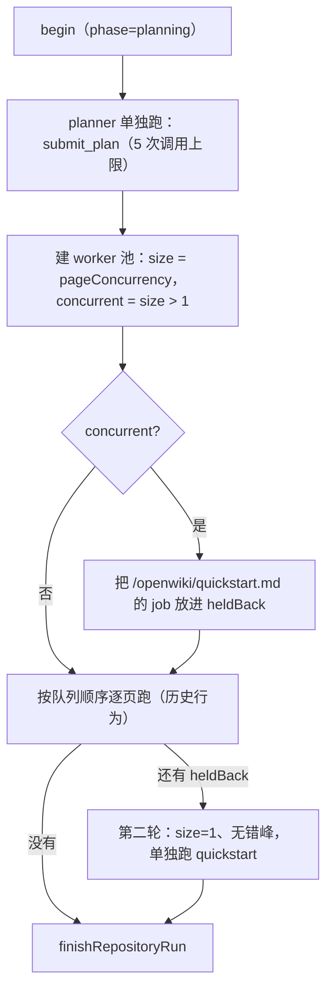

# 05 — 一轮 run 的推进：页并行与定向更新 (Run Cadence: Parallel Pages & Focused Updates)

> **30 秒版**：一轮 run 的骨架没变——`begin → planner 提交计划 → 逐页产出 → finish`。骨架上后加了两个**提速/省力**旋钮（页并行 v0.6.0、定向更新 v0.9.0）：
> **页并行（路径 B）**：`OPENWIKI_PAGE_CONCURRENCY`（1–8，默认 1）让多个 page worker 同时干活，quickstart 仍压到最后一轮；默认值下行为与历史完全一致。
> **定向更新（路径 A）**：`openwiki_submit_plan` 带 `deferUnplannedClaimIssues: true` 时，本轮只排相关页，无关的 stale Claim 页记成债务留给下次全量——这轮 finish 返回 `complete`，但 `.last-update.json` 仍是 `interrupted`。
> 两者都不改变 durable 状态形状，也不改变「谁先 begin 谁接上」的跨路径契约。

## 1. 两个旋钮的定位

| 旋钮 | 属于哪条路径 | 解决什么 | 默认/开关 |
|------|-------------|---------|-----------|
| 页并行 `pageConcurrency` | **路径 B**（原生 CLI 的 repository-runner） | 墙钟时间：一次 update 要写 N 页，串行太慢 | `OPENWIKI_PAGE_CONCURRENCY`，1–8，默认 **1**（`src/config/constants.ts:94-100,1158-1186`） |
| 定向更新 `deferUnplannedClaimIssues` | **路径 A**（host 通过 MCP 提交计划） | token/时间：只想更新某个子系统，不想被无关页的 stale Claim 拖去全量 | `submit_plan` 的可选布尔字段，默认关闭（`src/integrations/core/protocol.ts:105-114`，字段在 `:112`） |

两个旋钮**互不依赖**：并行是「同一批页怎么跑」，定向是「这一批页里放哪些」。路径 A 的页循环仍是顺序的（host 一次一个 `openwiki_next_page`、适配器单操作在途），路径 B 的计划仍由自己的 planner 全权决定（CLI 的 plan schema 里没有 defer 字段，见 §3.4）。

## 2. 页并行（路径 B）

### 2.1 旋钮与默认值

| 参数 | 位置 | 默认 | 说明 |
|------|------|------|------|
| `OPENWIKI_PAGE_CONCURRENCY` | `src/config/constants.ts:94` | `DEFAULT_PAGE_CONCURRENCY = 1`（`:95`） | 上限 `MAX_PAGE_CONCURRENCY = 8`（`:100`）；非 1–8 的整数直接报错（`resolvePageConcurrency`，`:1158-1186`） |
| `pageConcurrency` | `NativeRepositoryGenerationOptions`（`src/agent/repository-runner.ts:312-321`） | 1 | 由 `src/agent/index.ts:365` 解析、`:386` 进 config 对象、`:224` 传给 runner |
| worker 起跑错峰 | `workerStartStaggerMs`（`repository-runner.ts:323-331`） | 1 秒（`DEFAULT_WORKER_START_STAGGER_MS`，`:559`） | 第 i 个 slot 等 `i × stagger` 再发首个模型请求（`runWorkerLoop`，`:721-723`），避免同一瞬间打满 provider |
| provider 重试次数 | `OPENWIKI_PROVIDER_RETRY_ATTEMPTS` | 3；**并行时默认 5**（`PARALLEL_PROVIDER_RETRY_ATTEMPTS`，`src/config/constants.ts:86-92`） | `resolveProviderRetryAttempts` 按 `pageConcurrency > 1` 选（`:1199-1228`） |

一个 worker 仍然**只拥有一页**：`pageConcurrency = 3` 表示最多 3 个 worker 同时各写各的页，不是「3 个 agent 合写一页」。

默认值下（包括 `--init` 生成的 GitHub Actions 模板——它不写这个 env）一轮 update 仍是**串行**；要并行只能显式设 `OPENWIKI_PAGE_CONCURRENCY`。

### 2.2 时序：池、领页、quickstart 压轴



- **领页**：每个 loop 走 `acquireNextJob` → `nextRepositoryPage(run, { exclude: claimed ∪ heldBack })`（`src/agent/repository-runner.ts:771-788`）。`exclude` 是**进程内**所有权，durable 检查点里 pending 页从不记「谁在做」；`acquiring` promise 把取页串行化，避免同一 tick 多个 loop 看到同一个队头。
- **quickstart 压轴**：并发时先把它 held back（`src/agent/repository-runner.ts:652-659`），第一轮把其他页跑完，再以 `size = 1`、零错峰单跑 quickstart（`:669-671`）。原因写在选项注释里：quickstart 是任务路由页，它链接的页必须已经存在（`:315-317`）。单 worker 时队列本身已把 quickstart 排最后（`createRepositoryPlan` 的排序，`src/generation/page-jobs.ts:191-197`）。
- **两轮之间不重置已完成状态**：第二轮只是换 `heldBack` 和 `size` 再跑同一批 loop，已完成的页不会被重新领。

### 2.3 并发下的正确性边界

并行只发生在**模型干活**这一段；所有推进共享状态的记账都进进程内锁：

| 位置 | 做法 | 为什么 |
|------|------|--------|
| `submit_page` | 整段包在 `withRunMutation` 里（`src/generation/repository-run.ts:1370-1453`） | 拿锁后**重读** `run.state.plan`：等锁期间别的 worker 可能已推进队列；若该页已被完成则幂等返回（`:1378-1386`） |
| Claims finalize | 把「其他仍 pending 的页 + `deferredClaimPages`」作为 `otherPendingPages` 传给 `session.finalize`（`src/generation/repository-run.ts:1403-1410`） | 别的 worker 可能正写到一半，不能在这里给它盖验证戳或重算 sidecar 哈希 |
| 最终放弃一页 | `skipRepositoryPage`：`restoreRepositoryPage` → 重建 Claims runtime → 标 skipped，全在锁内（`src/generation/repository-run.ts:1214-1275`） | 先回滚页与 Claims，再从磁盘重建共享 session，避免读到并发提交的中间态 |
| 两次尝试之间 | `restoreRepositoryPage` 在锁外直接回滚该页（`src/agent/repository-runner.ts:916`） | 此刻该页只属于这个 worker，回滚不涉及共享记账 |
| 同一个 job 被重复提交 | 重读后发现 `status === "complete"` 就直接返回完成（不再报错） | 网络重试/模型重放都可能重复调用 |

页 worker 本身也有两道保险：**每页最多 2 次尝试**（`PAGE_WORKER_ATTEMPT_LIMIT = 2`，`src/agent/repository-runner.ts:872`；第一次没 submit 就把页回滚到运行前快照再试，`:884-922`），以及**每个 worker 最多 5 次 `submit_page` 调用**（`MAX_SUBMISSIONS_PER_WORKER = 5`，`:122-130`；超限以 error 收场，该页被跳过而不是无限重试）。planner 的 `submit_plan` 共享同一个 5 次上限。

### 2.4 限流与降档

补充一条**不**降档的失败：`submit_page` 如果被 Claims store 本身拒绝（不是可修正的 `invalid_input`），worker 不会重试，而是抛成致命错误——池子记下第一条 fatal、其余 loop 停止取新任务，run 在 finish 前把错抛出去（`src/agent/repository-runner.ts:992-993,1040`、`:738-742`）。

`isRateLimitError`（`src/agent/repository-runner.ts:840-869`）沿 `cause` 链识别 429 / `ThrottlingException` / `$metadata.httpStatusCode === 429` / `rate limit` 文案（含 Bedrock 的 token 配额消息）。命中时：

- 该页**不重试**（`runPageAgent` 里 rate limit 直接 break，`src/agent/repository-runner.ts:906-910`），以「回滚 + 跳过」收场；
- 池子的**活上限减 1，绝不低于 1**（`runWorkerLoop`，`src/agent/repository-runner.ts:745-755`），并向前端发一条 `Reduced page concurrency to N …` 的文本事件；
- 整轮 run 继续，最后由 finish 处理 skipped 页（`.last-update.json` 记 `interrupted`）。

### 2.5 观测：进度与 LangSmith

- **进度行**：单 in-flight 时仍是 `Documenting page i of N · <page>`；并发时切换成 `Documenting <completed> of N · K in flight: <pages>`（`src/cli/run-log/progress.ts:78-81`），事件里带 `completedCount`/`inFlightPages`（`emitGeneratingProgress`，`src/agent/repository-runner.ts:802-826`）。
- **LangSmith**：一轮 run 的 planner 与所有 page worker 共用同一个 thread（`resolveTraceThreadId(run.state.runId)`，`:536`、`:1032`；可用 `OPENWIKI_TRACE_THREAD_ID` 覆盖，`src/config/constants.ts:1144-1150`），trace 名分别是 `planning agent`（`:546`）与 `worker agent: <page>`（`:554-556`）。并发安全的前提是这些 worker 没有 checkpointer。

### 2.6 并行**不**改变什么

- durable 状态形状：`.run.json` 的页状态仍只有 `pending`/`skipped`/`complete`，`PageWorkerPool` 明确注释「nothing here is durable」（`src/agent/repository-runner.ts:568-612`）。
- 队列语义与 finish 顺序：finalize 五步仍是固定序（`src/agent/wiki-finalizer.ts:263-284`）。
- host 路径：`HostSessionManager.nextPage` 不传 `exclude`，host 侧页循环照旧一页一页来（`src/integrations/core/session-manager.ts:177-179`）。
- 默认值：不设 env 时 `pageConcurrency = 1`，时序与单 worker 的历史行为完全相同。

## 3. 定向更新（路径 A）

### 3.1 它解决什么

默认的 `update` 会把**所有有 Claims 问题的页**强制塞进计划（`addRequiredClaimIssueJobs`，`src/generation/page-jobs.ts:271-305`）：一个陈旧的 Claim 在无关页上，也会把那一页拖进本轮。想「只文档化我改的子系统」时，这些页纯属额外 token。

定向更新把这类页从**本轮计划**里摘出来，记成 durable 的 `deferredClaimPages`（债务），留给下一次全量 update。

### 3.2 打开方式与计划语义

```
openwiki_submit_plan({ runId, pages: [...相关页], deferUnplannedClaimIssues: true })
```

- 只对 `mode: "update"` 有效；`init` 带该字段直接 `invalid_input`（`createRepositoryPlan`，`src/generation/page-jobs.ts:184-189`，消息 `Init cannot defer Claim issues.`）。
- 打开后：`addRequiredClaimIssueJobs` 被跳过（`src/generation/page-jobs.ts:180-182`），而 `deferredClaimPages = 有 Claims 问题、但既不在本轮 pages 也不在 deletePages 的页`（`:199-203`）。
- 计划落盘时 `deferredClaimPages` 一起进 `.run.json`（`src/generation/run-state.ts:118,297`）；重复提交同一计划的等价性判断也算上它（`samePlanIgnoringJobIds`，`src/generation/repository-run.ts:1029-1046`），所以重放不会误判成「不同的计划」。
- 注意它**不是**「没计划的页都不管」：没有 Claims 问题、也没进计划的页本来就不会被强制重写，照旧保留自己的 manifest 基线。

### 3.3 收尾：complete 但记账为 interrupted

finish 把 `deferredClaimPages` 并入 `skippedPages`（`src/generation/repository-run.ts:1676-1679`），于是：

| 动作 | 对 deferred 页的处理 | 出处 |
|------|---------------------|------|
| claims 最终校验 | 从 `skippedPages` 里排除，不重盖验证戳 | `finishRepositoryRun` 的 `finalize(..., skippedPages)`，`src/generation/repository-run.ts:1733` |
| claimSources 溯源 | 过滤掉 skipped/deferred 页 | `src/generation/repository-run.ts:1721-1727` |
| page manifest | 保留原 source checkpoint（不推进基线） | `src/generation/repository-run.ts:1744-1755`（`preserveSourcePages`） |
| `.last-update.json` | 因 `skippedPages.size > 0` 写 **`interrupted`** | `src/generation/repository-run.ts:1759-1768` |

结果是：`openwiki_finish` 对 host 返回 `{status:"complete"}`，但下一轮 `getUpdateNoopStatus` 看到 `interrupted` 就**拒绝 no-op**（`src/agent/utils.ts:130-131`），必须把这些页的债还掉。这就是 SKILL.md 那句「The completed run remains marked interrupted until that debt is reconciled」的确切含义（`integrations/openwiki/SKILL.md:89-92`）。

### 3.4 为什么只有路径 A 能用

- **协议层**：`SubmitPlanInput` 才有这个字段（`src/integrations/core/protocol.ts:105-114`），`HostSessionManager.submitPlan` 原样透传（`src/integrations/core/session-manager.ts:160-169`）。
- **原生 CLI**：planner 的 `PlanSchema` 是 `.strict()` 的 `{pages, deletePages}`（`src/agent/repository-runner.ts:66-71`），没有 defer 字段，也不会有 host 去传。
- 换句话说，定向更新是**host 对「这一轮计划里放哪些页」的决策权**，不是生命周期的新状态。

### 3.5 什么时候值得用

| 场景 | 建议 |
|------|------|
| 只改了一个子系统，且知道哪些页相关 | 用；省掉无关 stale Claim 页的调研与写作 |
| 想让 next update 立刻回到干净状态 | 别用——它必然留下 `interrupted`，下一轮一定会跑 |
| 仓库有大量长期 stale Claim（迁移/大重构后） | 先跑一次普通全量 update 清债，再开始用定向 |
| 需要 quickstart 的任务路由同步 | 仍要把 quickstart 放进 `pages`（结构变化时 SKILL.md 强制要求） |

## 4. 两者的组合与边界

| 诉求 | 选哪个 |
|------|--------|
| 同样的页，跑得快一点 | 页并行（路径 B） |
| 更少的页，跑得省一点 | 定向更新（路径 A） |
| 路径 A 想快 | 当前没有并行：host 侧页循环顺序执行，适配器单操作在途（`src/integrations/core/session-manager.ts:310-319`） |
| 路径 B 想省 | 用 `--update` 的 no-op 门 + 按页 fast-forward（16/03 §5）；defer 不在 CLI 计划里 |

两个旋钮的共同点是**不改变产物形态**：并行不改变每页的内容契约，定向更新不改变未触及页的字节。它们改变的是「这轮跑了多少页、什么时候跑」，以及由此产生的记账（`interrupted` 债务）。

## Source Anchor

| 源文件 | 关键符号/内容 | 说明 |
|--------|--------------|------|
| `src/config/constants.ts:94-100,1158-1186` | `OPENWIKI_PAGE_CONCURRENCY` / `resolvePageConcurrency` | 页并行旋钮（1–8，默认 1） |
| `src/config/constants.ts:86-92,1199-1228` | `PARALLEL_PROVIDER_RETRY_ATTEMPTS` / `resolveProviderRetryAttempts` | 并行时默认重试 5 次 |
| `src/config/constants.ts:1144-1150` | `resolveTraceThreadId` | `OPENWIKI_TRACE_THREAD_ID` 覆盖 |
| `src/agent/repository-runner.ts:312-331` | `pageConcurrency` / `workerStartStaggerMs` | 并行选项与默认值 |
| `src/agent/repository-runner.ts:633-676` | `runPendingPageAgents` / `heldBack` | 池化 + quickstart 压轴 + 第二轮 |
| `src/agent/repository-runner.ts:711-788` | `runWorkerLoop` / `acquireNextJob` | 领页串行化与进程内所有权 |
| `src/agent/repository-runner.ts:802-826` | `emitGeneratingProgress` | `completedCount`/`inFlightPages` 事件 |
| `src/agent/repository-runner.ts:840-922` | `isRateLimitError` / 2 次尝试 | 限流识别与跳过回滚 |
| `src/agent/repository-runner.ts:122-130` | `MAX_SUBMISSIONS_PER_WORKER` | 每 worker 5 次提交上限 |
| `src/agent/repository-runner.ts:546-559` | `PLANNER_AGENT_NAME` / `workerAgentName` / stagger 常量 | LangSmith trace 名与错峰 |
| `src/generation/repository-run.ts:332-348` | `withRunMutation` | 并发下共享状态的进程内锁 |
| `src/generation/repository-run.ts:1370-1410` | 锁内 submit + `otherPendingPages` | 并发提交不互相覆盖 |
| `src/generation/page-jobs.ts:178-205` | defer 分支 / quickstart 排序 / `deferredClaimPages` | 定向更新的计划语义 |
| `src/generation/page-jobs.ts:271-305` | `addRequiredClaimIssueJobs` | 默认会把有问题的页强制排进计划 |
| `src/generation/run-state.ts:118,297` | `deferredClaimPages` | 债务的 durable 形态 |
| `src/generation/repository-run.ts:1676-1679,1721-1727,1744-1768` | finish 对 deferred 页的收尾 | 排除校验/溯源、保留基线、记 interrupted |
| `src/integrations/core/protocol.ts:105-114` | `SubmitPlanInput.deferUnplannedClaimIssues` | 路径 A 的开关 |
| `src/integrations/core/session-manager.ts:160-169` | `submitPlan` 透传 | host 适配器 |
| `integrations/openwiki/SKILL.md:89-92` | "leave unrelated stale Claim pages…" | 契约表述与 debt 提示 |
